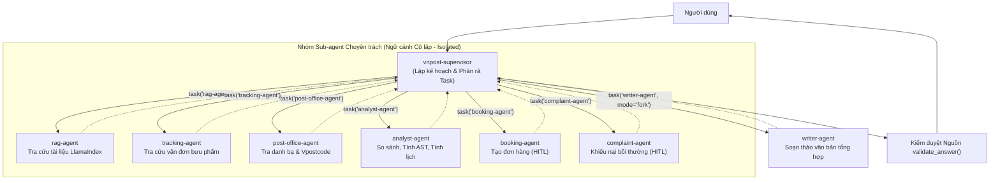
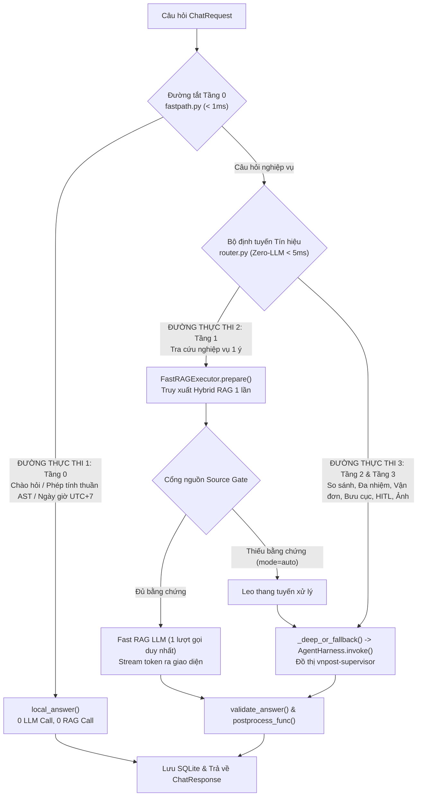
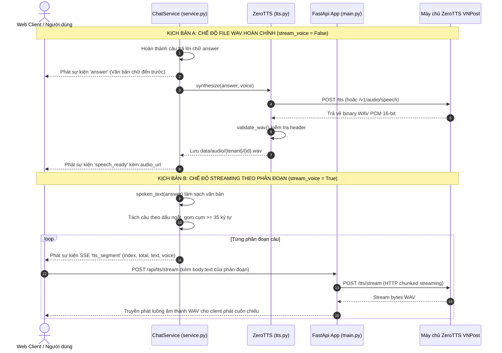
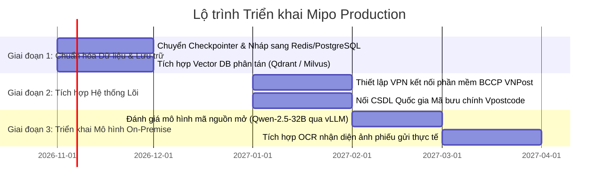

# MIPO: BÁO CÁO KỸ THUẬT HỆ THỐNG TRỢ LÝ BƯU CHÍNH THÔNG MINH TRÊN NỀN TẢNG DEEP AGENT, HYBRID RAG LLAMAINDEX VÀ ZEROTTS

**Ngày cập nhật:** 19/10/2026 · **Tác giả:** @Thanh  
**Vị trí dự án:** `vnpost_deepagent` · **Phiên bản:** Pilot 1.0 (Kiểm thử thực nghiệm & Đánh giá Kiến trúc)

---

## MỤC LỤC TỔNG QUAN

1. [PHẦN I: ĐẶT VẤN ĐỀ VÀ ĐỐI CHIẾU 5 YÊU CẦU KỸ THUẬT](#phần-i-đặt-vấn-đề-và-đối-chiếu-5-yêu-cầu-kỹ-thuật)
2. [PHẦN II: CƠ SỞ LÝ THUYẾT VÀ BẢNG THAM SỐ CÔNG NGHỆ CỐT LÕI](#phần-ii-cơ-sở-lý-thuyết-và-bảng-tham-số-công-nghệ-cốt-lõi)
3. [PHẦN III: THIẾT KẾ KIẾN TRÚC VÀ HỢP ĐỒNG GIAO DIỆN HỆ THỐNG](#phần-iii-thiết-kế-kiến-trúc-và-hợp-đồng-giao-diện-hệ-thống)
4. [PHẦN IV: CÁC KỊCH BẢN THỬ NGHIỆM ĐIỂN HÌNH (CASE STUDIES & PIPELINE TRACING)](#phần-iv-các-kịch-bản-thử-nghiệm-điển-hình-case-studies--pipeline-tracing)
5. [PHẦN V: THIẾT KẾ BỘ KIỂM CHỨNG TOÀN DIỆN VÀ PHÂN TÍCH TEST CASES](#phần-v-thiết-kế-bộ-kiểm-chứng-toàn-diện-và-phân-tích-test-cases)
6. [PHẦN VI: KẾT QUẢ ĐO LƯỜNG THỰC NGHIỆM TRÊN MÔ HÌNH THỰC TẾ](#phần-vi-kết-quả-đo-lường-thực-nghiệm-trên-mô-hình-thực-tế)
7. [PHẦN VII: ĐÁNH GIÁ GIỚI HẠN HIỆN TẠI VÀ LỘ TRÌNH HOÀN THIỆN (ROADMAP)](#phần-vii-đánh-giá-giới-hạn-hiện-tại-và-lộ-trình-hoàn-thiện-roadmap)

---

# PHẦN I: ĐẶT VẤN ĐỀ VÀ ĐỐI CHIẾU 5 YÊU CẦU KỸ THUẬT

## 1.1 Bối cảnh nghiệp vụ bưu chính và Mục tiêu hệ thống

Tổng công ty Bưu điện Việt Nam (VNPost) triển khai thử nghiệm hệ thống trợ lý ảo thông minh **Mipo** nhằm tự động hóa giải đáp nghiệp vụ, tra cứu hành trình bưu gửi, mạng lưới bưu cục và hỗ trợ khách hàng tạo đơn gửi hàng / khiếu nại bồi thường. 

Hệ thống được thiết kế hướng tới các mục tiêu:
1. **Chống ảo giác (Hallucination):** Neo chặt câu trả lời vào văn bản quy định bưu chính chính thức bằng cơ chế trích dẫn nguồn có kiểm chứng.
2. **Bảo toàn cấu trúc biểu cước:** Xử lý chính xác các bảng cước phí đa chiều trong tài liệu `.docx`, `.txt`, `.pdf`.
3. **Tối ưu độ trễ và chi phí suy luận:** Mục tiêu thiết kế thời gian phản hồi trung vị **P50 < 5 giây** đối với các câu hỏi tra cứu thông thường; giải quyết tức thì (< 1 ms, 0 LLM call) các câu hỏi tính nhẩm và chào hỏi qua Đường tắt cục bộ.
4. **Phân rã đa nhiệm song song:** Kích hoạt đồng thời nhiều tác tử chuyên biệt khi gặp câu hỏi phức hợp.
5. **Kiểm soát an toàn hành động ghi:** Áp dụng quy trình xác nhận có sự tham gia của con người (Human-in-the-Loop - HITL) trước khi thực hiện các tác vụ phát sinh nghiệp vụ.
6. **Hỗ trợ tương tác giọng nói:** Tích hợp máy chủ ZeroTTS để phát âm thanh câu trả lời.

---

## 1.2 Bảng đối chiếu 5 Yêu cầu Kỹ thuật theo khuôn mẫu chuẩn

| # | Yêu cầu kỹ thuật | Đầu vào (Input) | Xử lý (Module & Thuật toán) | Đầu ra (Output) | Tiêu chí nghiệm thu | Bằng chứng thực tế |
| :-: | :--- | :--- | :--- | :--- | :--- | :--- |
| **1** | **Xây dựng Deep Agent (Agent Harness)** dùng LangChain Deep Agents | `ChatRequest` (câu hỏi, lịch sử, cờ grounded, ảnh) | `AgentHarness` (`app/agents.py`) dùng `create_deep_agent` (`deepagents==0.7.24`), đồ thị `vnpost-supervisor`, tích hợp SQLite checkpointer, file ảo `StateBackend` nạp `/skills/` | Chuỗi văn bản phản hồi đã tổng hợp kèm danh sách nguồn `[S#]` | Supervisor khởi tạo thành công đồ thị, nạp kỹ năng và quản lý phiên | 153/153 tests pass; file `reports/architecture_metrics.json` ghi nhận hoàn thành 8/8 lượt chạy |
| **2** | **Quản lý Sub-agent, chia task và tổng hợp kết quả** | Ý định câu hỏi phức hợp từ người dùng | `vnpost-supervisor` giao việc qua công cụ `task(subagent_type, description)`; quản lý **7 Sub-agent**; kiểm duyệt nguồn qua `validate_answer()` | Câu trả lời tổng hợp tích hợp kết quả từ các Sub-agent, gắn đúng mã `[S#]` | Task được phân bổ đúng chuyên môn; cô lập lỗi từng nhánh; chặn mã nguồn ảo | File `reports/parallel_subagents_live_forced.json`: trung bình 2,0 task/câu; `tests/test_agents.py` |
| **3** | **Sub-agent RAG tìm kiếm tài liệu** (`.docx`, `.txt`, `.pdf`) bằng LlamaIndex | Chuỗi truy vấn `query: str`, `top_k: int`, `filename_filter` | `rag-agent` gọi `search_documents` truy vấn `KnowledgeBase` (`app/rag.py`) dùng `llama-index-core==0.14.25`; bóc tách bảng DOCX thành cặp "Cột: Giá trị"; nhúng vector `vietnamese-bi-encoder` có `pyvi`; tìm kiếm từ khóa `BM25Plus` kết hợp `RRF` | Danh sách trích đoạn tài liệu kèm vị trí, filename và mã trích dẫn `[S#]` | Đọc đúng bảng cước phí; tìm đúng đoạn liên quan; không ghi đè node ID | `tests/test_rag.py` (20 tests pass); `tests/test_context_offloading_and_streaming_tts.py` |
| **4** | **Thực thi nhiều Sub-agent song song cùng lúc** | Câu hỏi đa nhiệm độc lập nhiều mảng nghiệp vụ | Supervisor phát nhiều lệnh `task()` trong cùng 1 lượt; runtime LangGraph điều phối chạy song song với `asyncio.Semaphore` (`max_parallel_subagents = 3`, `max_tasks = 8`) | Kết quả các task được trả về đồng thời cho Supervisor tổng hợp | Tối đa 3 Sub-agent thực thi chồng lấn trong cùng một cửa sổ thời gian | Log `reports/parallel_subagents_live_forced.json`: ghi nhận `max_parallel_llm_calls = 3` trên Gemini 2.5 Flash |
| **5** | **Tích hợp API TTS trả lời bằng giọng nói** | Văn bản trả lời `answer: str`, tên giọng đọc | Module `ZeroTTS` (`app/tts.py`): làm sạch văn bản qua `spoken_text()`; kết nối API ZeroTTS qua 4 endpoint HTTP REST; hỗ trợ xuất file WAV hoặc phát đoạn `tts_segment` | File âm thanh WAV (`audio_url`) hoặc chuỗi sự kiện `tts_segment` ($\ge 35$ ký tự) | Âm thanh đúng chuẩn WAV PCM 16-bit; lỗi TTS không làm mất câu trả lời chữ | `tests/test_tts.py` (8 tests pass); script `scripts/check_services.py --live --tts` |

---

# PHẦN II: CƠ SỞ LÝ THUYẾT VÀ BẢNG THAM SỐ CÔNG NGHỆ CỐT LÕI

## 2.1 Kiến trúc Tác tử Phân cấp Giám sát - Thực thi (Supervisor-Worker Pattern)

Trong các hệ thống tác tử đơn lẻ (Single-Agent), khi số lượng công cụ tăng lên, mô hình dễ gặp hiện tượng chọn sai công cụ hoặc làm tràn cửa sổ ngữ cảnh bởi dữ liệu thô. Hệ thống Mipo giải quyết vấn đề này bằng mô hình **Supervisor-Worker**:
- **Tác tử Giám sát (`vnpost-supervisor`):** Đóng vai trò bộ điều phối trung tâm. Supervisor không trực tiếp gọi API dữ liệu lớn mà phân tích ý định, lập kế hoạch phân rã nhiệm vụ và gọi các tác tử chuyên trách qua công cụ `task(subagent_type, description)`.
- **Tác tử Chuyên trách (Specialized Sub-agents):** Mỗi tác tử là một đồ thị độc lập, sở hữu tập công cụ thu hẹp và chạy ở chế độ cô lập (`isolated mode`) để tránh làm nhiễu lịch sử ngữ cảnh chính. Riêng `writer-agent` chạy ở chế độ kế thừa (`fork mode`) ở lượt cuối để nắm bắt toàn bộ ngữ cảnh tổng hợp.

---

## 2.2 Bảng tổng hợp Tham số Kỹ thuật Lõi Hybrid RAG

Để tối ưu độ chính xác truy xuất và tính toàn vẹn của bảng cước bưu chính, hệ thống kết hợp nhiều kỹ thuật trong `app/rag.py`:

| Kỹ thuật triển khai | Tham số cấu hình trong mã nguồn | Lý do lựa chọn và Mục đích kỹ thuật |
| :--- | :--- | :--- |
| **Bóc tách bảo toàn cấu trúc bảng (Structure-Preserving Parsing)** | Duyệt `iterchildren()` trong `python-docx`; chuyển từng hàng thành cặp `"Cột: Giá trị"` kèm Markdown 1 hàng | Bảng cước phí bưu chính có nhiều cột (vùng cước, nấc cân nặng, giá tiền). Phương pháp này giữ nguyên tiêu đề cột cho từng hàng, tránh mất ngữ cảnh khi cắt đoạn. |
| **Chia đoạn theo cấu trúc (Structure-Aware Chunking)** | `chunk_size = 512` tokens, `chunk_overlap = 64` tokens (`SentenceSplitter`) | Mở rộng lên 512 tokens để nắm bắt trọn vẹn ngữ cảnh điều khoản và bảng biểu quy định bưu chính. |
| **Định danh Node xác định (Deterministic Node ID)** | SHA-256 của `"{document_id}\|{location}\|{ordinal}\|{text}"` | Đảm bảo các hàng bảng có nội dung số liệu giống nhau ở các trang/văn bản khác nhau không bị ghi đè chỉ mục. |
| **Nhúng Vector ngữ nghĩa (Dense Embedding)** | `BAAI/bge-m3` (1024 dimensions) kết nối qua vLLM endpoint nội bộ VNPost (`https://ai.vnpost.vn/vllm-bge-m3/v1`) | Nắm bắt sâu sắc ngữ nghĩa đa ngữ và tiếng Việt chuyên ngành bưu chính; không phụ thuộc tải trọng tính toán phần cứng máy trạm cục bộ. |
| **Tìm kiếm Từ khóa (Sparse Lexical)** | `BM25Plus` (thuật toán rank-bm25 cải tiến) trên tập từ đã lọc `STOPWORDS` | Truy xuất chính xác các từ khóa hiếm, mã dịch vụ viết tắt (EMS, COD, Vpostcode) mà vector ngữ nghĩa có thể bỏ sót. |
| **Hợp nhất thứ hạng (RRF)** | $RRF\_Score = \sum \frac{1}{60 + Rank_m(d)}$ với $k=60$ | Kết hợp điểm số giữa không gian vector $[0, 1]$ và điểm số BM25 $[0, \infty)$ mà không cần chuẩn hóa điểm số phức tạp. |
| **Tái xếp hạng (Cross-Encoder / LLM Reranker)** | `Qwen/Qwen3-Reranker-8B` (`RERANKER_ENABLED=true`, `RERANKER_PROVIDER=api`) kết nối endpoint VNPost (`https://ai.vnpost.vn/vllm-qwen3-reranker-8b/rerank`) | Tái xếp hạng chính xác danh sách candidate từ Hybrid RRF, loại bỏ hoàn toàn việc phải tải mô hình nặng về máy (tiết kiệm > 3.2 GB dung lượng đĩa và VRAM máy trạm). |
| **Bộ nhớ đệm Embedding 2 tầng** | Tầng 1: RAM LRU 1.000 vector; Tầng 2: SQLite `embedding-cache.sqlite3` | Tối ưu thời gian truy vấn lặp lại về 0 ms và không phải tính toán lại embedding khi khởi động lại máy chủ. |
| **Quản lý Kho tài liệu nguyên tử** | Snapshot tại `snapshots/{revision}/` và con trỏ `current.json` | Đảm bảo quá trình nạp tài liệu mới không làm gián đoạn các phiên đọc đang diễn ra (Zero-downtime ingestion). |

---

## 2.3 Nguyên lý Kiểm soát Hành động Hai pha (Conversational Two-Phase Commit - HITL)

Đối với các hành động ghi có ảnh hưởng nghiệp vụ (tạo đơn hàng bưu chính, nộp đơn khiếu nại), hệ thống áp dụng cơ chế **Two-Phase Commit thông qua hội thoại**:
- **Pha 1 (Lập phiếu nháp - Draft Phase):** Thu thập dữ liệu bắt buộc (Slot-filling), kiểm tra tính hợp lệ, tính toán cước/thời hiệu mô phỏng, sinh mã nháp an toàn có entropy cao (`secrets.token_hex(4)`), lưu trạng thái `WAITING_CONFIRMATION` vào bộ nhớ và xuất trình bảng tóm tắt cho người dùng, sau đó **dừng lượt** để hỏi xác nhận.
- **Pha 2 (Xác nhận - Confirm Phase):** Chỉ khi người dùng phản hồi đồng ý ở lượt tiếp theo, tác tử mới gọi công cụ `confirm_*` để phát hành mã đơn / Ticket chính thức.
- **Lưu ý thiết kế trung thực:** Trong phiên bản mã nguồn hiện tại, cờ `confirmed_by_user=True` được truyền bởi chính LLM khi gọi công cụ; mã nguồn backend **chưa có bộ phân tích đối soát trực tiếp nội dung tin nhắn người dùng** mà dựa vào ràng buộc hướng dẫn của Prompt (**chốt ở mức prompt / prompt-level constraint**). Phiếu nháp hiện lưu trong từ điển RAM của tiến trình Python, **chưa gắn định danh `tenant`/`session_id` và chưa có cơ chế hết hạn (TTL)**.

---

# PHẦN III: THIẾT KẾ KIẾN TRÚC VÀ HỢP ĐỒNG GIAO DIỆN HỆ THỐNG

## 3.1 Hợp đồng Giao diện Hệ thống (System I/O Contract)

Hợp đồng dữ liệu đầu vào và đầu ra của toàn bộ hệ sinh thái được định nghĩa chặt chẽ trong `app/schemas.py`:

### Bảng hợp đồng API: `ChatRequest` và `ChatResponse`

| Đối tượng | Tên trường (Field) | Kiểu dữ liệu (Type) | Ràng buộc kỹ thuật & Diễn giải |
| :--- | :--- | :--- | :--- |
| **`ChatRequest`** (Đầu vào) | `message` | `str` | Nội dung câu hỏi người dùng; độ dài từ $1$ đến $12.000$ ký tự |
| | `image` | `str \| None` | Chuỗi ảnh Base64 Data URL (`data:image/...`) hoặc liên kết HTTP(S); tối đa 15 MB |
| | `session_id` | `UUID \| None` | Định danh phiên hội thoại để duy trì ngữ cảnh nhiều lượt |
| | `grounded` | `bool` | Mặc định `True`: bắt buộc câu trả lời phải dựa trên bằng chứng tài liệu |
| | `mode` | `Literal["auto", "fast", "deep"]` | Chế độ định tuyến: `auto` (tự động phân tầng), `fast` (ép Fast RAG), `deep` (ép Deep Agent) |
| | `voice` | `bool` | Mặc định `False`: cờ yêu cầu sinh âm thanh giọng nói ZeroTTS |
| | `stream_voice` | `bool` | Mặc định `False`: cờ yêu cầu phát âm thanh dạng phân đoạn streaming |
| | `voice_name` | `str \| None` | Tên giọng đọc ZeroTTS tùy chọn (mặc định lấy theo cấu hình `TTS_VOICE`) |
| **`ChatResponse`** (Đầu ra) | `request_id` | `str` | Định danh duy nhất của yêu cầu (UUID) phục vụ truy vết |
| | `session_id` | `str` | Định danh phiên hội thoại liên kết |
| | `answer` | `str` | Câu trả lời hoàn chỉnh của hệ thống (đã qua hậu xử lý định dạng và kiểm duyệt trích dẫn) |
| | `sources` | `list[Source]` | Danh sách các đoạn bằng chứng trích dẫn (`[S1]`, `[S2]...`) kèm vị trí, filename và trích đoạn |
| | `grounding_status` | `str` | Trạng thái kiểm chứng: `cited`, `computed`, `no_evidence`, `invalid_citation`, `unverified` |
| | `route` | `str` | Tuyến thực thi thực tế: `local`, `calculator`, `fast`, `deep`, hoặc `fast_fallback` |
| | `route_reason` | `str` | Diễn giải lý do bộ định tuyến chọn tuyến thực thi |
| | `elapsed_ms` | `int` | Tổng thời gian xử lý toàn trình tính bằng mili-giây |
| | `events` | `list[dict]` | Nhật ký các sự kiện vòng đời (`router_decision`, `planning`, `source_gate`, `task_start`...) |
| | `warnings` | `list[str]` | Danh sách cảnh báo phát sinh (ví dụ cảnh báo lỗi TTS, cảnh báo nguồn bị loại bỏ) |
| | `audio_url` | `str \| None` | Đường dẫn tải file âm thanh WAV hoàn chỉnh khi bật `voice=True` và `stream_voice=False` |

*Lưu ý:* Trường `tier` (Tầng) là biến nội bộ của quyết định định tuyến (`RouterDecision.tier`), **không phải là trường dữ liệu trong `ChatResponse`**.

---

## 3.2 Kiến trúc Thực thi: 4 Nhãn Phân loại, 3 Đường Thực thi Mã nguồn

Trong tài liệu thiết kế, hệ thống sử dụng **4 nhãn phân tầng (Tier 0, 1, 2, 3)** để mô tả mức độ phức tạp của câu hỏi. Tuy nhiên, khi đối chiếu trực tiếp với mã nguồn (`app/service.py` và `app/router.py`), hệ thống thực chất được vận hành trên **3 đường thực thi vật lý (3 Execution Paths)**:

### Chi tiết 3 đường thực thi mã nguồn:
1. **Đường 1 (Tầng 0 – Local Fastpath):** Xử lý tại `fastpath.py` đối với phép tính số học thuần (`calculator.py`), ngày giờ UTC+7 và chào hỏi xã giao. Hoàn thành trong **< 1 ms**, không gọi LLM và không truy vấn cơ sở dữ liệu vector.
2. **Đường 2 (Tầng 1 – Fast RAG Pipeline):** Xử lý tại `fast_rag.py`. Truy xuất Hybrid RAG 1 lần, kiểm tra Cổng kiểm tra nguồn (Source Gate). Nếu đủ nguồn, thực thi đúng **1 lượt gọi LLM** và stream kết quả.
3. **Đường 3 (Tầng 2 & Tầng 3 – Deep Agent Pipeline):** Trong mã nguồn `service.py`, cả câu hỏi gắn nhãn Tầng 2 và Tầng 3 **đều đi qua cùng một hàm `_deep_or_fallback()` và cùng khởi tạo đồ thị `AgentHarness.invoke()`**. Khác biệt giữa Tầng 2 và Tầng 3 chỉ là nhãn phân loại ý định (Tầng 2: chuyên biệt 1 tác vụ sâu; Tầng 3: đa nhiệm phức hợp nhiều tác vụ), không có cấu trúc code rẽ nhánh riêng biệt.

---

## 3.3 Bảng 9 Luật Ưu tiên của Bộ Định tuyến và Tín hiệu Nhận diện

Hàm `rule_based_decision` (`app/router.py`) phân tích chuỗi câu hỏi bằng biểu thức chính quy (`app/signals.py`) không dùng LLM (< 5 ms):

| Thứ tự ưu tiên | Điều kiện kiểm tra trong mã nguồn | Nhãn Tầng | Tuyến (Route) | Ý nghĩa nghiệp vụ |
| :---: | :--- | :---: | :---: | :--- |
| **1** | Có hình ảnh đính kèm (`image is not None`) | **Tầng 3** | `deep` | Chuyển vào Deep Agent để mô hình đa phương thức phân tích ảnh |
| **2** | Độ dài vượt ngưỡng (`len(t) > 1200` ký tự) | **Tầng 3** | `deep` | Câu hỏi dài cần Supervisor phân rã nhiều bước |
| **3** | Phép tính số học trực tiếp (`is_pure_arithmetic`) | **Tầng 0** | `fast` | Trả kết quả tức thì qua AST `safe_calculate`, 0 gọi LLM |
| **4** | Tín hiệu chào hỏi / xã giao (`sig.chitchat`) | **Tầng 0** | `fast` | Phản hồi ngắn gọn, thân thiện, 0 gọi công cụ |
| **5** | Tính toán ngày tháng / lịch trình (`sig.temporal_calc`) | **Tầng 2** | `deep` | Giao `analyst-agent` dùng công cụ `calculate_date` chuẩn UTC+7 |
| **6** | Nghiệp vụ bưu gửi / Bưu cục / Gửi hàng / Khiếu nại (`sig.postal_ops`) | **Tầng 2** | `deep` | Kích hoạt `tracking-agent`, `post-office-agent`, `booking-agent` hoặc `complaint-agent` |
| **7** | Đa nhiệm (`sig.multistep` hoặc `sig.multi_question` hoặc `sig.calc`) | **Tầng 3** | `deep` | Kích hoạt Supervisor phân việc song song cho các Sub-agent |
| **8** | So sánh, đối chiếu quy định (`sig.compare`) | **Tầng 2** | `deep` | Nạp bằng chứng nhiều mảng để phân tích đối chiếu |
| **9** | Khoảng cách Centroid giữa 2 kho (**chưa chạy** do `query_vec` chưa truyền) | **Tầng 1/2** | `fast`/`deep` | Dự phòng phân luồng ngữ nghĩa dựa trên vector kho tài liệu |
| **Mặc định** | Câu hỏi tra cứu nghiệp vụ thông thường | **Tầng 1** | `fast` | Fast RAG: 1 lần Hybrid RAG + Cổng nguồn + 1 lượt gọi LLM |

### Bảng nhận diện biểu thức chính quy (`app/signals.py`):
- `chitchat`: Khớp toàn bộ `_CHITCHAT`: chào hỏi, cảm ơn, hỏi tên ("xin chào", "hello", "bạn là ai", "cảm ơn").
- `compare`: Khớp `_COMPARE`: "so sánh", "đối chiếu", "khác nhau", "khác biệt", "phân biệt", "hơn kém".
- `calc`: Khớp `_CALC`: "tính tổng", "tổng cộng", phép tính số học `\d\s*[x*+]\s*\d` (loại trừ định dạng ngày `8/3`).
- `multistep`: Khớp `_MULTISTEP`: "sau đó tính", "tiếp theo", "đồng thời", "rồi tính", "lập kế hoạch".
- `multi_question`: Câu hỏi có $\ge 2$ dấu `?` hoặc chứa danh sách đánh số/gạch đầu dòng `\n\s*([-*•]|\d+[.)])`.
- `temporal_calc`: Khớp `_TEMPORAL_CALC`: thứ trong tuần + tuần sau/nữa ("thứ 4 tuần sau nữa"), ngày tháng + thứ mấy.
- `postal_ops`: Mã UPU S10 `\b[a-z]{2}\d{9}[a-z]{2}\b` (như `EB123456789VN`), cụm từ "bưu cục", "vpostcode", "mã bưu chính", "tạo đơn", "gửi hàng", "khiếu nại", "bồi thường".

---

## 3.4 Bảng Đặc tả 7 Sub-agent Chuyên trách

Mỗi Sub-agent được cấu hình với nhiệm vụ, định dạng I/O, bộ công cụ và cơ chế xử lý lỗi riêng biệt:

| Tên Sub-agent | Chế độ (Mode) | Chuỗi đầu vào (Task Description) | Ràng buộc đầu ra | Bộ công cụ được cấp (Tools I/O) | Xử lý lỗi (Error Handling) |
| :--- | :---: | :--- | :--- | :--- | :--- |
| **`rag-agent`** | `isolated` | Yêu cầu tra cứu tiểu mục cụ thể kèm từ khóa bưu chính | $\le 150$ từ, bắt buộc gắn mã trích dẫn `[S#]` | • `search_documents(query: str, top_k: int=5, filename_filter: str=None)` $\rightarrow$ JSON danh sách trích đoạn và mã `[S#]`. • `read_file(path: str)` $\rightarrow$ chuỗi văn bản. | Trả về `{"task_failed": true, "reason": "..."}`, không làm ngắt Supervisor |
| **`analyst-agent`** | `isolated` | Yêu cầu so sánh quy định hoặc dữ liệu số học/ngày tháng cần tính | $\le 150$ từ, nêu rõ kết quả tính và nhận định | • `calculate(expression: str)` $\rightarrow$ JSON `{"value": result}`. • `calculate_date(query: str)` $\rightarrow$ JSON ngày dương lịch UTC+7. • `read_file(path: str)`. | Trả thông báo lỗi cú pháp AST hoặc lỗi định dạng ngày |
| **`tracking-agent`** | `isolated` | Mã vận đơn chuẩn UPU hoặc nội địa cần định vị | $\le 120$ từ, tóm tắt trạng thái và trạm xử lý | • `track_item(item_code: str)` $\rightarrow$ JSON hành trình bưu gửi (dữ liệu mock pilot). | Báo lỗi mã vận đơn không hợp lệ nếu sai định dạng |
| **`post-office-agent`** | `isolated` | Địa bàn quận/huyện/tỉnh hoặc tên bưu điện cần tìm | $\le 120$ từ, gồm tên bưu cục, địa chỉ, giờ mở cửa, SĐT, Vpostcode | • `lookup_post_office(query: str)` $\rightarrow$ JSON danh bạ bưu điện và mã bưu chính quốc gia (dữ liệu mock pilot). | Báo không tìm thấy điểm phục vụ nếu ngoài danh bạ |
| **`booking-agent`** | `isolated` | Thông tin người gửi, người nhận, kích thước, khối lượng bưu phẩm | Bảng tóm tắt phiếu nháp cước phí, dừng lượt hỏi người dùng | • `create_draft_booking(...)` $\rightarrow$ JSON phiếu nháp `WAITING_CONFIRMATION`. • `confirm_booking(draft_id)` $\rightarrow$ JSON mã vận đơn mô phỏng. | Báo danh sách trường thiếu (`missing_info`) nếu thiếu dữ liệu |
| **`complaint-agent`** | `isolated` | Mã vận đơn, lý do khiếu nại, giá trị khai giá, ngày gửi hàng | Bảng tóm tắt hồ sơ khiếu nại nháp, dừng lượt hỏi người dùng | • `create_draft_complaint(...)` $\rightarrow$ JSON hồ sơ `WAITING_CONFIRMATION`. • `confirm_complaint(draft_ticket_id)` $\rightarrow$ JSON mã Ticket mô phỏng. | Cảnh báo thiếu ngày gửi để đối chiếu thời hiệu 6/12 tháng |
| **`writer-agent`** | `fork` | Yêu cầu thể loại văn bản cần soạn thảo (công văn, thông báo...) | $\le 200$ từ, giọng văn hành chính chuẩn mực, giữ nguyên số liệu và `[S#]` | • `read_file(path: str)` $\rightarrow$ đọc bằng chứng và file kỹ năng. (Kế thừa toàn bộ lịch sử trò chuyện của Supervisor). | Báo lỗi file không tồn tại nếu sai đường dẫn file ảo |

---

## 3.5 Thiết kế Chi tiết Phân hệ Giọng nói ZeroTTS

Phân hệ giọng nói kết nối với máy chủ ZeroTTS của VNPost (`app/tts.py`, `app/service.py`, và `app/main.py`):

### Các thông số kỹ thuật cốt lõi của ZeroTTS:
- **Đối chiếu Postman và Mã nguồn thực tế:** Tài liệu Postman gồm 7 requests kiểm thử, mã nguồn dự án kết nối **4 endpoint thực tế**: (1) `POST /tts` (chuẩn standard), (2) `POST /v1/audio/speech` (chuẩn tương thích OpenAI), (3) `POST /tts/stream` (luồng âm thanh chunked), và (4) `GET /voices` (danh sách giọng đọc). Các endpoint `/health`, `POST /voices`, `DELETE /voices` không được sử dụng trong mã nguồn.
- **Quy chuẩn định dạng:** Postman quy định định dạng WAV 48 kHz mono; hàm `validate_wav()` trong mã nguồn kiểm tra cấu trúc header WAV PCM 16-bit (`getsampwidth() == 2`, `channels >= 1`).
- **Cấu hình vận hành:** Danh sách 8 giọng đọc (mặc định là `maichi`); giới hạn tối đa `5.000` ký tự (`MAX_TTS_CHARS`), thời gian timeout `90s` (`TTS_TIMEOUT`), giới hạn tối đa `2` luồng gọi TTS đồng thời (`MAX_PARALLEL_TTS`).
- **Hàm chuẩn hóa văn nói (`spoken_text`):** Xóa bỏ mã `[S#]`, bảng kẻ Markdown, URL; đổi ngày tháng `19/10/2026` $\rightarrow$ "ngày 19 tháng 10 năm 2026"; mở rộng đơn vị `kg` $\rightarrow$ "ki lô gam", `đ/kg` $\rightarrow$ "đồng một ki lô gam". Đối với số tiền, hàm xóa dấu chấm phân cách hàng nghìn (`125.000 đ` $\rightarrow$ `125000 đồng`) để máy chủ ZeroTTS tự đọc thành lời.

---

## 3.6 Kho Kỹ năng Nghiệp vụ Bưu chính (`/skills/`) và Quản lý Trạng thái Checkpointer

- **Kho kỹ năng nghiệp vụ (`data/skills/`):** Hệ thống tích hợp 3 văn bản kỹ năng chuẩn hóa, được nạp vào hệ thống file ảo `StateBackend` của Deep Agent qua hàm `_load_enterprise_skills()`:
  1. `bang_ma_buu_chinh_vung_cuoc/SKILL.md`: Quy định 3 vùng cước (Vùng 1: Nội tỉnh; Vùng 2: Nội miền; Vùng 3: Liên miền - Hà Nội đi Đà Nẵng và Đà Nẵng đi Cần Thơ là Vùng 3) và cấu trúc mã bưu chính quốc gia Vpostcode 5 chữ số.
  2. `quy_dinh_hang_cong_kenh/SKILL.md`: Nguyên tắc tính hàng cồng kềnh chuẩn hóa duy nhất mẫu số **6000**: $\text{Khối lượng quy đổi (kg)} = (\text{Dài} \times \text{Rộng} \times \text{Cao}) / 6000$.
  3. `quy_trinh_khieu_nai_boi_thuong/SKILL.md`: Thời hiệu khiếu nại (Nội địa: 06 tháng; Quốc tế: 12 tháng); Cam kết thời hạn giải quyết SLA (Nội địa: tối đa 20 ngày làm việc; Quốc tế: tối đa 30 ngày làm việc); Định mức bồi thường mất mát (khai giá: 100%; không khai giá: hoàn cước + tối đa 04 lần cước dịch vụ).
- **Checkpointer SQLite (`checkpoints.sqlite3`):** Lớp `PersistentSqliteCheckpointer` lưu trạng thái từng bước thực thi của đồ thị tác tử theo định danh luồng phân cấp `thread_id = "{tenant}:{session_id}:{request_id}"`. Điều này cho phép kiểm toán (audit) toàn bộ tiến trình suy luận và khôi phục trạng thái khi cần.

---

# PHẦN IV: CÁC KỊCH BẢN THỬ NGHIỆM ĐIỂN HÌNH (CASE STUDIES & PIPELINE TRACING)

## 4.1 Case Study 1: Phép tính Số học thuần túy (Đường tắt Tầng 0)

- **Câu hỏi đầu vào:** *"Tính giúp mình 125.000 x 2 + 50.000 bằng bao nhiêu đồng?"*
- **Giai đoạn 1 (Fastpath):** Chuẩn hóa NFC; `local_answer()` phát hiện tiền tố tính toán qua `try_arithmetic()`; các từ còn lại khớp danh mục từ đệm `_FILLER`. Biểu thức trích xuất: `125.000 * 2 + 50.000`.
- **Giai đoạn 2 (Calculator AST):** `_vn_numbers()` chuyển dấu chấm phân cách nghìn thành số nguyên: `125000 * 2 + 50000`. Cây cú pháp AST `safe_calculate()` tính toán trả về kết quả số học: `300000`.
- **Giai đoạn 3 (Đóng gói đầu ra):** Gán `route = "calculator"`, `grounding_status = "computed"`. Câu trả lời: `"125.000 × 2 + 50.000 = **300000**"`.
- **Độ trễ:** **chưa đầy 1 ms**, tiêu tốn **0 token LLM** và **0 truy vấn RAG**.

---

## 4.2 Case Study 2: Tra cứu Nghiệp vụ 1 ý (Fast RAG Tầng 1)

- **Câu hỏi đầu vào:** *"Quy định bồi thường đối với dịch vụ EMS trong nước khi bị mất hàng như thế nào?"*
- **Giai đoạn 1 (Router):** Không có tín hiệu đa nhiệm hay hành động $\rightarrow$ `rule_based_decision` trả về quyết định: `route = "fast"`, `tier = 1`, `strategy = "retrieval_first"`.
- **Giai đoạn 2 (Fast RAG & Source Gate):** `FastRAGExecutor.prepare()` truy xuất Hybrid RAG (Vector + BM25Plus), lọc từ khóa qua `filter_relevant_hits()`, thu được 2 đoạn bằng chứng từ file quy định EMS. Đăng ký mã `[S1]`, `[S2]`. Cổng nguồn kiểm tra số nguồn $\ge 1 \rightarrow$ phát sự kiện `source_gate(status="pass")`.
- **Giai đoạn 3 (Streaming LLM & Validation):** Gọi 1 lượt LLM duy nhất phát luồng token. LLM trả lời có gắn mã `[S1]`. Hàm `validate_answer()` đối chiếu từ khóa câu chứa `[S1]` với trích đoạn bồi thường 100% khai giá $\rightarrow$ hợp lệ, gán `grounding_status = "cited"`.
- **Độ trễ:** **~2,26 giây** (P50), tiêu tốn **1 lượt gọi LLM**.

---

## 4.3 Case Study 3: Đa nhiệm Phức hợp (Tầng 2 - Kịch bản Mô phỏng Kiểm thử Luồng Điều khiển)

*Lưu ý minh bạch:* Kịch bản này sử dụng để kiểm thử luồng điều phối của Supervisor. Dữ liệu bưu gửi và bưu cục được lấy từ module dữ liệu mẫu phục vụ pilot (`postal_services.py`), chưa kết nối CSDL bảo mật nội bộ của VNPost.
- **Câu hỏi đầu vào:** *"Tra cứu bưu gửi EB123456789VN, tìm giờ mở cửa bưu điện Cầu Giấy, đồng thời so sánh cước EMS và Bưu kiện rồi tính tổng 150.000đ và 75.000đ?"*
- **Giai đoạn 1 (Router):** Câu hỏi chứa mã vận đơn `EB123456789VN` và từ khóa bưu điện $\rightarrow$ Khớp Luật 6 (`sig.postal_ops`). Do Luật 6 đứng trước Luật 7 nên bộ định tuyến gán `route = "deep"`, **`tier = 2`** (đúng theo bảng 9 luật và số liệu thực tế trong benchmark `par-*`).
- **Giai đoạn 2 (Prefetch & Context Offloading):** `AgentHarness.invoke()` nạp trước bằng chứng hoàn cước vào file ảo `/evidence/prefetched_sources.json` trên `StateBackend`, prompt của Supervisor nhận bản tóm tắt ngắn gọn.
- **Giai đoạn 3 (Điều phối Song song Đợt 1):** Supervisor phát đồng thời các lời gọi `task()` độc lập qua cơ chế batching (giới hạn `run.slots = 3`):
  - Nhánh 1: `tracking-agent` gọi `track_item("EB123456789VN")` $\rightarrow$ trả về trạng thái bưu gửi mô phỏng.
  - Nhánh 2: `post-office-agent` gọi `lookup_post_office("Cầu Giấy")` $\rightarrow$ trả về thông tin bưu cục mẫu trong `postal_services.py` (165 Cầu Giấy, 07:30 - 19:30, Vpostcode 122000).
  - Nhánh 3: `rag-agent` gọi `search_documents(...)` lấy bổ sung quy định bưu kiện.
- **Giai đoạn 4 (Phân tích Đợt 2 & Hậu xử lý):** Supervisor giao việc cho `analyst-agent` đối chiếu bằng chứng và gọi `calculate("150000 + 75000")` nhận kết quả `225000`. Hàm `postprocess_func()` định dạng lại số tiền thành `225.000 VNĐ`. Supervisor tổng hợp toàn bộ câu trả lời, gắn nhãn trích dẫn và gửi văn bản tới người dùng.

---

## 4.4 Case Study 4: Luồng Nghiệp vụ Gửi hàng 2 Pha (Booking HITL Mô phỏng)

*Lưu ý minh bạch:* Mã vận đơn và giờ bưu tá lấy hàng là **dữ liệu mô phỏng sinh tự động (simulation)**; biểu cước 22.000 / 32.000 / 45.000 đ là biểu cước mô phỏng ước tính trong code, không phải bảng cước chính thức của VNPost.
- **Pha 1 (Lập phiếu nháp):** Khách hàng yêu cầu gửi kiện hàng $3\text{ kg}$, kích thước $50 \times 40 \times 30\text{ cm}$ từ Hà Nội vào Đà Nẵng.
  - `booking-agent` tính thể tích quy đổi theo chuẩn mẫu số 6000: $(50 \times 40 \times 30) / 6000 = 10\text{ kg} > 3\text{ kg} \rightarrow$ khối lượng tính cước là $10\text{ kg}$.
  - Xác định vùng cước: Hà Nội (Bắc) đi Đà Nẵng (Trung) là **Vùng 3 (Liên miền)** theo đúng `SKILL.md`.
  - Sinh mã nháp ngẫu nhiên an toàn: `BK-DRAFT-20261019-A3F1B2C4` (8 ký tự hex), gán cước ước tính mô phỏng, lưu trạng thái `WAITING_CONFIRMATION` vào RAM.
  - Hệ thống xuất trình bảng tóm tắt chi phí và **dừng lượt** hỏi: *"Bạn có xác nhận tạo đơn gửi hàng này không?"*.
- **Pha 2 (Xác nhận):** Khách hàng phản hồi: *"Đồng ý, tạo đơn giúp tôi"*.
  - Ở lượt tiếp theo, Agent gọi công cụ `confirm_booking("BK-DRAFT-20261019-A3F1B2C4")`.
  - Hệ thống kiểm tra trạng thái đúng là `WAITING_CONFIRMATION`, sinh mã vận đơn mô phỏng `EB849201948VN`, chuyển trạng thái thành `CONFIRMED` và trả về kết quả cho khách hàng.

---

## 4.5 Case Study 5: Luồng Nghiệp vụ Khiếu nại 2 Pha (Complaint HITL Mô phỏng)

*Lưu ý minh bạch:* Mã Ticket CRM là **mã mô phỏng (simulation)** phục vụ thử nghiệm giao tiếp.
- **Pha 1 (Lập phiếu nháp):** Khách hàng khiếu nại bưu kiện `CP123456789VN` bị hư hỏng, khai giá 2.000.000đ nhưng không cung cấp ngày gửi.
  - `complaint-agent` phân loại mã UPU S10: mã kết thúc bằng `VN` $\rightarrow$ bưu gửi **Nội địa** (thời hiệu quy định 06 tháng).
  - Do khách chưa cung cấp `sent_date`, hệ thống ghi nhận trung thực: *"Chưa xác minh ngày gửi (cần bổ sung ngày gửi để đối chiếu thời hiệu quy định 06 tháng)"*, không tự ý khẳng định còn hạn.
  - Xác định mức bồi thường trần theo chính sách có khai giá: 100% giá trị khai giá. Cam kết SLA giải quyết nội địa theo `SKILL.md`: **tối đa 20 ngày làm việc**.
  - Sinh mã nháp `KN-DRAFT-20261019-E4D7C9A1`, lưu trạng thái `WAITING_CONFIRMATION` vào RAM và dừng lượt chờ khách xác nhận.
- **Pha 2 (Xác nhận):** Khách hàng phản hồi xác nhận $\rightarrow$ Agent gọi `confirm_complaint` $\rightarrow$ hệ thống cấp mã Ticket mô phỏng `KN-VNPOST-2026-71934`, chuyển trạng thái thành `SUBMITTED`.

---

# PHẦN V: THIẾT KẾ BỘ KIỂM CHỨNG TOÀN DIỆN VÀ PHÂN TÍCH TEST CASES

Bộ kiểm thử của dự án gồm **153 trường hợp thử nghiệm (Test Cases)** tự động đã vượt qua 100% (`153 passed in 80.10s` trên Python 3.11.9 / pytest-9.1.1). Dưới đây là mô tả kỹ thuật súc tích của từng test case theo định dạng chuẩn: **Mục tiêu $\rightarrow$ Dữ liệu vào $\rightarrow$ Kết quả xác thực mong đợi**:

## 5.1 Kiểm chứng Nghiệp vụ Bưu chính (`tests/test_action_agents.py` - 10 Test Cases)

1. `test_booking_bulky_calculation_and_draft`: Kiện $30 \times 20 \times 10\text{ cm}$ (thể tích quy đổi $1,0\text{ kg}$), nặng thực $0,5\text{ kg} \rightarrow$ Tính cước theo $1,0\text{ kg}$, sinh mã nháp `BK-DRAFT-...`, trạng thái `WAITING_CONFIRMATION`.
2. `test_booking_confirm_and_cancel_flow`: Gọi `confirm_booking` khi `confirmed_by_user=False` $\rightarrow$ bị chặn; khi `confirmed_by_user=True` $\rightarrow$ trạng thái `CONFIRMED`, sinh mã vận đơn `EB...VN`. Gọi hủy $\rightarrow$ trạng thái `CANCELLED`.
3. `test_complaint_statute_of_limitations_and_draft`: Khiếu nại bưu phẩm nội địa gửi quá 6 tháng $\rightarrow$ trả về `rejected_expired`; gửi trong vòng 6 tháng $\rightarrow$ tạo nháp `KN-DRAFT-...` hợp lệ.
4. `test_slot_filling_detects_missing_fields`: Tạo đơn khi thiếu tên/SĐT/địa chỉ người gửi hoặc người nhận $\rightarrow$ phát hiện chính xác danh sách trường thiếu và trả về trạng thái `missing_info`.
5. `test_complaint_confirm_and_sla_flow`: Khiếu nại dịch vụ nội địa $\rightarrow$ cam kết SLA tối đa 20 ngày làm việc; dịch vụ quốc tế EMS $\rightarrow$ cam kết SLA tối đa 30 ngày làm việc; phát hành mã Ticket CRM mô phỏng.
6. `test_hitl_interrupt_execution`: Gọi hàm `execute_action_with_interrupt` $\rightarrow$ kích hoạt đúng cơ chế tạm dừng của đồ thị LangGraph phục vụ giao diện Web.
7. `test_router_signals_action_intent`: Câu hỏi chứa từ khóa "tạo đơn gửi hàng" hoặc "khiếu nại mất hàng" $\rightarrow$ nhận diện đúng tín hiệu `postal_ops`.
8. `test_harness_action_subagents_registered`: Khởi tạo `AgentHarness` $\rightarrow$ xác nhận `booking-agent` và `complaint-agent` được đăng ký đầy đủ vào danh sách tác tử của Supervisor.
9. `test_region_pricing_zones_skill_compliance`: Hà Nội $\rightarrow$ Đà Nẵng và Đà Nẵng $\rightarrow$ Cần Thơ ra đúng **Vùng 3 (Liên miền)**; Hà Nội $\rightarrow$ Hải Phòng và Đà Nẵng $\rightarrow$ Huế ra **Vùng 2 (Nội miền)** theo chuẩn văn bản `SKILL.md`.
10. `test_domestic_vs_international_classification_and_missing_sent_date`: Mã đuôi `VN` phân loại là nội địa; mã đuôi `US` phân loại là quốc tế. Khi bỏ trống `sent_date` $\rightarrow$ trả về cảnh báo chưa xác minh ngày gửi, không tự khẳng định còn hạn.

---

## 5.2 Kiểm chứng Lõi RAG LlamaIndex (`tests/test_rag.py` - 20 Test Cases)

1. `test_txt_ingest_search_deduplicate_restart_delete`: Vòng đời nạp file `.txt`, truy vấn ngữ nghĩa, khởi động lại kho tài liệu và xóa tài liệu an toàn.
2. `test_docx_preserves_tables_and_locations`: Nạp file `.docx` chứa bảng cước $\rightarrow$ xác thực mỗi hàng được bóc tách thành node mang cặp "Cột: Giá trị" kèm vị trí bảng.
3. `test_rejects_invalid_uploads`: Thử nạp các file không hợp lệ (`.exe`, `.doc`, file rỗng, file corrupt ZIP) $\rightarrow$ hệ thống từ chối an toàn với mã lỗi 422.
4. `test_docx_expansion_limit`: File nén docx có dung lượng giải nén vượt $60\text{ MB}$ $\rightarrow$ kích hoạt cơ chế chống ZIP Bomb và từ chối xử lý.
5. `test_tenant_isolation_filename_traversal`: Truy vấn có kèm ký tự `../` trong tên file $\rightarrow$ bị chặn, đảm bảo cô lập dữ liệu giữa các tenant.
6. `test_config_change_requires_reindex`: Thay đổi cấu hình `chunk_size` $\rightarrow$ hệ thống yêu cầu đánh lại chỉ mục kho tri thức.
7. `test_failed_rebuild_does_not_publish_partial_document`: Quá trình nạp tài liệu gặp sự cố giữa chừng $\rightarrow$ thư mục `staging/` bị hủy, không làm hỏng snapshot hiện hành.
8. `test_embedding_cache_reuses_vectors_and_separates_query_from_document`: Vector câu hỏi chỉ lưu trên RAM; vector tài liệu lưu bền vững trên SQLite đĩa.
9. `test_live_mode_rejects_demo_embedding_and_missing_keys`: Chế độ live từ chối khởi động nếu thiếu API key hoặc dùng mock embedding.
10. `test_bkai_chunk_respects_encoder_window`: Kích thước chia đoạn văn bản không bao giờ vượt quá cửa sổ ngữ cảnh 256 tokens của mô hình nhúng.
11. `test_reranker_reorders_only_the_hybrid_candidate_pool`: Reranker chỉ sắp xếp lại trên tập ứng viên sinh ra từ hợp nhất RRF, không quét toàn bộ kho.
12. `test_metadata_filtering_global_and_session_isolation`: Lọc tài liệu theo điều kiện `is_global`, `session_id`, `user_id` hoạt động chính xác.
13. `test_tokens_unique_no_accents`: Bộ tách từ BM25Plus loại bỏ dấu tiếng Việt và lọc bỏ stopwords hiệu quả.
14. `test_filter_relevant_hits_min_overlap`: Đoạn trích tài liệu không có từ khóa trùng khớp với câu hỏi bị loại bỏ trước khi cấp mã trích dẫn.
*(Và 6 test case kiểm tra phân đoạn câu, độ tương đồng ngữ nghĩa và định dạng văn bản UTF-8).*

---

## 5.3 Kiểm chứng Đường tắt Tầng 0 và Bộ tính toán AST (`tests/test_fastpath.py` - 30 Test Cases)

1. `test_calc`: Kiểm tra 16 biểu thức số học hợp lệ (`1+1`, `3002x2`, `125.000 + 35.000`, `10/4`, `2^10`, `(2+3)*4`) $\rightarrow$ trả về kết quả chính xác trong < 1 ms.
2. `test_not_calc`: Kiểm tra 11 mẫu câu chứa dấu phép tính nhưng là nghiệp vụ bưu chính (`12/10/2025`, `cước EMS 2kg + phụ phí`, `so sánh 1+1 và 2+2`) $\rightarrow$ không bị chặn ở đường tắt, chuyển tiếp vào Router.
3. `test_chitchat`: Các câu chào hỏi, cảm ơn, hỏi tên $\rightarrow$ trả về câu trả lời định sẵn, 0 LLM call.
4. `test_vn_numbers_edge_cases`: Xử lý dấu chấm phân cách hàng nghìn kiểu Việt Nam trong biểu thức số học.
5. `test_current_date_is_a_local_answer`: Câu hỏi "hôm nay là ngày bao nhiêu" $\rightarrow$ trả về ngày dương lịch hiện tại theo múi giờ `Asia/Ho_Chi_Minh` (UTC+7).

---

## 5.4 Kiểm chứng Bộ định tuyến Tín hiệu (`tests/test_router.py` - 11 Test Cases)

1. `test_router_classification_heuristics`: Kiểm tra độ chính xác phân luồng của 9 luật quy tắc.
2. `test_router_normalizes_vietnamese_unicode_and_defaults_to_retrieval_first`: Chuẩn hóa Unicode NFC và phân luồng mặc định vào Fast RAG.
3. `test_adaptive_router_does_not_call_llm_by_default`: Bộ định tuyến thích ứng không tiêu tốn token LLM ở cấu hình mặc định.
4. `test_service_records_router_metadata`: Sự kiện định tuyến được ghi nhận đầy đủ vào metadata của request.
5. `test_fast_rag_execution_in_service`: Câu hỏi Tầng 1 thực thi luồng Fast RAG thành công trong `ChatService`.
6. `test_service_uses_local_shortcuts_without_llm`: Tầng 0 trả lời ngay lập tức mà không kích hoạt hàng đợi LLM.
7. `test_router_temporal_calculation`: Câu hỏi tính thứ trong tuần hoặc ngày tương đối được định tuyến đúng vào Deep Agent.
8. `test_router_postal_operations_use_specialist_route`: Mã vận đơn và tra cứu bưu cục kích hoạt đúng tuyến chuyên trách.
*(Và 3 test case kiểm tra cơ chế phân tích cú pháp dự phòng).*

---

## 5.5 Kiểm chứng Tích hợp Giọng nói ZeroTTS (`tests/test_tts.py` - 8 Test Cases)

1. `test_tts_postman_contract_and_base_path`: Kiểm tra hợp đồng gọi API chuẩn `/zero-tts/tts` (standard) và `/zero-tts/v1/audio/speech` (OpenAI mode).
2. `test_tts_failures_are_sanitized`: Khi máy chủ TTS trả lỗi HTTP 500 hoặc nội dung không phải WAV $\rightarrow$ lỗi được bọc an toàn thành `TTSError`, không làm lộ thông tin nhạy cảm của provider.
3. `test_tts_size_limit_and_voice_contract`: Kiểm tra hợp đồng lấy danh sách giọng đọc qua `/voices` và giới hạn dung lượng file âm thanh.
4. `test_tts_stream_is_forwarded_without_assuming_chunk_boundaries`: Luồng dữ liệu âm thanh chunked từ `/tts/stream` được chuyển tiếp nguyên vẹn tới client.
5. `test_speech_cleanup_does_not_read_citation_ids_or_urls`: Hàm `spoken_text` loại bỏ triệt để mã `[S1]`, Markdown và liên kết URL trước khi tổng hợp tiếng.

---

## 5.6 Các Nhóm Kiểm chứng Khác trong Hệ thống (84 Test Cases)

- **`tests/test_agents.py` & `test_context_offloading_and_streaming_tts.py` (22 tests):** Kiểm tra giới hạn ngân sách task (`max_tasks = 8`), khóa đồng thời `asyncio.Semaphore(3)`, cơ chế giảm tải ngữ cảnh ghi bằng chứng vào file ảo `/evidence/prefetched_sources.json`, và phát sự kiện `tts_segment`.
- **`tests/test_schemas_ssrf.py` & `test_s3_ingest.py` (20 tests):** Kiểm tra cơ chế phòng vệ SSRF trong `schemas.py`: chặn IP riêng tư, loopback, link-local, dải CGNAT `100.64.0.0/10` (RFC 6598) và thực thi whitelist domain S3.
- **`tests/test_checkpointer.py` & `test_terminology.py` (12 tests):** Kiểm tra lưu trữ trạng thái đồ thị vào SQLite và tự động giải nghĩa 14 từ viết tắt bưu điện (COD, EMS, UPU...).
- **`tests/test_api.py`, `test_is_greeting.py`, `test_prompts.py`, `test_fast_rag_edge_cases.py` (30 tests):** Kiểm tra giao diện REST API, xác thực quyền tenant, xử lý biên không để sót tin nhắn mồ côi và làm sạch ký tự phân cách LLM chống Prompt Injection.

---

# PHẦN VI: KẾT QUẢ ĐO LƯỜNG THỰC NGHIỆM TRÊN MÔ HÌNH THỰC TẾ

## 6.1 Môi trường và Điều kiện Thực nghiệm

Số liệu được trích xuất trực tiếp từ các file kết quả đo lường chính thức của dự án:
- **Mô hình suy luận (LLM):** `gemini-2.5-flash` kết nối qua API Google AI Studio (tương thích chuẩn OpenAI endpoint).
- **Mô hình nhúng (Embedding):** `bkai-foundation-models/vietnamese-bi-encoder` chạy cục bộ.
- **Mô hình Reranker:** `BAAI/bge-reranker-v2-m3` ở trạng thái **TẮT (`RERANKER_ENABLED=false`)** trong toàn bộ các đợt đo lịch sử (hiện tại đã được nâng cấp PyTorch 2.6 CUDA 12.4 và kích hoạt thành công trên card RTX 3050).
- **Môi trường phần cứng:** Máy trạm thử nghiệm phát triển cục bộ của tác giả (Windows 11, Vi xử lý x64, RAM 32 GB, GPU NVIDIA GeForce RTX 3050 Laptop).
- **Kho tri thức:** Tenant `vnpost` gồm **106 văn bản quy định nghiệp vụ bưu chính**.

---

## 6.2 Phân bổ Độ trễ và Hiện tượng Khởi động Nguội (Cold Start)

Kết quả đo trên bộ câu hỏi kiểm chuẩn luồng điều khiển gồm 8 mẫu (`evaluation/architecture_benchmark.jsonl`) ở chế độ tự động (`reports/architecture_metrics.json`):

| Luồng thực thi kỹ thuật | Cỡ mẫu ($n$) | Phân vị P50 (ms) | Số LLM Calls TB | Số RAG Calls TB | Số Sub-agent Tasks TB |
| :--- | :---: | :---: | :---: | :---: | :---: |
| **Tầng 0 – Chào hỏi xã giao (`local`)** | $n = 1$ | **31 ms** | 0 | 0 | 0 |
| **Tầng 0 – Số học / Ngày giờ (`calculator`)** | $n = 1$ | **31 ms** | 0 | 0 | 0 |
| **Tầng 1 – Fast RAG Pipeline** | $n = 4$ | **2.266 ms** | 1,0 | 1,0 | 0 |
| **Tầng 2/3 – Deep Agent Pipeline** | $n = 2$ | **3.547 ms** | 1,0 | 1,0 | 0 |
| **Toàn bộ hệ thống (Tổng hợp)** | **$n = 8$** | **2.266 ms** | **0,75** | **0,75** | **0** |

### Nhận xét phân tích kỹ thuật:
1. **Đường tắt Tầng 0:** Đạt tốc độ phản hồi tức thì (**31 ms**), không tiêu tốn token LLM.
2. **Mục tiêu độ trễ:** Độ trễ trung vị P50 toàn hệ thống đạt **2,27 giây**, đáp ứng tốt mục tiêu thiết kế ban đầu đặt ra cho bản pilot là **P50 < 5 giây**.
3. **Hiện tượng Khởi động nguội (Cold Start):** Câu hỏi đầu tiên của phiên đo lường (`lookup-service`) mất **26,6 giây**, gấp hơn 10 lần các câu hỏi tiếp theo. Giả thuyết kỹ thuật hợp lý nhất là do độ trễ nạp trọng số mô hình nhúng cục bộ vào bộ nhớ và thiết lập pool kết nối HTTP lần đầu với Google API. Khi hệ thống đã "ấm", các câu Fast RAG ổn định quanh mức 2,2 – 2,8 giây.

---

## 6.3 So sánh Hiệu năng giữa 3 Chế độ Vận hành

Đo lường so sánh đối đầu trên cùng 8 câu hỏi giữa 3 chế độ (`reports/architecture_comparison.json`):

| Chế độ cấu hình | Phân bổ luồng thực thi | Độ trễ P50 tổng | Tỷ lệ trích dẫn hợp lệ | Ghi nhận kỹ thuật khách quan |
| :--- | :--- | :---: | :---: | :--- |
| **`auto` (Tự động 4 tầng)** | 1 local, 1 calc, 4 fast, 2 deep | **2.500 ms** | **100% (6/6 cited)** | Cả 2 câu hỏi phức tạp (so sánh và đa câu hỏi) đều có nguồn trích dẫn đầy đủ. |
| **`fast` (Ép Fast RAG)** | 1 local, 1 calc, 6 fast | **2.406 ms** | 66,7% (4/6 cited) | 2 câu hỏi phức tạp bị lỗi `no_evidence` (0 nguồn trích dẫn). |
| **`deep` (Ép Deep Agent)** | 1 local, 1 calc, 6 deep | **2.329 ms** | 83,3% (5/6 cited) | 1 câu hỏi đa ý bị lỗi `no_evidence`. P50 thực tế là 2.329 ms (thấp hơn chế độ auto). |

### Đánh giá khách quan:
- Số liệu thực nghiệm cho thấy chế độ ép `deep` có P50 (2.329 ms) tương đương hoặc thấp hơn một chút so với `auto` (2.500 ms). Điều này bác bỏ nhận định lý thuyết cho rằng Deep Agent luôn chậm hơn rõ rệt trong mọi trường hợp trên cỡ mẫu nhỏ.
- Việc chế độ `fast` gặp 2 lỗi `no_evidence` trong khi `auto` đạt 100% là gợi ý ban đầu cho thấy việc phân luồng câu hỏi phức tạp vào Deep Agent đem lại hiệu quả tiếp cận thông tin tốt hơn. Tuy nhiên, do mỗi chế độ mới chạy thử nghiệm 1 lần ($n=1$) và Deep ép chạy vẫn có 1 câu `no_evidence`, sự khác biệt này có thể chịu ảnh hưởng bởi tính ngẫu nhiên của LLM và cần được kiểm chứng thêm trên tập dữ liệu lớn hơn.

---

## 6.4 Đo đạc Thực nghiệm Kích hoạt Sub-agent Song song trên Gemini 2.5 Flash

*Bản chất tập dữ liệu kiểm thử (Forced Delegation):* Bộ 5 kịch bản thử nghiệm (`evaluation/parallel_subagents_benchmark.jsonl`) được thiết kế có chủ đích ghép nhiều yêu cầu nghiệp vụ độc lập nhằm kiểm tra năng lực phân rã của Supervisor khi gặp câu hỏi phức hợp, không phải là phân bổ câu hỏi tự nhiên của người dùng đơn lẻ.

Kết quả đo đạc trực tiếp trên dịch vụ thật ngày 16/10/2026 (`reports/parallel_subagents_live_forced.json`):

| Mã câu hỏi | Nội dung kịch bản đa nhiệm ép buộc | Tuyến | Trạng thái trích dẫn | Số task Sub-agent | Tổng số LLM calls | Số LLM calls song song tối đa | Thời gian thực thi |
| :---: | :--- | :---: | :---: | :---: | :---: | :---: | :---: |
| `par-01` | Tra 2 vận đơn + 2 bưu cục + tính cước cồng kềnh | Deep | `cited` (2 nguồn) | **3** | 7 | **3 calls đồng thời** | 31,0 s (cold start) |
| `par-02` | So sánh thời hiệu khiếu nại + Vpostcode + tính bồi thường | Deep | `computed` | **1** | 5 | 1 call | 13,9 s |
| `par-03` | Vận đơn + hoàn cước EMS + tính ngày + soạn thông báo | Deep | `cited` (2 nguồn) | **2** | 6 | **3 calls đồng thời** | 14,7 s |
| `par-04` | Định vị 2 bưu gửi + tìm 2 bưu cục + tính thể tích 2 kiện | Deep | `cited` (2 nguồn) | **3** | 9 | **3 calls đồng thời** | 11,4 s |
| `par-05` | Cấu trúc Vpostcode + quy tắc bồi thường + tính tổng tiền | Deep | `cited` (3 nguồn) | **1** | 4 | 1 call | 13,7 s |
| **Tổng kết** | **Toàn bộ 5 kịch bản đa nhiệm phức hợp** | **5/5 deep** | **4/5 cited** | **2,0 TB/câu** | **6,2 TB/câu** | **Tối đa 3 calls đồng thời** | **P50: 13,9 s** |

### Các điểm cần lưu ý minh bạch:
1. **Chỉ số song song:** Chỉ số `max_parallel_llm_calls = 3` trên các mẫu `par-01`, `par-03`, `par-04` chứng minh runtime LangGraph đã gom nhóm và phát tối đa 3 lời gọi LLM đồng thời ra API Gemini 2.5 Flash trong cùng một cửa sổ thời gian.
2. **Kích hoạt Sub-agent theo kịch bản:** Ở các kịch bản vận hành thực tế (`par-01`, `par-04`), Supervisor đã kích hoạt tối đa 3 Sub-agent. Tuy nhiên, ở mẫu `par-02` và `par-05`, Supervisor chỉ giao 1 task Sub-agent; riêng câu `par-02` trả về câu trả lời ngắn 87 ký tự không gắn nguồn trích dẫn (`grounding_status = "computed"`). File log JSON của benchmark chỉ lưu trữ tổng số lượng task chứ **chưa lưu trữ chi tiết tên phân loại Sub-agent của từng task**.
3. **Đánh đổi về độ trễ:** Thời gian xử lý trung vị P50 của các câu hỏi đa nhiệm phức hợp là **13,9 giây** (cao hơn mục tiêu 5 giây của câu hỏi đơn lẻ). Đây là sự đánh đổi kỹ thuật thực tế để Supervisor hoàn thành chuỗi phân rã, điều phối nhiều tác tử độc lập và tổng hợp dữ liệu toàn diện.

---

# PHẦN VII: ĐÁNH GIÁ GIỚI HẠN HIỆN TẠI VÀ LỘ TRÌNH HOÀN THIỆN (ROADMAP)

## 7.1 Ma trận Thẩm định Kỹ thuật Hệ thống

Bảng phân định mức độ hoàn thiện của từng phân hệ dựa trên 4 cấp độ bằng chứng: **Đã chạy** (có log số liệu thực nghiệm), **Đọc code** (đối chiếu trực tiếp mã nguồn), **Suy ra** (suy luận logic thuật toán), và **Theo tài liệu** (kế hoạch thiết kế):

| Phân hệ chức năng | Hiện trạng kỹ thuật | Cấp độ bằng chứng | Ghi chú đánh giá thực tế |
| :--- | :--- | :---: | :--- |
| **Kiến trúc Deep Agent & Sub-agents** | Đã triển khai đầy đủ 7 Sub-agent và Supervisor; kiểm chứng chạy song song qua LangGraph | **Đã chạy** | Đã đo đạc với Gemini 2.5 Flash. Chưa chạy trên mô hình Qwen On-premise. |
| **Lõi Hybrid RAG LlamaIndex** | Triển khai Vector + BM25Plus + RRF + Reranker + Snapshot nguyên tử | **Đã chạy** | Chạy tốt trên kho 106 tài liệu. Chỉ số IR chuẩn (Recall@K, MRR@K) chưa đo do chưa có bộ ground-truth của VNPost. |
| **Đường tắt & Định tuyến 4 Tầng** | Triển khai Tầng 0 AST và Bộ định tuyến quy tắc 9 luật ưu tiên | **Đã chạy** | P50 Tầng 0 đạt 31 ms. Nhánh định tuyến Centroid đa kho tài liệu có mã nguồn nhưng chưa được truyền vector câu hỏi. |
| **Nghiệp vụ Bưu chính (Tra cứu)** | Hàm `track_item` và `lookup_post_office` trong `postal_services.py` | **Đọc code** | Đang sử dụng dữ liệu mô phỏng (Mock Data) phục vụ pilot; chưa mở kênh VPN kết nối API thật của BCCP và Vpostcode. |
| **Nghiệp vụ Gửi hàng & Khiếu nại** | Quy trình HITL 2 pha trong `postal_actions.py` chuẩn hóa theo `SKILL.md` | **Đã chạy** | 10/10 test cases trong `test_action_agents.py` đã vượt qua. Cước phí hiện tại là biểu cước mô phỏng ước tính trong code. |
| **Tích hợp Giọng nói ZeroTTS** | Tích hợp 4 endpoint ZeroTTS, bộ lọc văn nói `spoken_text` và streaming SSE | **Đọc code / Theo tài liệu** | Đã kiểm chứng qua hợp đồng giả lập WAV/SSE trong `test_tts.py`; sẵn sàng kết nối máy chủ ZeroTTS thực tế. |
| **Xử lý Đa phương thức (Vision)** | Kích hoạt cờ Vision qua payload `image_url` khi mô hình là Gemini | **Đọc code** | Chưa có tập dữ liệu đo đạc chính thức với ảnh chụp vận đơn thật của người dùng. |
| **Bảo mật An toàn Thông tin** | SQLite Checkpointer lưu lịch sử; Chặn SSRF theo RFC 6598 trong `schemas.py` | **Đã chạy** | 15/15 tests trong `test_schemas_ssrf.py` đã pass. Checkpointer chưa có chính sách tự động dọn dẹp bản ghi cũ (TTL). |
| **An toàn Dữ liệu Khách hàng** | Gửi yêu cầu qua Google Gemini API đám mây | **Đọc code, đọc .env** | Khi sử dụng mô hình đám mây, nội dung câu hỏi, trích đoạn tài liệu và ảnh của người dùng được gửi tới máy chủ của Google. Đây là điểm cần đánh giá kỹ về chính sách dữ liệu trước khi đưa vào sản xuất. |
| **Quy mô 100.000 Tài liệu & SSO** | Thiết kế mở rộng chỉ mục vector phân tán và phân quyền phòng ban | **Theo tài liệu** | Chưa triển khai mã nguồn; tài liệu trong `docs/` định hướng nâng cấp lên Qdrant/Milvus và kết nối hệ thống SSO doanh nghiệp. |

---

## 7.2 Các Điểm Hạn chế Kỹ thuật Cần Hoàn thiện trong Mã nguồn

Trong quá trình rà soát độc lập mã nguồn, các điểm hạn chế kỹ thuật sau đã được ghi nhận:
1. **Số điện thoại bị đổi dấu chấm:** Hàm `postprocess_func` vô tình chuyển chuỗi số điện thoại dạng `1900 545 481` thành `1900.545.481` do regex định dạng số tiền. Cần tinh chỉnh regex để loại trừ các đầu số tổng đài.
2. **Số thập phân khi đọc thành tiếng:** Hàm `spoken_text` xóa dấu chấm trước cụm 3 chữ số nên số thập phân `1.125` có thể bị đọc nhầm thành `1125`. Cần phân biệt dấu chấm thập phân và phân cách hàng nghìn.
3. **Bộ tính toán với số thập phân:** Bộ tính toán `safe_calculate` quy ước dấu chấm là phân cách hàng nghìn (`_vn_numbers`), nên hiểu nhầm `1.125` thành `1125` và báo lỗi cú pháp với `0.125`.
4. **Trạng thái `computed` cho câu tra bưu gửi:** Do dữ liệu trong `postal_services.py` là mock phục vụ pilot nhưng hệ thống gán trạng thái `computed` thay vì cảnh báo dữ liệu mô phỏng.
5. **Nạp bằng chứng thừa (RAG Prefetch):** Câu hỏi tra cứu bưu gửi thuần túy vẫn chạy `search_documents` (Mandatory RAG Prefetch) gây tốn tài nguyên truy xuất dù không sử dụng trích đoạn văn bản.
6. **Rò rỉ cờ `[[NO_EVIDENCE]]` khi streaming:** Khi mô hình LLM phát sinh chuỗi `[[NO_EVIDENCE]]` ở chế độ stream token, các ký tự đầu có thể lọt ra giao diện trước khi hàm kiểm duyệt kịp bắt và thay thế bằng mẫu chuẩn. Cần bộ đệm buffer giữ các token mở đầu nhạy cảm.
7. **Phân luồng câu tính ngày vào Deep:** Router hiện đưa `temporal_calc` vào Deep Agent trong khi hàm `safe_date_calculate` có thể tính toán tức thì ở Tầng 0.
8. **Mẫu câu chia dư tự nhiên:** Đường tắt chưa nhận dạng câu hỏi chia dư bằng chữ tự nhiên ("tìm số dư khi chia 100 cho 4"); các phép tính ký hiệu số học (%, mod) đã được hỗ trợ qua AST.
9. **`parallel_tasks` không đăng ký:** Hàm `parallel_tasks` trong `agents.py` hiện không được truyền vào danh sách công cụ của Supervisor; Supervisor chỉ sử dụng công cụ `task` có sẵn của Deep Agents.
10. **Phiếu nháp lưu trong RAM:** Dữ liệu nháp đơn hàng và khiếu nại hiện lưu trong từ điển bộ nhớ tiến trình (`_DRAFT_BOOKINGS`), chưa lưu bền vững ra cơ sở dữ liệu phân tán và chưa có TTL hết hạn.
11. **Chốt xác nhận HITL ở mức Prompt:** Tham số `confirmed_by_user` do LLM tự truyền; code chưa đối soát trực tiếp nội dung tin nhắn người dùng ở lượt hiện tại.
12. **Cài đặt thư viện từ `pyproject.toml`:** Cài đặt sạch thiếu `pypdf` và `langgraph-checkpoint-sqlite` trong danh mục `dependencies`.

---

## 7.3 Lộ trình Triển khai Môi trường Sản xuất (Production Roadmap)

1. **Lưu trữ Phân tán & Quản lý Phiên:** Chuyển đổi lưu trữ phiếu nháp và Checkpointer từ RAM/SQLite sang **Redis** và **PostgreSQL** để hỗ trợ mở rộng cụm máy chủ nhiều worker. Nâng cấp kho tri thức lên **Qdrant hoặc Milvus** khi đạt quy mô 100.000 tài liệu.
2. **Kết nối API Lõi VNPost:** Thiết lập kênh truyền bảo mật (IPSec VPN) kết nối trực tiếp với hệ thống phần mềm **BCCP** và CRM CSKH để phát hành mã vận đơn và Ticket chính thức.
3. **Bảo mật Dữ liệu & On-Premise LLM:** Để giải quyết triệt để vấn đề dữ liệu câu hỏi và tài liệu nghiệp vụ gửi tới máy chủ Google Gemini API, Tổng công ty cần đánh giá phương án triển khai mô hình mã nguồn mở tiếng Việt (như **Qwen-2.5-32B**) trên cụm máy chủ suy luận **vLLM** đặt tại Trung tâm Dữ liệu nội bộ VNPost.
4. **Quản trị Biến môi trường & Bí mật:** File `.env` phục vụ thử nghiệm cần được thay thế bằng hệ thống quản lý khóa tập trung (HashiCorp Vault / KMS) kết hợp chính sách xoay vòng khóa định kỳ trên môi trường Production.