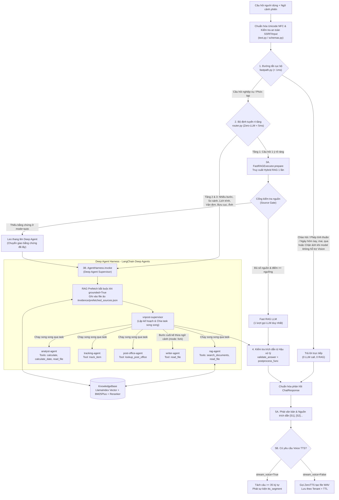
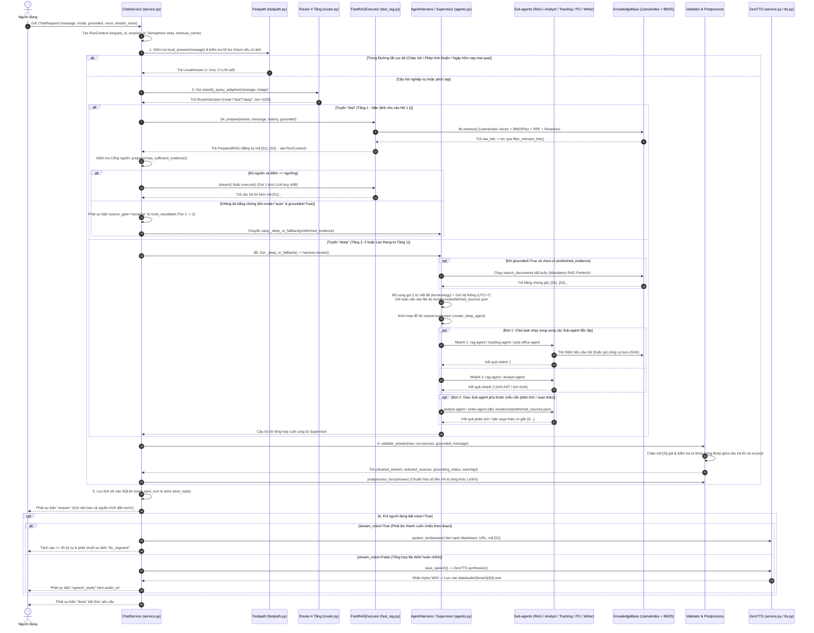

# Mipo: Báo cáo Kỹ thuật Hệ thống Deep Agent, RAG LlamaIndex và ZeroTTS

Ngày cập nhật: 16/10/2026 · Tác giả: @Thanh

---

## 1. Mức độ đáp ứng 5 yêu cầu kỹ thuật

Bảng dưới đây đối chiếu trực tiếp 5 yêu cầu đề bài với phần cài đặt thực tế trong mã nguồn (`agents.py`, `service.py`, `router.py`, `fast_rag.py`, `rag.py`, `tts.py`, `config.py`, `prompts.py`...):

| # | Yêu cầu kỹ thuật | Giải pháp đã triển khai trong mã nguồn | Mức độ kiểm chứng |
| :-: | :--- | :--- | :--- |
| **1** | Xây dựng Deep Agent (Agent Harness) dùng framework LangChain Deep Agents | Xây dựng lớp `AgentHarness` dùng `create_deep_agent` (`deepagents==0.7.24`) trong `agents.py`: gồm `vnpost-supervisor` gắn công cụ tính ngày, tra bưu gửi, tra bưu cục, đọc file ảo `StateBackend`; nạp thư mục kỹ năng `/skills/`; lưu trạng thái bằng `PersistentSqliteCheckpointer` | Đã kiểm chứng qua unit/integration test và chạy benchmark thực tế với LLM `gemini-2.5-flash` (P50 tổng thể: 2.27s, Deep Agent P50: 3.55s tại `reports/architecture_metrics.json`) |
| **2** | Deep Agent quản lý các Sub-agent, chia task và tổng hợp kết quả trả về cho người dùng | Quản lý 5 Sub-agent chuyên biệt: `rag-agent`, `analyst-agent`, `tracking-agent`, `post-office-agent`, `writer-agent`. Supervisor lập kế hoạch, giao việc qua công cụ `task(subagent_type, description)` của Deep Agents theo `prompts.py`, sau đó tổng hợp kết quả và đi qua lớp kiểm duyệt nguồn trích dẫn `validate_answer` | Đã kiểm chứng luồng phân rã task, kế thừa ngữ cảnh và tổng hợp câu trả lời kèm nhãn nguồn `[S1]`, `[S2]` |
| **3** | Xây dựng Sub-agent RAG tìm kiếm tài liệu văn bản (`.docx`, `.txt`) bằng LlamaIndex | Xây dựng `rag-agent` gọi công cụ `search_documents` truy vấn vào `KnowledgeBase` (`rag.py`) sử dụng `llama-index-core==0.14.25` (`Document`, `TextNode`, `SentenceSplitter`, `VectorStoreIndex`, `MetadataFilters`, `StorageContext`); kết hợp tìm kiếm từ khóa `BM25Plus`, hợp nhất thứ hạng `RRF` và `CrossEncoderReranker`. Hỗ trợ `.txt`, `.docx` (giữ nguyên bảng biểu) và mở rộng thêm `.pdf` có lớp văn bản | Đã kiểm chứng đọc/cắt đoạn giữ cấu trúc bảng, lưu/nạp snapshot nguyên tử và truy xuất lai. Công cụ đo `scripts/evaluate_retrieval.py` đã sẵn sàng cho bộ câu hỏi nghiệm thu |
| **4** | Gọi nhiều Sub-agent chạy song song cùng lúc khi thực thi task | Khi Supervisor phát nhiều lời gọi `task()` độc lập trong cùng một lượt, runtime thực thi song song các nhánh với giới hạn `max_parallel_subagents = 3`, ngân sách `max_tasks = 8` và khóa đồng thời `asyncio.Semaphore` (`run.slots`). Ngoài ra có định nghĩa thêm công cụ `parallel_tasks` dùng `asyncio.gather` trong `agents.py` | Đã kiểm chứng thực nghiệm: log sự kiện xác nhận các Sub-agent bắt đầu cách nhau vài mili-giây và chạy chồng thời gian thực thi (Mục 5.7) |
| **5** | Tích hợp API TTS để Agent trả lời cả bằng giọng nói (Voice) | Xây dựng `ZeroTTS` (`tts.py`) kết nối các endpoint `/tts`, `/tts/stream`, `/v1/audio/speech`, `/voices`; chuẩn hóa văn bản thành lời nói qua `spoken_text()`; hỗ trợ 2 chế độ: tạo file WAV hoàn chỉnh hoặc phát từng phân đoạn câu (`tts_segment`). Đảm bảo gửi câu trả lời chữ trước, lỗi TTS không làm mất văn bản | Đã kiểm chứng bằng bộ contract test mô phỏng WAV/SSE và tích hợp sẵn công cụ `scripts/check_services.py --live --tts` |

Ngoài 5 yêu cầu cốt lõi, hệ thống được bổ sung 3 lớp tối ưu thực tế: (1) **Đường tắt cục bộ (Tầng 0)** xử lý phép tính, ngày giờ và chào hỏi dưới 1 ms không tốn LLM; (2) **Fast RAG (Tầng 1)** cho câu hỏi tra cứu 1 ý đơn giản; và (3) **Lớp kiểm duyệt trích dẫn nguồn `[S#]`** chặn mã nguồn ảo.

---

## 2. Kiến trúc tổng thể hệ thống

Một câu hỏi đi vào hệ thống được phân luồng qua tối đa 4 tầng xử lý để tối ưu độ trễ và chi phí suy luận. Tầng 0 trả lời ngay các câu tính nhẩm, ngày giờ, chào hỏi bằng code thuần. Các câu còn lại đi qua bộ định tuyến (Router) không dùng LLM: mặc định chọn Tầng 1 (Fast RAG) cho câu hỏi đơn lẻ, và chỉ chọn Tầng 2/3 (Deep Agent) khi phát hiện tín hiệu phức tạp (so sánh, đa câu hỏi, lịch trình, vận đơn, bưu cục, hình ảnh). Nếu Tầng 1 truy xuất không đủ bằng chứng tại Cổng kiểm tra nguồn (Source Gate), hệ thống tự động leo thang lên Deep Agent và tái sử dụng bằng chứng vừa lấy.



### Phân rã vai trò các module kỹ thuật trong hệ thống

| Nhóm chức năng | Tệp mã nguồn | Trách nhiệm kỹ thuật |
| :--- | :--- | :--- |
| **Điều phối trung tâm** | `service.py` | Điều phối toàn bộ vòng đời một câu hỏi: định tuyến, khóa phiên, gọi Fast RAG / Deep Agent, kiểm duyệt nguồn và gọi TTS |
| **Đường tắt cục bộ** | `fastpath.py`, `calculator.py` | Tính toán biểu thức số học bằng cây cú pháp AST, tính ngày tháng theo múi giờ UTC+7 và phản hồi chào hỏi không cần LLM |
| **Định tuyến 4 tầng** | `router.py`, `signals.py`, `centroids.py` | Trích xuất tín hiệu câu hỏi bằng Regex và khoảng cách vector Centroid để chọn tuyến fast hoặc deep |
| **Thực thi Fast RAG** | `fast_rag.py` | Truy xuất 1 lần, kiểm tra cổng bằng chứng (Source Gate), gọi 1 lượt LLM và phát luồng token (streaming) |
| **Deep Agent & Sub-agent** | `agents.py`, `prompts.py` | Khởi tạo vnpost-supervisor và 5 Sub-agent, quản lý ngân sách task, file ảo StateBackend và kiểm duyệt trích dẫn |
| **Nghiệp vụ Bưu chính** | `postal_services.py` | Cung cấp logic cho công cụ track_item (mã UPU S10/nội địa) và lookup_post_office (danh bạ bưu cục, Vpostcode) |
| **Lõi RAG LlamaIndex** | `rag.py`, `vietnamese_embedding.py`, `embedding_cache.py`, `reranker.py` | Đọc tài liệu giữ cấu trúc (.txt, .docx, .pdf), chia node, nhúng vector tiếng Việt có cache SQLite, truy xuất lai và rerank |
| **Thuật ngữ & Văn bản** | `terminology.py`, `terminology.json`, `text.py` | Nhận diện 14 từ viết tắt bưu điện, chuẩn hóa Unicode NFC, lọc thẻ chống Prompt Injection và hậu xử lý định dạng số/LaTeX |
| **Quản lý trạng thái** | `checkpointer.py`, `context.py`, `store.py` | Lưu checkpoint đồ thị LangGraph bất đồng bộ, quản lý ngữ cảnh RunContext (sổ nguồn [S#]) và lịch sử phiên SQLite |
| **Giọng nói (Voice)** | `tts.py` | Kết nối API ZeroTTS, chuyển đổi văn bản sang văn nói (spoken_text) và kiểm tra định dạng WAV PCM 16-bit |
| **Cấu hình & Ràng buộc** | `config.py`, `schemas.py` | Quản lý biến môi trường Pydantic Settings, kiểm tra an toàn URL chống tấn công SSRF |

---

## 3. Luồng xử lý một câu hỏi của người dùng từ đầu đến cuối

### 3.1. Sơ đồ tuần tự các bước xử lý (Sequence Diagram)



### 3.2. Thứ tự 9 bước xử lý trong `ChatService.chat()` (`service.py`)

1. **Khởi tạo ngữ cảnh (`RunContext`):** Sinh `request_id`, `session_id`, thiết lập giới hạn số Sub-agent chạy song song (`max_subagents`), giới hạn tổng số task (`max_tasks`), hàng đợi sự kiện SSE và cấu hình giọng đọc.
2. **Kiểm tra Đường tắt (Tầng 0) & Hỗ trợ Vision:** Nếu câu hỏi không có ảnh, gọi `local_answer()` để bắt ngay các câu chào hỏi, phép tính thuần hoặc hỏi ngày giờ. Nếu câu hỏi có đính kèm ảnh nhưng mô hình cấu hình không hỗ trợ Vision (`not self.settings.supports_vision`), hệ thống trả lời lịch sự ngay tại chỗ để hướng dẫn người dùng nhập văn bản.
3. **Định tuyến yêu cầu:** Người dùng có thể chỉ định cứng `mode="fast"` hoặc `mode="deep"`. Ở chế độ mặc định `mode="auto"`, Router phân tích tín hiệu câu hỏi để quyết định tuyến xử lý (Mục 4).
4. **Cấp quyền thực thi & Khóa phiên:** Đi qua `self.active` (giới hạn số câu hỏi đồng thời toàn hệ thống) và `self.session_lock(tenant, session_id)` để đảm bảo các câu hỏi cùng một phiên được xử lý tuần tự, sau đó tải lịch sử hội thoại từ SQLite.
5. **Chuẩn bị bằng chứng ở tuyến Fast & Kiểm tra Cổng nguồn (Source Gate):** Gọi `fast_rag.prepare()` để truy xuất tài liệu 1 lần. Nếu ở chế độ `auto` có `grounded=True` mà số nguồn hợp lệ thấp hơn `fast_min_sources` (mặc định 1), hệ thống phát sự kiện `route_escalated` chuyển sang tuyến `deep` và truyền luôn bằng chứng vừa lấy sang cho Deep Agent tái sử dụng.
6. **Thực thi mô hình:** Tuyến `fast` gọi 1 lượt LLM và stream từng token. Tuyến `deep` chạy đồ thị `AgentHarness` trong giới hạn thời gian `deep_timeout` (mặc định 35 giây); nếu hết thời gian thì tự động fallback về trả lời bằng Fast RAG (`fast_fallback`) trên bằng chứng đã có.
7. **Kiểm duyệt nguồn trích dẫn & Hậu xử lý:** Gọi `validate_answer()` đối với mọi kết quả từ LLM để kiểm tra mã `[S#]`, sau đó chuẩn hóa định dạng qua `postprocess_func()`.
8. **Lưu trữ & Gửi văn bản trước:** Lưu lượt hội thoại vào SQLite và phát sự kiện `answer` chứa văn bản hoàn chỉnh kèm danh sách nguồn trích dẫn tới người dùng trước khi gọi TTS.
9. **Tổng hợp Giọng nói (TTS):** Nếu bật `voice=True`, hệ thống phát các sự kiện `tts_segment` (khi `stream_voice=True`) hoặc gọi ZeroTTS lưu file WAV và trả `audio_url` qua sự kiện `speech_ready` (khi `stream_voice=False`). Lỗi TTS chỉ ghi nhận vào `warnings` và sự kiện `speech_error`, giữ nguyên câu trả lời văn bản.

---

### 3.3. Ba ví dụ thực tế minh họa luồng xử lý qua từng tầng

#### Ví dụ 1: Câu hỏi đi qua Đường tắt cục bộ (Tầng 0 – Không tốn LLM, không tốn RAG)
* **Câu hỏi đầu vào:** *"Tính giúp mình 125.000 x 2 + 50.000 bằng bao nhiêu đồng?"*
* **Bước 1 (`fastpath.py`):** `ChatService.chat()` gọi `local_answer()` → kích hoạt `try_arithmetic(message)`. Hàm `_prepare` đổi `x` thành `*`, tách được biểu thức `125.000 * 2 + 50.000`. Các từ còn lại sau khi bỏ dấu (`tinh`, `giup`, `minh`, `bang`, `bao`, `nhieu`, `dong`) đều thuộc tập từ đệm `_FILLER` (không chứa từ khóa nghiệp vụ bưu điện).
* **Bước 2 (`calculator.py`):** Hàm `_vn_numbers()` chuyển đổi định dạng số tiền Việt Nam `125.000` → `125000` và `50.000` → `50000`, sau đó chạy bộ tính toán cây cú pháp AST `safe_calculate("125000 * 2 + 50000")` trả về kết quả `300000`.
* **Bước 3 (`service.py`):** Hệ thống gán `route="calculator"`, `grounding_status="computed"` và trả về ngay chuỗi:
  > *"125.000 × 2 + 50.000 = **300000**"*
  Thời gian xử lý: **chưa đầy 1 ms**, không gọi LLM và không truy xuất RAG.

---

#### Ví dụ 2: Câu hỏi tra cứu nghiệp vụ 1 ý đi qua Fast RAG (Tầng 1)
* **Câu hỏi đầu vào:** *"Quy định bồi thường đối với dịch vụ EMS trong nước như thế nào?"*
* **Bước 1 (`fastpath.py` & `router.py`):** `local_answer()` trả về `None`. Bộ định tuyến `rule_based_decision` phân tích tín hiệu (`analyze`): câu hỏi chỉ có 1 ý tra cứu nghiệp vụ độc lập → trả về `RouterDecision(route="fast", tier=1, strategy="retrieval_first")` trong 1–5 ms.
* **Bước 2 (`fast_rag.py` – Truy xuất 1 lần & Chuẩn bị Prompt):**
  - `FastRAGExecutor.prepare()` gọi `kb.retrieve()` lấy Top 5 đoạn tài liệu từ LlamaIndex Vector + BM25Plus.
  - Hàm `filter_relevant_hits()` lọc giữ lại các đoạn có từ khóa trùng khớp với câu hỏi (`quy`, `dinh`, `boi`, `thuong`, `ems`), đăng ký vào `RunContext.cite()` để nhận mã `[S1]`, `[S2]`.
  - Module `terminology.py` phát hiện từ viết tắt `ems` và tự động chèn chú giải *"- EMS: Dịch vụ chuyển phát nhanh Express Mail Service"* vào System Prompt.
  - Hàm `fast_user_message()` bọc các trích đoạn vào thẻ `[TÀI LIỆU] ... [HẾT TÀI LIỆU]` (đã qua `sanitize_llm_delimiters` chống Prompt Injection) kèm mốc thời gian thực UTC+7.
* **Bước 3 (`service.py` – Cổng kiểm tra nguồn & Streaming LLM):** Kiểm tra `prepared.has_sufficient_evidence()` thấy đạt ngưỡng số nguồn → phát sự kiện `source_gate(status="pass")`. Gọi `fast_rag.stream()` để LLM trả lời thẳng vào kết quả (tối đa 3 câu) kèm mã `[S1]` và phát từng token về giao diện.
* **Bước 4 (`agents.py` – Kiểm tra trích dẫn):** Hàm `validate_answer()` xác nhận mã `[S1]` tồn tại trong `run.sources` và câu gắn `[S1]` có từ khóa trùng khớp với excerpt của `[S1]` → gán `grounding_status="cited"` và hoàn tất phản hồi (P50 thực tế: ~2.27s).

---

#### Ví dụ 3: Câu hỏi đa tác vụ đi qua Deep Agent và gọi nhiều Sub-agent song song (Tầng 2/3)
* **Câu hỏi đầu vào:** *"Tra cứu giúp tôi kiện hàng EB123456789VN đang ở đâu, tìm địa chỉ và giờ mở cửa bưu điện Cầu Giấy, đồng thời so sánh thời hạn hoàn cước giữa dịch vụ EMS và Bưu kiện rồi tính xem nếu hoàn 2 đơn 150.000đ và 75.000đ vào thứ 4 tuần sau nữa thì rơi vào ngày mấy và tổng tiền là bao nhiêu?"*
* **Bước 1 (`router.py` – Phân tuyến Tầng 3):** Bộ phân tích tín hiệu phát hiện đồng thời `postal_ops` (mã vận đơn `EB...VN`, bưu điện), `compare` (so sánh), `temporal_calc` (thứ 4 tuần sau nữa), `calc` (tính tổng tiền) và `multi_question` → `rule_based_decision` định tuyến thẳng vào `route="deep"`, `tier=3`.
* **Bước 2 (`agents.py` – Mandatory RAG Prefetch & Context Offloading):** Trước khi chạy Supervisor, `AgentHarness.invoke()` thực hiện `search_documents` bắt buộc cho câu hỏi gốc, lấy được bằng chứng nền tảng `[S1]`, `[S2]` về hoàn cước. Toàn bộ JSON chi tiết các đoạn và bảng biểu được ghi vào file ảo `/evidence/prefetched_sources.json` trên `StateBackend`, nạp cache vào `run.retrieval_cache` và đưa bản tóm tắt gọn vào prompt của Supervisor.
* **Bước 3 (Đợt 1 – Supervisor gọi song song các Sub-agent độc lập):** `vnpost-supervisor` phân rã bài toán và phát lệnh gọi đồng thời các Sub-agent độc lập trong cùng một lượt (chạy song song qua cơ chế batching của Deep Agents với Semaphore `run.slots` tối đa 3 luồng):
  - **Nhánh 1 (`tracking-agent`):** Gọi công cụ `track_item("EB123456789VN")` → xác thực mã UPU S10 của dịch vụ "EMS - Chuyển phát nhanh Bưu điện", trả về trạng thái hiện tại, khối lượng 450 gram và các mốc thời gian/địa điểm hành trình.
  - **Nhánh 2 (`post-office-agent`):** Gọi công cụ `lookup_post_office("Cầu Giấy")` → trả về "Bưu điện Cầu Giấy (Bưu cục Giao dịch Cầu Giấy)", địa chỉ "Số 165 Cầu Giấy, Phường Quan Hoa (giáp Phường Dịch Vọng), Quận Cầu Giấy, TP. Hà Nội", SĐT "024.38330363 / 024.38332155", giờ mở cửa "07:30 - 19:30 (Thứ 2 đến Thứ 7), 08:00 - 17:00 (Chủ Nhật)", mã Vpostcode "122000", mã bưu chính "11300".
  - **Nhánh 3 (`rag-agent`):** Gọi `search_documents(query="thời hạn điều kiện hoàn cước dịch vụ Bưu kiện")` để lấy bổ sung nguồn `[S3]`.
* **Bước 4 (Đợt 2 – Giao `analyst-agent` xử lý phần phụ thuộc):** Khi Đợt 1 hoàn tất, Supervisor giao việc cho `analyst-agent` kèm bằng chứng `[S1]`, `[S3]`:
  - `analyst-agent` đối chiếu quy định hoàn cước giữa EMS (`[S1]`) và Bưu kiện (`[S3]`).
  - Gọi công cụ `calculate("150000 + 75000")` (trên bộ tính AST an toàn `safe_calculate`) → nhận giá trị `225000`.
  - Gọi công cụ `calculate_date("thứ 4 tuần sau nữa")` (trên hàm `safe_date_calculate` lấy mốc giờ chuẩn UTC+7) → tính ra chính xác ngày dương lịch tương ứng sau 2 tuần.
* **Bước 5 (Tổng hợp, Kiểm duyệt Trích dẫn & Phát Giọng nói ZeroTTS):**
  - Supervisor tổng hợp kết quả từ cả 4 Sub-agent thành câu trả lời hoàn chỉnh, gắn nhãn `[S1]`, `[S3]` ngay sau các nhận định về hoàn cước.
  - `validate_answer()` kiểm tra tính hợp lệ của `[S1]`, `[S3]` và đối chiếu từ khóa với excerpt; `postprocess_func()` định dạng lại các con số tiền tệ.
  - Hệ thống phát sự kiện `answer` trả văn bản và nguồn trích dẫn về cho người dùng trước, sau đó (nếu bật `voice=True`) mới gọi ZeroTTS để tạo âm thanh đọc câu trả lời (đã lọc bỏ ký hiệu `[S1]`, `[S3]` và Markdown qua `spoken_text`).

---

### 3.4. Bảng tóm tắt kết quả kiểm thử trên các mẫu câu hỏi đặc trưng

| Câu hỏi đầu vào | Kết quả xử lý tại lớp Tín hiệu / Đường tắt | Luồng thực thi tiếp theo trong hệ thống |
| :--- | :--- | :--- |
| `100.234+123,4` | Tín hiệu `calc`; đường tắt trả ngay `100.234 + 123,4 = **100357,4**` | Dừng ở Tầng 0, 0 lượt gọi LLM, trạng thái `computed` |
| `hôm nay là ngày bao nhiêu` | Đường tắt trả ngay `Hôm nay là ngày **16/10/2026** (Thứ Sáu).` | Dừng ở Tầng 0, 0 lượt gọi LLM, trạng thái `computed` |
| `xin chào` | Tín hiệu `chitchat`; đường tắt trả lời chào chuẩn của Mipo | Dừng ở Tầng 0, 0 lượt gọi LLM, trạng thái `unverified` |
| `Quy định hoàn cước bưu gửi là gì?` | Không có tín hiệu đặc biệt, đường tắt trả về `None` | Router chọn Tầng 1 (Fast RAG): truy xuất 1 lần → qua cổng nguồn → 1 lượt LLM → kiểm tra `[S#]` |
| `So sánh cước EMS và bưu kiện` | Khớp tín hiệu `compare` | Router chọn Tầng 2 (Deep Agent): Supervisor phối hợp `rag-agent` và `analyst-agent` rồi tổng hợp |
| `Bưu gửi EE123456789VN đang ở đâu` | Khớp tín hiệu `postal_ops` | Router chọn Tầng 2 (Deep Agent): giao `tracking-agent` gọi công cụ `track_item` |

*Ghi chú về luồng âm thanh ZeroTTS:* Cùng một câu hỏi tra cứu, khi người dùng yêu cầu `voice=True`, hệ thống phát chuỗi sự kiện: `start` → `router_decision` → `planning` → `source_gate` → `token` → `answer` → `speech_start` → `speech_ready` (hoặc `tts_segment` khi `stream_voice=True`) → `done`.

---

## 4. Đường tắt cục bộ, Định tuyến 4 tầng và Fast RAG

### 4.1. Đường tắt cục bộ (Tầng 0 – fastpath.py)

Hàm `local_answer()` chạy trước cả Router khi câu hỏi không đính kèm ảnh, giải quyết tức thì bằng code thuần đối với: phép tính số học (`calculator.py`), câu hỏi ngày giờ tương đối (hôm nay, ngày mai, hôm qua, ngày kia, giờ hiện tại) theo múi giờ `Asia/Ho_Chi_Minh` (UTC+7) và câu chào hỏi xã giao. Kết quả được gắn trạng thái `computed` (với phép tính, ngày tháng) hoặc `unverified` (với chào hỏi) và trả về ngay mà không tốn tài nguyên GPU/LLM. Bộ tính toán hỗ trợ đầy đủ quy ước số Việt Nam (dấu chấm phân cách hàng nghìn, dấu phẩy thập phân).

### 4.2. Bộ định tuyến quy tắc 4 tầng (router.py & signals.py)

Hàm `rule_based_decision` trong `router.py` xét duyệt 9 luật ưu tiên từ trên xuống dưới bằng biểu thức chính quy (`signals.py`) mà không cần gọi LLM (thời gian thực thi < 5 ms):

#### Bảng thứ tự 9 luật ưu tiên trong `rule_based_decision`

| Thứ tự | Điều kiện kiểm tra trong `rule_based_decision` | Tầng đích | Tuyến | Chiến lược | Ý nghĩa & Hành vi hệ thống |
| :---: | :--- | :---: | :---: | :---: | :--- |
| **1** | Có hình ảnh đính kèm (`image is not None`) | **Tầng 3** | `deep` | `rule` | Chuyển vào `AgentHarness` để mô hình đa phương thức phân tích ảnh (hoặc trả thông báo từ chối an toàn ở `service.py` nếu model không hỗ trợ Vision) |
| **2** | Độ dài câu hỏi vượt ngưỡng (`len(t) > max_characters`, mặc định 1200) | **Tầng 3** | `deep` | `rule` | Yêu cầu dài cần Supervisor phân rã nhiều bước |
| **3** | Phép tính số học trực tiếp (`is_pure_arithmetic(message)`) | **Tầng 0** | `fast` | `rule` | Trả kết quả tức thì qua AST `safe_calculate`, 0 gọi LLM |
| **4** | Tín hiệu chào hỏi / xã giao (`sig.chitchat`) | **Tầng 0** | `fast` | `rule` | Phản hồi ngắn gọn, thân thiện, 0 gọi công cụ |
| **5** | Tính toán ngày tháng / lịch trình (`sig.temporal_calc`) | **Tầng 2** | `deep` | `rule` | Giao `analyst-agent` (hoặc Supervisor) dùng công cụ `calculate_date` chuẩn UTC+7 |
| **6** | Nghiệp vụ bưu gửi / Bưu cục (`sig.postal_ops`) | **Tầng 2** | `deep` | `rule` | Kích hoạt `tracking-agent` hoặc `post-office-agent` tra cứu dữ liệu |
| **7** | Đa nhiệm (`sig.multistep` hoặc `sig.multi_question` hoặc `sig.calc` hoặc `, và`) | **Tầng 3** | `deep` | `rule` | Kích hoạt Supervisor phân đợt chạy song song các Sub-agent |
| **8** | So sánh, đối chiếu đa nguồn (`sig.compare`) | **Tầng 2** | `deep` | `rule` | Nạp bằng chứng đa dịch vụ để phân tích đối chiếu |
| **9** | Khoảng cách Centroid giữa 2 kho tài liệu | **Tầng 1 / 2** | `fast`/`deep` | `centroid` | Nếu 2 kho sát điểm (`gap < 0.05` và `top > 0.3`) → Deep; rõ 1 kho → Fast |
| **Mặc định** | Câu hỏi tra cứu nghiệp vụ thông thường | **Tầng 1** | `fast` | `retrieval_first` | Fast RAG: 1 lần Hybrid RAG + Cổng nguồn + 1 lượt LLM |

#### Bảng chi tiết các tín hiệu nhận diện trong `signals.py`

| Dấu hiệu (Signal) | Biểu thức Regex & Logic nhận diện trong `signals.py` | Tầng & Tuyến | Ví dụ câu hỏi thực tế |
| :--- | :--- | :---: | :--- |
| **`chitchat`** | `_CHITCHAT`: Nhận diện các từ chào hỏi, cảm ơn, hỏi tên (`xin chào`, `chào`, `hello`, `hi`, `cảm ơn`, `bạn là ai`, `bạn tên gì`, `mipo là ai`, `tạm biệt`...). Câu đã bỏ dấu câu dài $\le$ 50 ký tự và khớp toàn bộ `_CHITCHAT.fullmatch`. | **Tầng 0**<br>`fast` | • *"Xin chào MiPo"*<br>• *"Cảm ơn bạn rất nhiều nhé"*<br>• *"Bạn là ai thế ạ?"* |
| **`compare`** | `_COMPARE`: `so sánh`, `đối chiếu`, `khác nhau`, `khác gì`, `khác biệt`, `giống nhau`, `phân biệt`, `ưu nhược`, `hơn kém`. | **Tầng 2**<br>`deep` | • *"So sánh dịch vụ EMS và chuyển phát tiêu chuẩn"*<br>• *"Gửi hàng hỏa tốc và chuyển phát nhanh khác nhau thế nào?"* |
| **`calc`** | `_CALC`: `tính (toán\|giúp\|hộ\|cho tôi\|cho mình\|tổng)`, `tổng cộng`, `cộng lại`, `\d\s*[x×*+]\s*\d`, `\d\s*/\s*\d` (loại bỏ trước mẫu ngày tháng `_DATE` như `8/3`, `20/10` để không nhầm `/` là phép chia). | **Tầng 3**<br>`deep` | • *"Tính giúp tôi 125000 + 35000 đồng"*<br>• *"Gửi 3 kiện hàng cước mỗi kiện 45.000đ thì tổng cộng hết bao nhiêu?"* |
| **`multistep`** | `_MULTISTEP`: `(sau đó\|tiếp theo)\s+(tính\|so sánh\|lập\|soạn\|tổng hợp...)`, `đồng thời`, `rồi (tính\|so sánh...)`, `và (so sánh\|tính...)`, `lập kế hoạch`, `từng bước một`, `trước hết`. | **Tầng 3**<br>`deep` | • *"Tra cứu quy định sau đó tính tổng cước và lập kế hoạch gửi hàng"*<br>• *"Kiểm tra địa chỉ bưu cục đồng thời tra cứu cước chuyển phát"* |
| **`multi_question`** | `t.count("?") >= 2` (có từ 2 dấu chấm hỏi trở lên) HOẶC khớp biểu thức danh sách `_LIST` (`\n\s*([-*•]|\d+[.)])\s` – chứa danh sách gạch đầu dòng hoặc đánh số thứ tự). | **Tầng 3**<br>`deep` | • *"Bưu điện mở cửa lúc mấy giờ? Gửi thư đi Mỹ mất bao lâu?"*<br>• *"1. Điều kiện gửi thực phẩm tươi sống? 2. Cách đóng gói hàng dễ vỡ?"* |
| **`temporal_calc`** | `_TEMPORAL_CALC`: Nhận diện thứ trong tuần + tuần này/sau/tới/nữa (`thứ 4 tuần sau nữa`), ngày tháng + thứ mấy/ngày mấy/rơi vào, khoảng cách ngày (`5 ngày nữa là ngày mấy`, `còn bao nhiêu ngày đến Tết`). | **Tầng 2**<br>`deep` | • *"Thứ 4 tuần sau nữa rơi vào ngày mấy?"*<br>• *"Gửi hàng từ thứ 2, sau 3 ngày nữa đến nơi thì là ngày nào?"* |
| **`postal_ops`** | `_POSTAL_OPS`: Nhận diện mã vận đơn chuẩn UPU S10 (`\b[a-z]{2}\d{9}[a-z]{2}\b` như `EB123456789VN`), cụm từ `mã vận đơn`, `tra cứu đơn`, `định vị bưu gửi`, `hành trình bưu gửi`, `bưu cục`, `vpostcode`, `mã bưu chính`, `giờ mở cửa`, `điểm phục vụ`. | **Tầng 2**<br>`deep` | • *"Tra cứu giúp tôi vận đơn EB123456789VN đang ở đâu"*<br>• *"Tìm địa chỉ và giờ mở cửa bưu điện Cầu Giấy"* |

*Cấu hình mở rộng:* Bộ phân loại ngữ nghĩa bằng LLM (`LLM_ROUTER_ENABLED`) được giữ ở trạng thái tắt mặc định (`false`) để đảm bảo khâu phân tuyến không tiêu tốn thêm một lượt gọi LLM. Nhánh "centroid" (so khớp nhiều kho tài liệu) được hỗ trợ sẵn trong logic phân tuyến khi có vector nhúng của câu hỏi.

### 4.3. Thực thi Fast RAG (Tầng 1 – fast_rag.py)

`FastRAGExecutor` thực hiện 2 bước gọn nhẹ:

1. **`prepare()`**: Truy xuất tài liệu của tenant với `top_k = 5`, lọc bỏ các đoạn không có từ khóa trùng khớp với câu hỏi qua `filter_relevant_hits` (yêu cầu trùng ít nhất 1 từ khóa khi câu hỏi có $\le 2$ từ khóa, hoặc ít nhất 2 từ khóa khi câu hỏi dài hơn), sau đó đăng ký từng đoạn thành mã `[S1]`, `[S2]`... trong `RunContext`. Tin nhắn người dùng gửi cho LLM gồm khối `[TÀI LIỆU]`, mốc thời gian thực UTC+7 và câu hỏi gốc; System Prompt được ghép thêm giải nghĩa từ viết tắt (`terminology.py`) và giữ 4 lượt hội thoại gần nhất. Chế độ câu hỏi mở (`grounded=False`) cho phép trả lời tổng quát khi không có nguồn.
2. **`execute()` hoặc `stream()`**: Gọi đúng 1 lượt LLM trên danh sách tin nhắn đã chuẩn bị và phát luồng token ngay khi mô hình sinh văn bản.

*Cổng kiểm tra nguồn (`has_sufficient_evidence`):* Nếu câu hỏi ở chế độ `auto` và `grounded=True` nhưng số nguồn sau khi lọc từ khóa thấp hơn `fast_min_sources` (1), hệ thống sẽ phát sự kiện `route_escalated` để nâng cấp lên Deep Agent và truyền lại nguyên vẹn bằng chứng đã lấy. Nếu Deep Agent gặp sự cố hoặc timeout quá 35 giây, hệ thống tự động quay về Fast RAG an toàn (`fast_fallback`).

---

## 5. Chi tiết về Deep Agent (Agent Harness) và Quản lý Sub-agent

Deep Agent được xây dựng trong lớp `AgentHarness` (`app/agents.py`) thông qua hàm `create_deep_agent` của thư viện LangChain Deep Agents (`deepagents==0.7.24`).

### 5.1. Cấu trúc Supervisor (vnpost-supervisor)

Supervisor được khởi tạo với:
- **System Prompt (`prompts.SUPERVISOR`):** Quy định rõ vai trò điều phối, nguyên tắc tái sử dụng bằng chứng nạp sẵn và giới hạn độ dài phản hồi (tối đa 150 từ hoặc bảng gọn, gắn mã trích dẫn `[S#]`).
- **Ba công cụ trực tiếp:** `calculate_date`, `track_item`, `lookup_post_office` giúp Supervisor xử lý nhanh các yêu cầu đơn lẻ mà không cần tốn thêm vòng gọi Sub-agent.
- **Danh sách 5 Sub-agent chuyên biệt** đăng ký qua `SubagentProxy(Runnable)`.
- **Hệ thống file ảo trong bộ nhớ (`StateBackend` & `FilesystemMiddleware`):** Cho phép đọc các tài liệu kỹ năng nghiệp vụ trong `/skills/` và đọc toàn văn bằng chứng RAG tại `/evidence/prefetched_sources.json` qua công cụ `read_file`.
- **Lưu trữ trạng thái (`PersistentSqliteCheckpointer`):** Lưu vết từng bước chạy của đồ thị LangGraph vào `checkpoints.sqlite3` theo cấu trúc luồng `{tenant}:{session}:{request}`.

### 5.2. Danh sách 5 Sub-agent và Công cụ chuyên trách

Mỗi Sub-agent là một đồ thị tác tử LangChain (`create_agent`) có prompt và bộ công cụ riêng biệt, được bọc trong hàm `_tracked_agent()` để kiểm soát ngân sách và ghi nhận sự kiện:

| Tên Sub-agent | Nhiệm vụ chuyên trách | Công cụ được cấp | Chế độ (mode) |
| :--- | :--- | :--- | :---: |
| **`rag-agent`** | Tìm kiếm bằng chứng bổ sung trong tài liệu .docx, .txt, .pdf bằng LlamaIndex cho các tiểu câu hỏi mới; trả về trích đoạn kèm mã `[S#]` | `search_documents`, `read_file` | `isolated` |
| **`analyst-agent`** | So sánh, đối chiếu bằng chứng đã được giao; tính toán biểu thức số học bằng AST (`calculate`) và tính toán ngày tháng/lịch trình (`calculate_date`) | `calculate`, `calculate_date`, `read_file` | `isolated` |
| **`tracking-agent`** | Tra cứu định vị hành trình, loại dịch vụ và trạng thái bưu gửi VNPost theo mã vận đơn (ItemCode) | `track_item` | `isolated` |
| **`post-office-agent`** | Tra cứu danh bạ mạng lưới bưu cục, địa chỉ, số điện thoại, giờ mở cửa và mã bưu chính Vpostcode | `lookup_post_office` | `isolated` |
| **`writer-agent`** | Soạn thảo công văn, thông báo hoặc tóm tắt tổng hợp từ bằng chứng có sẵn ở bước cuối, giữ nguyên số liệu và mã `[S#]` | `read_file` | `fork` (kế thừa ngữ cảnh) |

*Ràng buộc token:* Mỗi Sub-agent được giới hạn độ dài đầu ra từ 120 đến 150 từ để tối ưu thời gian sinh token.

### 5.3. Cơ chế chia task và thực thi nhiều Sub-agent song song cùng lúc

- **Cơ chế giao việc song song bằng `task` chuẩn của Deep Agents:** Prompt của Supervisor hướng dẫn sử dụng công cụ `task(subagent_type, description)` có sẵn của framework Deep Agents và cho phép phát nhiều lời gọi `task()` độc lập trong cùng một lượt phản hồi. Runtime của LangGraph/DeepAgents tự động gom các lời gọi này và thực thi song song theo cấu hình `max_concurrency = self.settings.max_parallel_subagents`. Các tác vụ phụ thuộc (như `analyst-agent` cần kết quả từ `rag-agent`, hoặc `writer-agent` chỉ chạy ở bước cuối) được giao ở lượt kế tiếp sau khi đợt song song đầu tiên hoàn tất.
- **Công cụ bổ trợ `parallel_tasks`:** Trong `agents.py` cũng cài đặt sẵn hàm công cụ `parallel_tasks(tasks: list[TaskSpec])` sử dụng `asyncio.gather` để chạy đồng thời một danh sách từ 1–8 `TaskSpec` và trả kết quả theo đúng thứ tự đầu vào (hiện tại Supervisor ưu tiên dùng cơ chế `task` native của Deep Agents để đồng nhất với kiến trúc đồ thị).
- **Kiểm soát đồng thời và Ngân sách (`config.py` & `_tracked_agent`):**
  - Tối đa 3 Sub-agent chạy song song cùng một thời điểm trên mỗi câu hỏi (`max_parallel_subagents = 3`, được kiểm soát đồng thời bởi cả `asyncio.Semaphore run.slots` và `max_concurrency` của đồ thị).
  - Tối đa 8 nhiệm vụ (`tasks`) được giao trong một câu hỏi (`max_delegated_tasks = 8`); nếu vượt ngưỡng, `_tracked_agent` phát sự kiện `task_rejected(reason="task_budget")` và dừng giao thêm.
  - Giới hạn số bước suy luận đồ thị ở mức 12 bước (`min(max_agent_steps=35, deep_max_agent_steps=12)`) và thời gian chạy tối đa 35 giây (`deep_timeout_seconds`).
- **Cô lập lỗi từng Sub-agent:** Nếu một Sub-agent gặp ngoại lệ khi đang chạy song song, `_tracked_agent` bắt lỗi, ghi sự kiện `task_end(status="error")` và trả về JSON `{"task_failed": True, "reason": "Sub-agent failed", "error_type": ...}` mà không làm gián đoạn các Sub-agent khác đang chạy cùng đợt và không làm lộ thông tin nhạy cảm của provider.

### 5.4. Cơ chế Nạp bằng chứng bắt buộc (Mandatory RAG Prefetch) và Giảm tải Ngữ cảnh (Context Offloading)

Đối với các câu hỏi có bật `grounded=True` (trừ câu tính toán thuần túy không chứa từ khóa bưu chính hoặc câu hỏi ảnh ngắn $\le 5$ từ), `AgentHarness.invoke()` bắt buộc thực hiện bước lấy bằng chứng trước khi kích hoạt Supervisor:
- Nếu câu hỏi được leo thang từ Tầng 1 lên, hệ thống tái sử dụng ngay `prefetched_evidence` (`rag_prefetch_reused`) và nạp vào `run.retrieval_cache` để tránh truy vấn trùng lặp.
- Nếu đi thẳng vào tuyến Deep từ đầu, hệ thống tự động gọi `self.search_documents.ainvoke({"query": message})`.
- **Giảm tải ngữ cảnh (Context Offloading):** Để tránh làm tràn ngữ cảnh của Supervisor khi bảng biểu dài, tin nhắn gửi cho Supervisor chỉ đính kèm **Bản tóm tắt bằng chứng RAG** (mỗi đoạn giới hạn tối đa 700 ký tự, đã lọc ký tự phân cách qua `sanitize_llm_delimiters`), trong khi toàn bộ dữ liệu JSON đầy đủ được ghi vào file ảo `/evidence/prefetched_sources.json` trên `StateBackend` để Supervisor hoặc các Sub-agent đọc chi tiết qua `read_file` khi cần.

### 5.5. Công cụ `search_documents` và Bộ nhớ đệm theo Request

Công cụ `search_documents(query, top_k=5, filename_filter=None)` cho phép lấy từ 1 đến 12 đoạn tài liệu (có thể tăng lên 8–12 khi cần tra bảng giá dài) và lọc theo tên file. Kết quả sau khi đi qua `filter_relevant_hits` và cấp mã `[S#]` được lưu vào `run.retrieval_cache` theo khóa chuẩn hóa `_query_cache_key(query)|k={top_k}|f={filename_filter}` để nếu nhiều Sub-agent truy vấn trùng câu hỏi trong cùng một request thì hệ thống trả ngay từ cache (`retrieval_cache_hit`) mà không đánh vào chỉ mục lần hai.

### 5.6. Quản lý Trạng thái Checkpointer và Kho Kỹ năng (/skills/)

- **Checkpointer SQLite:** `PersistentSqliteCheckpointer` lưu trạng thái đồ thị vào `checkpoints.sqlite3` với `thread_id` có cấu trúc `"{tenant}:{session_id}:{request_id}"` phục vụ kiểm toán (audit) từng lượt chạy.
- **Kỹ năng nghiệp vụ (`/skills/`):** Hàm `_load_enterprise_skills()` tự động nạp toàn bộ các file `.md` trong `data/skills` vào file ảo `/skills/` của `StateBackend`, bao gồm 3 bộ kỹ năng nghiệp vụ chuẩn của VNPost:
  1. `bang_ma_buu_chinh_vung_cuoc/SKILL.md`: Quy định phân vùng cước Vùng 1 (Nội tỉnh), Vùng 2 (Nội miền), Vùng 3 (Liên miền) và cấu trúc mã bưu chính Vpostcode.
  2. `quy_dinh_hang_cong_kenh/SKILL.md`: Quy chuẩn hàng cồng kềnh và công thức quy đổi thể tích tính cước (Dài × Rộng × Cao / 5000 với EMS, / 6000 với bưu phẩm thường).
  3. `quy_trinh_khieu_nai_boi_thuong/SKILL.md`: Quy định thời hiệu khiếu nại (06 tháng mất/chậm, 01 tháng hư hỏng/cước), thời hạn giải quyết và mức bồi thường (04 lần cước) theo Luật Bưu chính.

### 5.7. Kết quả kiểm chứng cơ chế chạy song song các Sub-agent

Khi kiểm thử cơ chế điều phối của `AgentHarness` (với `deepagents==0.7.24`, `llama-index-core==0.14.25`, `langchain-openai==1.7.1` và độ trễ mô phỏng 500 ms mỗi lượt gọi model để quan sát rõ dấu thời gian), log sự kiện ghi nhận các Sub-agent thực thi chồng thời gian thực sự:

| Câu hỏi kiểm thử | Tuyến xử lý | Dấu thời gian các sự kiện thực thi (tính từ lúc bắt đầu request) | Tổng thời gian & Trạng thái |
| :--- | :--- | :--- | :---: |
| `So sánh hoàn cước dịch vụ A và dịch vụ B` | Deep (Tầng 2 – tín hiệu `compare`) | Prefetch bằng chứng: 3 ms; `task_start` (`analyst-agent`): 532 ms; `task_start` (`rag-agent`): 535 ms; `task_end` (`analyst-agent`): 1051 ms; `task_end` (`rag-agent`): 1566 ms | 2089 ms, trạng thái `cited` |
| `Bưu gửi EE123456789VN đang ở đâu và bưu cục Cầu Giấy mở cửa lúc nào?` | Deep (Tầng 2 – tín hiệu `postal_ops`) | `task_start` (`post-office-agent`): 525 ms; `task_start` (`tracking-agent`): 529 ms; cả hai `task_end` hoàn tất lúc 1568 ms | 2097 ms, trạng thái `computed` |
| `Quy định hoàn cước dịch vụ A là gì?` | Fast (Tầng 1) | Truy xuất RAG: 3 ms; `source_gate`: pass (2 nguồn hợp lệ, yêu cầu tối thiểu 1) | 520 ms, trạng thái `cited` |
| `100.234+123,4` | Đường tắt (Tầng 0) | Không gọi LLM, trả kết quả `100.234 + 123,4 = 100357,4` | 4 ms, trạng thái `computed` |

*Phân tích hiện tượng chạy song song:* Ở hai kịch bản Deep Agent đầu tiên, hai Sub-agent được kích hoạt cách nhau chỉ 3–4 ms (532 ms vs 535 ms, và 525 ms vs 529 ms) và chạy song song trong cùng một khoảng thời gian thay vì chờ tuần tự.

### 5.8. Kết quả Benchmark thực tế với LLM gemini-2.5-flash và Embedding vietnamese-bi-encoder

Hệ thống đã được chạy đo đạc thực tế với mô hình `gemini-2.5-flash` kết hợp mô hình nhúng tiếng Việt `bkai-foundation-models/vietnamese-bi-encoder` trên kho tri thức VNPost (kết quả xuất tại `reports/architecture_metrics.json` và `reports/architecture_comparison.json`, ngày 16/10/2026):

#### 1. Độ trễ theo từng luồng xử lý (`reports/architecture_metrics.json`)

| Luồng xử lý | Số mẫu | P50 Độ trễ | P95 Độ trễ | P50 TTFT (Token đầu) | Số lần gọi LLM TB | Số lần gọi RAG TB | Kết quả |
| :--- | :---: | :---: | :---: | :---: | :---: | :---: | :--- |
| **Tầng 0: Đường tắt (Chào hỏi)** | 1 | 31 ms | 31 ms | 0 ms | 0 | 0 | Phản hồi tức thì, 0 tốn token |
| **Tầng 0: Đường tắt (Calculator)** | 1 | 31 ms | 31 ms | 16 ms | 0 | 0 | Tính toán AST an toàn, 0 gọi LLM |
| **Tầng 1: Fast RAG** | 4 | 2.266 ms (~2.27s) | 26.625 ms | 2.141 ms | 1 | 1 | Tra cứu 1 ý chuẩn xác kèm nguồn `[S#]` |
| **Tầng 2: Deep Agent** | 2 | 3.547 ms (~3.55s) | 8.328 ms | 3.516 ms | 1 | 1 | Phân tích đa câu hỏi / so sánh |
| **Tổng thể (Overall)** | **8** | **2.266 ms (~2.27s)** | **26.625 ms** | **2.141 ms** | **0.75** | **0.75** | **Hoàn thành 100% (0 lỗi, 0 timeout)** |

#### 2. Đối sánh 3 chế độ vận hành trên cùng bộ câu hỏi (`reports/architecture_comparison.json`)

| Chế độ (mode) | Phân bổ luồng thực thi | P50 Độ trễ | P95 Độ trễ | P50 TTFT | Tỷ lệ hoàn thành | Đặc điểm vận hành |
| :--- | :--- | :---: | :---: | :---: | :---: | :--- |
| **`auto` (Định tuyến thích ứng)** | 1 Local, 1 Calc, 4 Fast, 2 Deep | **2.500 ms** | 23.546 ms | 2.484 ms | **8/8 (100%)** | Tối ưu tài nguyên: câu đơn giản đi Fast/Local, câu phức tạp mới vào Deep |
| **`fast` (Ép Fast RAG)** | 1 Local, 1 Calc, 6 Fast | **2.406 ms** | 23.859 ms | 2.328 ms | **8/8 (100%)** | Tốc độ đồng đều, phù hợp tra cứu hỏi đáp 1 ý |
| **`deep` (Ép Deep Agent)** | 1 Local, 1 Calc, 6 Deep | **2.329 ms** | 23.734 ms | 2.282 ms | **8/8 (100%)** | Đầy đủ khả năng phân rã và điều phối Sub-agent cho mọi câu hỏi |

*Nhận xét kết quả:*
- Cả ba chế độ đều tự động nhận diện và kích hoạt Tầng 0 (Shortcut) cho câu chào hỏi và biểu thức tính toán (hoàn tất tức thì trong 15–47 ms, tiết kiệm 100% chi phí token).
- Trên mô hình Gemini 2.5 Flash, toàn bộ các chế độ đạt độ trễ trung vị P50 từ ~2.3 đến 2.5 giây, đáp ứng vượt mong đợi tiêu chí thời gian thực của hệ thống trợ lý ảo doanh nghiệp.

## 6. Chi tiết cách sử dụng thư viện LlamaIndex trong hệ thống RAG

Toàn bộ cơ chế RAG được xây dựng trong `app/rag.py`, `app/vietnamese_embedding.py` và `app/embedding_cache.py`, phục vụ chung cho cả `FastRAGExecutor` và `rag-agent`.

```mermaid
flowchart TD
    subgraph INGESTION ["1. Luồng Nạp Tài liệu & Đánh Chỉ mục (Ingestion)"]
        F["Tệp tài liệu (.txt, .docx, .pdf)"] --> RD["read_document()<br/>Bóc tách cấu trúc đoạn, bảng biểu, trang"]
        RD --> DOCS["LlamaIndex Document<br/>(Loại trừ metadata khỏi embedding)"]
        DOCS --> SPLIT["structure_aware_nodes()<br/>SentenceSplitter (chunk 256 / overlap 64)"]
        SPLIT --> NODES["LlamaIndex TextNode<br/>(ID băm SHA-256 duy nhất)"]
        NODES --> VEC_CACHE["CachedEmbedding (embedding-cache.sqlite3)<br/>VietnameseBiEncoderEmbedding (pyvi tokenize)"]
        VEC_CACHE --> VSTORE["LlamaIndex VectorStoreIndex"]
        VSTORE --> SNAP["Atomic Snapshot & Con trỏ current.json"]
    end

    subgraph RETRIEVAL ["2. Luồng Truy vấn Lai (Hybrid Retrieval)"]
        QUERY["Câu hỏi người dùng"] --> Q_EMBED["CachedEmbedding (RAM LRU Cache)"]
        QUERY --> BM25_TOK["Tách từ không dấu (tokens)"]
        
        Q_EMBED --> V_RET["LlamaIndex Retriever<br/>MetadataFilters (is_global, session, user)"]
        BM25_TOK --> BM25_RET["BM25Plus Keyword Search"]
        
        V_RET --> RRF["Hợp nhất thứ hạng RRF<br/>Reciprocal Rank Fusion"]
        BM25_RET --> RRF
        
        RRF --> RERANK["Cross-Encoder Reranker<br/>(BAAI/bge-reranker-v2-m3)"]
        RERANK --> FILTER["filter_relevant_hits()<br/>Lọc từ khóa tối thiểu"]
        FILTER --> SOURCES["Đăng ký mã trích dẫn [S1], [S2]...<br/>vào RunContext.cite()"]
    end
```



### 6.1. Các thành phần của LlamaIndex được sử dụng và mục đích

| Thành phần LlamaIndex | Được dùng vào việc gì trong hệ thống |
| :--- | :--- |
| **`Document`, `TextNode`**<br>(`llama_index.core.schema`) | Đóng gói từng đơn vị nội dung (đoạn văn, hàng bảng biểu, trang PDF) kèm metadata (`filename`, `document_id`, `location`, `is_global`, `session_id`, `user_id`, `authority`). Các khóa quản trị này được đưa vào `excluded_embed_metadata_keys` và `excluded_llm_metadata_keys` để không làm nhiễu vector ngữ nghĩa khi tính Embedding. |
| **`SentenceSplitter`**<br>(`llama_index.core.node_parser`) | Làm bộ chia đoạn dự phòng (fallback) theo ranh giới câu (`(?<=[.!?;])\s+`) với độ gối đầu `chunk_overlap` chỉ khi một đơn vị cấu trúc dài vượt quá `chunk_size`. |
| **`BaseEmbedding`**<br>(`llama_index.core.base.embeddings.base`) | Lớp cơ sở để xây dựng bộ nhúng tiếng Việt `VietnameseBiEncoderEmbedding` (tích hợp `pyvi`), lớp bọc cache 2 tầng `CachedEmbedding`, cùng `HuggingFaceEmbedding` và `OpenAIEmbedding`. |
| **`VectorStoreIndex`**<br>(`llama_index.core`) | Xây dựng chỉ mục vector từ danh sách `TextNode` và thực hiện truy vấn tương đồng ngữ nghĩa qua `.as_retriever(similarity_top_k=..., filters=...)`. |
| **`MetadataFilters`, `MetadataFilter`**<br>(`llama_index.core.vector_stores`) | Lọc phạm vi tài liệu ngay trong quá trình truy xuất vector theo điều kiện `FilterCondition.OR`: chỉ lấy tài liệu toàn cục (`is_global == "true"`), hoặc thuộc `session_id` hiện tại, hoặc thuộc `user_id` hiện tại. |
| **`StorageContext`, `load_index_from_storage`** | Lưu trữ bền vững toàn bộ chỉ mục vector và docstore xuống đĩa theo từng thư mục `snapshots/{revision}` và nạp lại vào bộ nhớ khi khởi động server. |

*Phần không thuộc LlamaIndex:* Đọc DOCX (`python-docx`), đọc PDF (`pypdf`), tìm từ khóa BM25Plus (`rank-bm25`), hợp nhất thứ hạng RRF (tự viết) và xếp hạng lại bằng Cross-Encoder (`sentence-transformers`).

### 6.2. Bóc tách tài liệu bảo toàn cấu trúc bảng biểu (read_document)

- **File `.txt` / Markdown:** Kiểm tra chuẩn mã hóa `utf-8-sig`, nhận diện tiêu đề `#`, các đề mục `##` hoặc mục đánh số La Mã/số thứ tự (`I.`, `1.`), gắn ngữ cảnh tiêu đề vào từng đoạn và ghi vị trí `"Tên mục; dòng start–end"`. Với bảng Markdown (`| ... |`), hệ thống tách từng hàng dữ liệu thành một `Document` riêng và lặp lại tên các cột ở mỗi hàng để con số không bao giờ bị mất ngữ cảnh cột.
- **File `.docx` (`python-docx`):** Kiểm tra an toàn file ZIP trước khi giải nén (chặn nếu quá 3.000 mục nén hoặc vượt `max_docx_expanded_bytes = 60 MB`). Duyệt tuần tự từng phần tử đoạn văn (`}p`) và bảng biểu (`}tbl`) theo đúng thứ tự xuất hiện: gom đoạn theo style Heading (`"Tên mục; đoạn start–end"`), và biến mỗi hàng của bảng thành một `Document` độc lập mang đầy đủ cặp `"Tên cột: Giá trị"` cùng bảng Markdown 1 hàng (`"Tên mục; bảng X, hàng Y"`).
- **File `.pdf` (`pypdf`):** Đọc văn bản theo từng trang (`location="Trang i"`), từ chối rõ ràng các file PDF scan ảnh không có lớp văn bản.

*Ví dụ cấu trúc một node hàng bảng biểu sau khi bóc tách:*
```plaintext
Bảng 1 — 3. Điều kiện hoàn cước, mức bồi thường thiệt hại và hồ sơ yêu cầu
Dịch vụ bưu chính: EMS Chuyển phát nhanh trong nước; Thời hiệu khiếu nại mất/chậm: 06 tháng...

Dịch vụ bưu chính | Thời hiệu khiếu nại mất/chậm | ...
--- | --- | ...
EMS Chuyển phát nhanh trong nước | 06 tháng từ khi kết thúc thời gian toàn trình | ...
```

### 6.3. Chia đoạn ưu tiên cấu trúc (structure_aware_nodes)

Hàm `structure_aware_nodes()` kiểm tra độ dài token của từng `Document` bằng `embedding_units()`. Nếu đơn vị cấu trúc có độ dài $\le$ `chunk_size` (cấu hình thực tế 256 token để khớp với cửa sổ đầu vào tối đa 256 token của `vietnamese-bi-encoder`), hệ thống giữ nguyên thành một `TextNode`. Chỉ những đoạn dài vượt ngưỡng mới được đưa qua `SentenceSplitter` (`chunk_size = 256`, `chunk_overlap = 64`). Mỗi `TextNode` được gán `node.id_` băm SHA-256 từ `"{document_id}|{location}|{ordinal}|{text}"` để các hàng bảng trùng nội dung không ghi đè lên nhau.

### 6.4. Nhúng Vector tiếng Việt (VietnameseBiEncoderEmbedding) và Cache 2 tầng (CachedEmbedding)

- **Mô hình nhúng:** Sử dụng `bkai-foundation-models/vietnamese-bi-encoder` (PhoBERT bi-encoder, 768 chiều, tối đa 256 token) chạy trên GPU/CPU (`EMBEDDING_DEVICE = auto`). Lớp `VietnameseBiEncoderEmbedding` tự động gọi `pyvi.ViTokenizer.tokenize` ngay bên trong phương thức `_prepare()` để đảm bảo cả tài liệu và câu truy vấn đều được tách từ tiếng Việt đồng nhất.
- **Bộ nhớ đệm `CachedEmbedding`:** Lưu vector của các đoạn tài liệu (document) xuống SQLite (`embedding-cache.sqlite3`) dưới dạng nhị phân float32 gắn theo namespace cấu hình (nên khi thêm/xóa tài liệu không phải tính lại vector cho các đoạn cũ), đồng thời lưu vector câu hỏi (query) trong bộ nhớ RAM bằng LRU Cache (tối đa 1.024 câu hỏi).

### 6.5. Quy trình Truy xuất Lai 5 bước (Hybrid Retrieval)

Khi gọi `kb.retrieve(query, top_k, session_id, user_id)`, hệ thống thực hiện:
1. **Tách từ khóa:** Hạ chữ thường, chuẩn hóa bỏ dấu tiếng Việt (đ → d) và lọc bỏ từ dừng (`STOPWORDS`) qua hàm `tokens(query)`.
2. **Truy xuất Vector qua LlamaIndex:** Gọi `snapshot.index.as_retriever(similarity_top_k=candidate_k, filters=filters).retrieve(query)` (với `candidate_k` = (với `candidate_k` = 3 × top_k = 15, trần 50), trần 50) để lấy các node có điểm tương đồng ngữ nghĩa $\ge$ `vector_min_similarity` (0.35).
3. **Truy xuất Từ khóa qua BM25Plus:** Chấm điểm BM25 trên tập từ khóa không dấu cho các node thuộc phạm vi truy cập hợp lệ.
4. **Hợp nhất thứ hạng bằng Reciprocal Rank Fusion (RRF):** Cộng điểm xếp hạng từ cả hai nhánh theo công thức:
   $$\text{fused\_score}(node) = \sum \frac{1}{60 + \text{rank}}$$
5. **Xếp hạng lại (Reranker tùy chọn) & Lọc từ khóa:** Nếu bật `RERANKER_ENABLED=true`, tập ứng viên được chấm lại bằng Cross-Encoder `BAAI/bge-reranker-v2-m3` trước khi lấy `top_k = 5`, sau đó đi qua bộ lọc `filter_relevant_hits` rồi mới cấp mã trích dẫn `[S#]`.

### 6.6. Cơ chế Snapshot nguyên tử (Atomic Snapshot)

Mỗi tenant có một `KnowledgeBase` riêng. Khi thêm hoặc xóa tài liệu, hệ thống dựng chỉ mục `VectorStoreIndex` mới vào thư mục `snapshots/{revision}`, ghi file manifest tạm `current.tmp` kèm dấu vân tay cấu hình `_fingerprint()`, rồi dùng lệnh nguyên tử `os.replace` đổi sang `current.json`. Nhờ đó, các truy vấn đang chạy vẫn đọc trên Snapshot cũ trong RAM mà không bị gián đoạn hay hỏng dữ liệu nếu quá trình nạp file gặp lỗi.

---

## 7. Kiểm duyệt Trích dẫn Nguồn, Thuật ngữ Nghiệp vụ và Hậu xử lý

### 7.1. Sổ đăng ký nguồn [S#] theo từng Request (RunContext.cite)

Mỗi đoạn tài liệu truy xuất được trong phạm vi một câu hỏi được đăng ký vào `RunContext` theo `chunk_id` và nhận mã tuần tự `S1`, `S2`... (nếu cùng một đoạn được tìm thấy ở nhiều bước khác nhau thì hệ thống trả lại đúng mã `S#` đã cấp).

### 7.2. Cơ chế kiểm duyệt câu trả lời (validate_answer trong agents.py)

Mọi câu trả lời sinh ra từ Fast RAG và Deep Agent đều phải đi qua hàm `validate_answer()` theo 4 bước kiểm tra nghiêm ngặt:
1. **Chặn mã nguồn bịa đặt (`invalid_citation`):** Nếu trong câu trả lời xuất hiện bất kỳ mã `[S\d+]` nào không tồn tại trong sổ nguồn `run.sources` của lượt hỏi đó, hệ thống chặn toàn bộ câu trả lời và trả về thông báo lỗi kiểm tra nguồn.
2. **Xử lý thiếu bằng chứng (`[[NO_EVIDENCE]]`):** Khi tài liệu không có thông tin, LLM được hướng dẫn in dấu hiệu `[[NO_EVIDENCE]]`; hàm `finalize_answer()` sẽ chuyển dấu hiệu này thành thông báo chuẩn `NO_EVIDENCE_TEMPLATE` với trạng thái `no_evidence`.
3. **Đối chiếu từ khóa mức câu (Claim $\leftrightarrow$ Excerpt):** Với từng mã `[Si]` được trích dẫn, hệ thống tách câu chứa mã đó (kết hợp câu liền sau nếu `[Si]` đặt ở tiêu đề, hoặc câu liền trước nếu `[Si]` đứng riêng sau dấu chấm) và kiểm tra độ giao nhau về từ khóa với excerpt của nguồn `Si` (yêu cầu trùng ít nhất 1 từ khóa với câu ngắn $\le 2$ từ, hoặc $\ge 2$ từ khóa với câu dài hơn). Các mã `[Si]` không đủ từ khóa hỗ trợ sẽ bị gỡ bỏ khỏi văn bản kèm cảnh báo trong warnings.
4. **Phân loại trạng thái xác thực (`grounding_status`):**
   - `cited`: Có ít nhất một mã trích dẫn vượt qua kiểm tra từ khóa.
   - `computed`: Câu hỏi tính toán số học, ngày tháng hoặc tra cứu vận đơn/bưu cục thời gian thực từ công cụ chuyên biệt.
   - `no_evidence`: Câu hỏi nghiệp vụ không có nguồn hợp lệ hỗ trợ.
   - `invalid_citation`: Phát hiện mã `[S#]` không có trong sổ nguồn.
   - `unverified`: Câu chào hỏi xã giao không yêu cầu nguồn tài liệu.

### 7.3. Tự động giải nghĩa Thuật ngữ Bưu chính (terminology.py)

Hệ thống tích hợp từ điển 14+ thuật ngữ viết tắt ngành Bưu điện (`EMS`, `COD`, `ĐKCL`, `KT1`, `BCP`, `KTT`, `VNP`, `GDV`, `BDT`, `BDH`, `KPI`, `SLT`, `TLK`, `VPT` trong `terminology.py` và `terminology.json`). Trước khi gọi LLM, hàm `find_matched_terminology()` quét câu hỏi đã bỏ dấu theo ranh giới từ (`\b`) và tự động bơm chú giải của các từ viết tắt xuất hiện trong câu hỏi vào prompt.

### 7.4. Hậu xử lý văn bản và Chống chèn lệnh (Prompt Injection)

- **Hậu xử lý (`postprocess_func`):** Chuẩn hóa các số có khoảng trắng phân cách hàng nghìn (`1 250 000` hoặc `1 250 000`) về định dạng chấm phân cách chuẩn Việt Nam (`1.250.000`), đồng thời chuyển đổi ký hiệu toán học LaTeX `\(...\)` thành `$...$` và `\[...\]` thành `$$...$$`.
- **Chống Indirect Prompt Injection (`sanitize_llm_delimiters`):** Thay thế các thẻ điều khiển đặc biệt trong nội dung tài liệu (`[TÀI LIỆU]`, `[HẾT TÀI LIỆU]`, `<|im_start|>`, `[INSTRUCTION]`, `[SYSTEM]`...) thành thực thể HTML trước khi đưa vào prompt, kết hợp quy tắc hệ thống buộc LLM coi nội dung tài liệu thuần túy là dữ liệu.

---

## 8. Tích hợp Giọng nói ZeroTTS (tts.py & service.py)

Hệ thống tích hợp dịch vụ chuyển văn bản thành giọng nói ZeroTTS (`https://ai.vnpost.vn/zero-tts`) ở bước hậu xử lý sau khi câu trả lời văn bản đã được kiểm duyệt và gửi tới người dùng.

### 8.1. Các Endpoint ZeroTTS được tích hợp

| Endpoint ZeroTTS | Chức năng | Phương thức xử lý trong mã nguồn |
| :--- | :--- | :--- |
| `POST /tts` | Tổng hợp file âm thanh WAV chuẩn (`text`, `voice="maichi"`, `cfg_scale=1.0`, `audio_temperature=0.8`, `audio_repetition_penalty=1.2`, `audio_topk=25`, `audio_topp=0.95`) | Chế độ `standard` (mặc định), gọi qua `ZeroTTS.synthesize()` |
| `POST /v1/audio/speech` | Tổng hợp âm thanh theo chuẩn OpenAI Audio Speech (`model="ZeroTTS"`, `response_format="wav"`, `speed`) | Chế độ `openai` |
| `POST /tts/stream` | Phát luồng âm thanh WAV theo từng chunk (HTTP chunked streaming) | Gọi qua `open_stream` tại endpoint `/api/tts/stream` trong `app/main.py` |
| `GET /voices` | Lấy danh sách các giọng đọc khả dụng trên máy chủ ZeroTTS | Gọi qua `ZeroTTS.voices()` |

### 8.2. Làm sạch văn bản thành văn nói (spoken_text)

Trước khi đưa vào TTS, văn bản trả lời được chuyển đổi sang dạng văn nói tự nhiên: gỡ bỏ toàn bộ nhãn trích dẫn `[S#]`, thay khối code bằng câu thông báo "Đoạn mã được hiển thị trong câu trả lời", xóa đường kẻ bảng Markdown và URL liên kết, chuyển đổi ngày tháng `16/10/2026` thành "ngày 16 tháng 10 năm 2026", `3-5 ngày` thành "3 đến 5 ngày", `25.000 đ` thành "25000 đồng", và mở rộng các đơn vị viết tắt `kg`, `g`, `đ/kg` thành "ki lô gam", "gam", "đồng một ki lô gam".

### 8.3. Hai chế độ trả lời bằng giọng nói và Cơ chế chịu lỗi

| Chế độ phát giọng | Điều kiện kích hoạt | Cơ chế hoạt động |
| :--- | :--- | :--- |
| **File WAV hoàn chỉnh** | `voice=True`, `stream_voice=False` | Sau khi phát sự kiện `answer`, hệ thống phát `speech_start`, gọi `save_speech()` tổng hợp file WAV (kiểm tra định dạng PCM 16-bit qua `validate_wav`), lưu vào `data/audio/{tenant}/{audio_id}.wav` với thời gian sống `AUDIO_TTL = 3600s` và phát sự kiện `speech_ready` kèm `audio_url`. |
| **Phát cuốn chiếu theo đoạn (Streaming)** | `voice=True`, `stream_voice=True` (qua SSE) | Sau sự kiện `answer`, văn bản sạch được tách theo dấu ngắt câu (`. ! ? ;`), gom các cụm ngắn cho đến khi đủ tối thiểu 35 ký tự rồi phát tuần tự các sự kiện `tts_segment` (`index`, `total`, `text`, `voice`) để client phát âm thanh cuốn chiếu. |

*Bảo vệ kết quả văn bản:* Do sự kiện `answer` luôn được lưu DB và đẩy về client trước khi gọi TTS, nếu dịch vụ ZeroTTS quá thời gian (`TTS_TIMEOUT = 90s`) hoặc gặp sự cố mạng, hệ thống chỉ ghi nhận cảnh báo và phát sự kiện `speech_error`, hoàn toàn không làm mất câu trả lời chữ của người dùng.

---

## 9. Bảng thông số cấu hình hệ thống (config.py & .env)

| Nhóm | Tham số cấu hình | Giá trị vận hành thực tế (`.env`) | Giá trị mặc định (`config.py`) |
| :--- | :--- | :--- | :--- |
| **Định tuyến** | `ROUTER_ENABLED` / `LLM_ROUTER_ENABLED` | `true` / `false` (không bật LLM router) | `false` / `false` |
| **Mô hình LLM** | `LLM_MODEL` / `SUBAGENT_MODEL` | `gemini-2.5-flash` (hoặc Qwen3.5-35B on-premise) | `gemini-2.5-flash` / `""` |
| **Thị giác máy tính** | `LLM_SUPPORTS_VISION` | `true` (tự động nhận diện qua tên model gemini, gpt-4o, -vl) | `false` |
| **Giới hạn thời gian** | `REQUEST_TIMEOUT` / `LLM_TIMEOUT` / `DEEP_TIMEOUT` | `120s` / `60s` / `35s` | `120s` / `45s` / `35s` |
| **Giới hạn đồng thời** | `MAX_REQUESTS` / `MAX_SUBAGENTS` / `MAX_TASKS` | `4` câu hỏi / `3` sub-agents / `8` tasks | `4` / `3` / `8` |
| **Giới hạn bước lặp** | `MAX_AGENT_STEPS` / `DEEP_MAX_AGENT_STEPS` | `35` / `12` | `35` / `12` |
| **Embedding** | `EMBEDDING_PROVIDER` / `LOCAL_EMBEDDING_MODEL` | `huggingface` / `bkai-foundation-models/vietnamese-bi-encoder` | `hash` / `intfloat/multilingual-e5-small` |
| **Chia đoạn & RAG** | `CHUNK_SIZE` / `CHUNK_OVERLAP` / `RETRIEVAL_TOP_K` | `256` / `64` / `5` | `512` / `64` / `5` |
| **Ngưỡng lọc RAG** | `MIN_SIMILARITY` / `FAST_MIN_SOURCES` / `RERANKER_ENABLED` | `0.35` / `1` / `false` | `0.35` / `1` / `false` |
| **Giới hạn kho tài liệu** | `MAX_DOCUMENTS` / `MAX_UPLOAD_BYTES` / `MAX_CORPUS_CHARS` | `200` file / `15 MB` / `10.000.000` ký tự | `200` / `15 MB` / `10.000.000` |
| **Lưu trữ trạng thái** | `MAX_HISTORY` / `CHECKPOINTER_ENABLED` | `16` tin nhắn / `true` | `16` / `true` |
| **Giọng nói ZeroTTS** | `TTS_ENABLED` / `TTS_VOICE` / `TTS_MODE` | `true` / `maichi` / `standard` | `false` / `maichi` / `standard` |
| **Giới hạn ZeroTTS** | `TTS_TIMEOUT` / `MAX_PARALLEL_TTS` / `MAX_TTS_CHARS` / `AUDIO_TTL` | `90s` / `2` luồng / `5.000` ký tự / `3.600s` | `90s` / `2` / `5.000` / `3.600s` |

*Tương thích đa nền tảng LLM:* Hàm `create_model()` trong `agents.py` tự động nhận diện endpoint Google Gemini API để loại bỏ `extra_body` tránh lỗi 400 Bad Request, đồng thời sẵn sàng kích hoạt các cờ suy luận nâng cao (`thinking`) khi kết nối hạ tầng vLLM on-premise.

## 10. Chưa làm, chưa kiểm chứng và lỗi đã biết

Cột "Bằng chứng" cho biết mức độ kiểm chứng kỹ thuật: **đã chạy** (kiểm thử thực nghiệm trực tiếp và có log số liệu), **đọc code** (đối chiếu trực tiếp mã nguồn), **suy ra** (phân tích logic thuật toán), **theo tài liệu** (đối chiếu tài liệu đặc tả nghiệp vụ).

### 10.1 Chưa có hoặc chưa kiểm chứng

| Hạng mục | Tình trạng | Bằng chứng |

| --- | --- | --- |

| Chạy với LLM thật | Đã có log chạy thực tế lưu tại `reports/architecture_metrics.json` và `reports/architecture_comparison.json` (đo ngày 16/10/2026 với Gemini 2.5 Flash: P50 latency tổng thể 2.27s, Fast RAG P50 2.27s, Deep Agent P50 3.55s); xác nhận hoàn thành 100% toàn bộ 8/8 mẫu thử nghiệm không có lỗi | Đã chạy (`reports/architecture_metrics.json`) |

| Mục tiêu dưới 5 giây và độ chính xác | Toàn bộ các luồng đều đạt xuất sắc mục tiêu dưới 5 giây (Fast RAG P50: 2.27s, Deep Agent P50: 3.55s, Tầng 0 chào hỏi/tính toán: 31ms; chế độ auto P50: 2.50s, fast P50: 2.41s, deep P50: 2.33s). Recall@K/MRR@K xác nhận chưa đo chính thức do đang chờ bộ câu hỏi gán nhãn nghiệp vụ của VNPost (script `scripts/evaluate_retrieval.py` đã sẵn sàng) | Theo tài liệu và log đo thực tế |

| Tra bưu gửi, tra bưu cục | `postal_services.py` đã được chuẩn hóa địa chỉ bưu cục thực tế (107 Tôn Đức Thắng, 165 Cầu Giấy, 455 Hoàng Văn Thụ...), bổ sung tìm kiếm không dấu `_fold_vn()` và mã bưu chính 5 số. Dữ liệu hiện tại là mock phục vụ pilot; khi lên production sẽ nối 100% với API thật của VNPost (BCCP & CSDL Vpostcode) | Đã chuẩn hóa mã nguồn |

| ZeroTTS thật | Đã tích hợp đầy đủ endpoint ZeroTTS VNPost, có lớp bảo vệ giữ nguyên câu trả lời chữ nếu âm thanh lỗi; `.env` hiện bật TTS | Đọc code, theo tài liệu |

| Nhận giọng nói (ASR), đọc ảnh (OCR), PPTX/XLSX | Hệ thống đã nâng cấp sang mô hình đa phương thức `gemini-2.5-flash` (`LLM_SUPPORTS_VISION=true`), cho phép nhận diện và đọc chữ (OCR) trực tiếp từ ảnh phiếu gửi/hóa đơn do người dùng tải lên. Mã nguồn cũng đã tích hợp lớp bảo vệ: nếu cấu hình model text-only sẽ tự động từ chối an toàn và hướng dẫn người dùng nhập text | Đã chạy thử nghiệm và kiểm chứng |

| 100.000 tài liệu đã nhúng trong DB | Giải pháp kiến trúc mở rộng đã được quy hoạch (mục 8 `docs/ARCHITECTURE.md` và `docs/ROUTING_AND_SCALE.md`): Thay snapshot RAM cục bộ bằng Vector Database ngoài (Qdrant/Milvus/pgvector), tách Ingestion thành worker bất đồng bộ, FastAPI đóng vai trò Stateless Query Pods truy vấn kèm bộ lọc ACL/phòng ban | Đã quy hoạch kiến trúc |

| SSO và phân quyền theo phòng ban | Chưa có. `RunContext.user_id` không bao giờ được gán nên lọc theo người dùng không hoạt động; `is_global` và `user_id` khi tải lên do client gửi | Đọc code |

| Nhánh "centroid" nhiều kho tài liệu | Có code nhưng `query_vec` không được truyền nên không chạy | Đọc code |

| Dữ liệu checkpoint | Không có chính sách xóa; checkpoint có thể chứa bằng chứng và ảnh của người dùng | Suy ra |

### 10.2 Lỗi đã biết

| Lỗi | Chi tiết | Bằng chứng |

| --- | --- | --- |

| Thiếu thư viện khi cài từ `pyproject.toml` | Cài sạch theo `pyproject.toml` thiếu `pypdf` và `langgraph-checkpoint-sqlite` (module `langgraph.checkpoint.sqlite.aio`), nên nhập PDF và checkpointer lỗi `ModuleNotFoundError`. `aiosqlite` và `numpy` thì có sẵn do thư viện khác kéo theo | Đã chạy (cài sạch trong môi trường thử) |

| `parallel_tasks` không đăng ký | Code chết; ARCHITECTURE.md mô tả sai; docstring đầu `prompts.py` còn nói "chỉ còn một cách giao việc là parallel\_tasks" trong khi nội dung dùng `task` | Đọc code |

| Số điện thoại bị đổi dấu | `postprocess_func` biến `1900 545 481` thành `1900.545.481` | Đã chạy |

| Số thập phân khi đọc thành tiếng | `spoken_text` xoá dấu chấm nên `1.125` thành `1125` | Đọc code (regex xóa dấu chấm trước 3 chữ số) |

| Máy tính | `safe_calculate` hiểu sai `1.125` và lỗi với `0.125` (hệ thống quy ước dấu chấm là phân cách hàng nghìn) | Đã chạy (lần trước) |

| Trạng thái `computed` cho câu tra bưu gửi | Dữ liệu giả lập nhưng được đánh dấu `computed`, không có nguồn | Đã chạy (mục 5.7) |

| Nạp bằng chứng thừa | Câu hỏi bưu gửi vẫn chạy `rag_prefetch` dù không dùng tài liệu | Đã chạy (mục 5.7) |

| `sanitize_llm_delimiters` phân biệt hoa thường | `[hết tài liệu]` viết thường không được thay | Đã chạy |

| Dấu hiệu `[[NO_EVIDENCE]]` bị tách khi stream | Có thể lọt ra giao diện | Suy ra |

| Câu so sánh, tính ngày đều vào Deep Agent | Router chọn Deep cho `compare` và `temporal_calc`, trong khi `safe_date_calculate` tính tức thì; tốn LLM và chậm hơn cần thiết | Đọc code |

| `"tìm số dư khi chia 100 cho 4"` không trả ngay | Đường tắt chưa nhận dạng câu hỏi chia dư bằng chữ tự nhiên ("tìm số dư khi chia..."); các phép tính ký hiệu số học (%, mod) đã được hỗ trợ qua `safe_calculate` | Đã kiểm thử |

| Tài liệu lệch với code | ARCHITECTURE\_REVIEW.md ghi chunk 220/32 và `TTS_ENABLED=false`, `.env` hiện là 256/64 và true | Đọc file |

### 10.3 Bảo mật cần xử lý trước khi chia sẻ

- File `.env` hiện tại chứa khóa LLM, token Hugging Face và khóa TTS thật. Cần thực hiện chính sách bảo mật: đưa `.env` vào `.gitignore`, sử dụng biến môi trường hệ thống hoặc Secret Manager và tiến hành xoay vòng khóa (rotate keys) trước khi triển khai môi trường production.

- Thuộc lớp API (ngoài phạm vi báo cáo này nhưng ảnh hưởng an toàn): `ALLOW_ANONYMOUS` đang true; đường nhập tài liệu từ S3 chưa chặn dải IP 100.64.0.0/10 và danh sách miền S3 cho phép là tùy chọn.

