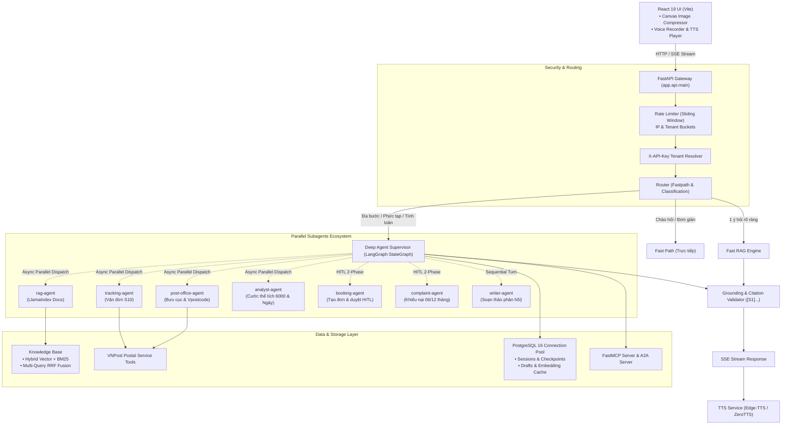

# VNPost Deep Agent Chatbot

Hệ thống Trợ lý AI Bưu chính Đa tác tử (**Multi-Agent System**) thế hệ mới phục vụ nghiệp vụ bưu chính **VNPost (Vietnam Post)**. Hệ thống kết hợp **FastAPI**, **React (Vite)**, kiến trúc điều phối **LangChain / LangGraph Deep Agents**, **LlamaIndex Advanced RAG**, giao thức **FastMCP / A2A**, cùng pipeline giọng nói **STT/TTS** và phân tích thị giác **Vision**.

> [!IMPORTANT]
> **Bảo mật thông tin:** Dự án không chứa API key, token bí mật, lịch sử chat, vector index hay dữ liệu khách hàng. Hãy sao chép `.env.example` thành `.env` và điền cấu hình hợp lệ trước khi vận hành. File `.env` đã được cấu hình trong `.gitignore` để không bao giờ bị đẩy lên kho lưu trữ.

---

## 🌟 Điểm nổi bật & Yêu cầu nghiệp vụ

Hệ thống đáp ứng trọn vẹn 5 yêu cầu cốt lõi cùng các tiêu chuẩn sẵn sàng cho môi trường Production:

1. **Deep Agent Harness (LangChain / DeepAgents):**
   - Đóng vai trò nhạc trưởng điều phối (**Agent Harness**), tự động phân tích và chia nhỏ tác vụ của người dùng (**Task Decomposition**).
   - Tự động ủy quyền công việc cho các Sub-agents chuyên trách, tổng hợp kết quả từ nhiều nguồn và định dạng câu trả lời hoàn chỉnh kèm kiểm tra độ xác thực bằng chứng (**Grounding Verification**).

2. **Hệ sinh thái Sub-Agents chuyên trách:**
   - **`rag-agent`**: Tra cứu văn bản quy chế, biểu cước, dịch vụ từ kho tri thức.
   - **`tracking-agent`**: Tra cứu trạng thái và hành trình bưu phẩm/bưu kiện theo mã vận đơn chuẩn UPU S10 và nội địa.
   - **`post-office-agent`**: Tìm kiếm mạng lưới bưu cục VNPost, mã bưu chính quốc gia Vpostcode, địa chỉ và giờ làm việc.
   - **`analyst-agent` / `calculator`**: Tính toán cước phí an toàn qua AST, áp dụng quy chuẩn quy đổi thể tích hàng cồng kềnh $(\text{Dài} \times \text{Rộng} \times \text{Cao}) / 6000$ và đối soát ngày tháng theo múi giờ UTC+7.
   - **`writer-agent`**: Soạn thảo công văn, thư phúc đáp khách hàng và tóm tắt theo quy chuẩn hành chính.
   - **`booking-agent` & `complaint-agent`**: Hỗ trợ tiếp nhận tạo đơn gửi và tra cứu quy trình khiếu nại bồi thường (thời hiệu 06 tháng nội địa, 12 tháng quốc tế).

3. **Sub-agent RAG nâng cao với LlamaIndex:**
   - Xử lý và đọc hiểu chuyên sâu các tài liệu định dạng `.docx` (giữ cấu trúc bảng biểu), `.txt` và `.pdf` (có text layer).
   - Áp dụng **Multi-Query Decomposition** phân rã câu hỏi phức tạp thành nhiều truy vấn phụ.
   - Cơ chế truy hồi lai (**Hybrid Search**) kết hợp Vector Semantic Search + BM25Plus chuẩn hóa tiếng Việt, xếp hạng hợp nhất bằng **Reciprocal Rank Fusion (RRF)** và Cross-Encoder Reranker tùy chọn (`BAAI/bge-reranker-v2-m3`).
   - Đánh dấu và trích dẫn bằng chứng cụ thể `[S1]`, `[S2]`... có đối soát từ khóa excerpt ngăn chặn ảo giác (hallucination).

4. **Thực thi song song (Parallel Subagents Execution):**
   - Deep Agent có khả năng kích hoạt đồng thời nhiều Sub-agents trong cùng một lượt chạy thông qua cơ chế gom đợt của **LangGraph** runtime và `asyncio.gather`.
   - Kiểm soát tài nguyên chặt chẽ với hàng đợi Semaphore (`max_parallel_subagents`), giới hạn số bước đồ thị (graph recursion limit) và timeout trên từng yêu cầu.

5. **Tích hợp Pipeline Voice STT & TTS Streaming:**
   - **Speech-to-Text (STT):** Nhận diện giọng nói qua Whisper API hoặc HuggingFace Inference API, nạp trực tiếp vào ngữ cảnh hội thoại.
   - **Text-to-Speech (TTS):** Chuyển đổi văn bản thành giọng nói tiếng Việt tự nhiên (hỗ trợ Edge-TTS, ZeroTTS, Kokoro), phát trực tuyến qua Server-Sent Events (SSE) hoặc endpoint `/api/tts/stream`.

6. **Sẵn sàng cho Production (Production Hardening):**
   - **Rate Limiting:** Bộ điều phối tốc độ Sliding Window (`app/core/rate_limit.py`) kiểm soát theo IP và Tenant API Key, chống giả mạo header `X-Forwarded-For`.
   - **Cơ sở dữ liệu PostgreSQL chuẩn Production:** Toàn bộ lịch sử hội thoại (`sessions`), phản hồi (`replies`), bản nháp giao dịch (`draft_bookings`, `draft_complaints`), bộ nhớ trạng thái suy luận (`checkpoints` qua `langgraph-checkpoint-postgres`), và bộ nhớ đệm vector nhúng (`embedding_cache`) đều được lưu trữ tập trung trên PostgreSQL, loại bỏ hoàn toàn các hạn chế khóa tệp của SQLite để sẵn sàng mở rộng ngang (horizontal scale).
   - **Tối ưu hình ảnh:** Client nén ảnh tự động qua HTML5 Canvas trước khi mã hóa Base64, giảm hơn 95% tải băng thông mạng.
   - **Chuẩn FastMCP & A2A:** Tích hợp máy chủ FastMCP (`app/mcp/server.py`) và giao thức Agent-to-Agent (`app/a2a/server.py`).


---

## 📐 Kiến trúc hệ thống



---

## 📂 Cấu trúc thư mục mã nguồn

```text
vnpost_deepagent/
├── app/
│   ├── api/                     # FastAPI application layer
│   │   ├── main.py              # Endpoints, middleware, SSE streaming, upload tài liệu
│   │   └── schemas.py           # Pydantic request/response schemas
│   ├── agents/                  # Multi-Agent Orchestration layer
│   │   ├── orchestrator.py      # Deep Agent Supervisor, StateGraph, Task decomposition
│   │   ├── postal_actions.py    # Bộ công cụ nghiệp vụ bưu chính (tracking, bưu cục, tra cước)
│   │   ├── calculator.py        # Công cụ tính cước hàng cồng kềnh (/6000) & ngày tháng
│   │   ├── signals.py           # Bộ nhận diện tín hiệu phân tuyến (signals)
│   │   └── subagents/           # Các Sub-agents chuyên biệt độc lập
│   │       ├── rag/             # Sub-agent RAG LlamaIndex
│   │       ├── tracking/        # Sub-agent tra cứu vận đơn
│   │       ├── post_office/     # Sub-agent mạng lưới bưu cục
│   │       ├── analyst/         # Sub-agent so sánh và tính toán
│   │       ├── writer/          # Sub-agent soạn văn bản
│   │       ├── booking/         # Sub-agent tạo đơn bưu gửi
│   │       └── complaint/       # Sub-agent khiếu nại bồi thường
│   ├── rag/                     # LlamaIndex Advanced RAG engine
│   │   ├── engine.py            # LlamaIndex query engine, Multi-Query, RRF, Hybrid search
│   │   ├── fast_rag.py          # Fast RAG pipeline cho câu hỏi đơn giản
│   │   ├── store.py             # Quản lý phiên chat (sessions) & replies trên PostgreSQL
│   │   ├── embedding_cache.py   # Bộ nhớ đệm vector nhúng BGE-M3 trên PostgreSQL
│   │   ├── reranker.py          # Cross-encoder reranking
│   │   └── vietnamese_embedding.py # Embedding tiếng Việt (BGE-M3 / local / OpenAI)
│   ├── core/                    # Hạ tầng và cấu hình hệ thống
│   │   ├── config.py            # Pydantic BaseSettings, đọc từ .env
│   │   ├── rate_limit.py        # Rate limiter theo sliding window
│   │   ├── checkpointer.py      # Checkpointer persistence (SQLite fallback cho test)
│   │   ├── postgres.py          # PostgreSQL Pool, DDL schemas, checkpointer & draft persistence
│   │   └── prompts.py           # Hệ thống prompt chuẩn hóa cho các tác tử
│   ├── mcp/                     # Chuẩn tích hợp FastMCP
│   │   ├── server.py            # FastMCP server cung cấp postal tools
│   │   ├── clients.py           # MCP client gọi công cụ bên ngoài
│   │   └── tools.py             # Đăng ký công cụ MCP
│   ├── a2a/                     # Giao thức Agent-to-Agent
│   │   └── server.py            # A2A JSON-RPC 2.0 server & agent card
│   ├── tts/                     # Voice pipeline
│   │   ├── service.py           # Chuyển đổi văn bản thành giọng nói (Edge-TTS / ZeroTTS)
│   │   └── stt.py               # Nhận diện giọng nói (Whisper API / HF)
│   └── router/                  # Bộ phân tuyến câu hỏi
│       ├── classifier.py        # Phân loại mức độ phức tạp (fast/deep)
│       └── fastpath.py          # Trả lời nhanh chào hỏi/ngày tháng tại chỗ
├── frontend/                    # Giao diện người dùng React 19 + Vite
│   ├── src/                     # React components, Canvas compression, Voice/TTS
│   ├── package.json             # Cấu hình frontend dependencies
│   └── vite.config.js           # Vite dev server proxy tới cổng 8000
├── scripts/                     # Kịch bản bảo trì & kiểm định
│   ├── seed_demo.py             # Khởi tạo dữ liệu giả lập ban đầu
│   ├── benchmark_architecture.py# Đo lường hiệu năng kiến trúc đa tác tử
│   └── reindex.py               # Tái tạo vector index cho kho tài liệu
├── tests/                       # 224+ automated test cases (Pytest)
├── compose.yaml                 # Docker Compose chạy Chatbot + PostgreSQL 16 + Qdrant v1.12
├── Dockerfile                   # Dockerfile multi-stage production build
├── .env.example                 # Mẫu cấu hình môi trường chuẩn hóa (70 biến)
└── pyproject.toml               # Quản lý dependencies dự án Python
```

---

## 🚀 Hướng dẫn cài đặt & Khởi chạy

### 1. Yêu cầu tiên quyết
- **Python**: 3.11 hoặc 3.12 (khuyên dùng Python 3.12).
- **Node.js**: Phiên bản 20+ hoặc 22+ (khi phát triển frontend).
- **Docker & Docker Compose**: (Tùy chọn, dùng khi triển khai container).

---

### 2. Triển khai bằng Docker Compose (Khuyên dùng cho Production)

Hệ thống đi kèm file [`compose.yaml`](file:///c:/Users/admin/Downloads/vnpost_deepagent/compose.yaml) chuẩn hóa Production bao gồm **PostgreSQL 16 Alpine** (lưu sessions, checkpoints, drafts, embedding cache), **Qdrant Vector Database v1.12** cùng service **Chatbot Backend**:

```bash
# 1. Sao chép cấu hình môi trường
cp .env.example .env

# 2. Điền thông tin API Key thật của bạn vào file .env

# 3. Khởi tạo và chạy toàn bộ dịch vụ ngầm
docker compose up --build -d
```

- Backend API & Web UI: [http://127.0.0.1:8080](http://127.0.0.1:8080)
- OpenAPI Swagger Docs: [http://127.0.0.1:8080/docs](http://127.0.0.1:8080/docs)
- Dữ liệu lưu trữ bền vững tại Docker volumes: `chatbot_data`, `postgres_data`, và `qdrant_data`.

---

### 3. Cài đặt và chạy cục bộ (Local Development)

#### Bước A: Thiết lập môi trường Python

**Trên Windows (PowerShell):**
```powershell
# Tạo môi trường ảo Python 3.12
py -3.12 -m venv .venv
.\.venv\Scripts\Activate.ps1

# Cài đặt mã nguồn và các gói phát triển
python -m pip install --upgrade pip
python -m pip install -e ".[dev]"

# Tạo file cấu hình từ template
Copy-Item .env.example .env

# Khởi tạo dữ liệu demo
python scripts\seed_demo.py

# Khởi chạy server FastAPI (mặc định cổng 8000)
python -m uvicorn app.api.main:app --host 127.0.0.1 --port 8000 --reload
```

Hoặc sử dụng kịch bản PowerShell có sẵn:
```powershell
.\start.ps1 -Port 8000
```

**Trên Linux / macOS:**
```bash
python3.12 -m venv .venv
source .venv/bin/activate
pip install --upgrade pip
pip install -e '.[dev]'
cp .env.example .env
python scripts/seed_demo.py
python -m uvicorn app.api.main:app --host 127.0.0.1 --port 8000 --reload
```

---

#### Bước B: Khởi chạy Giao diện Frontend (React / Vite)

```bash
cd frontend
npm install
npm run dev
```

- Giao diện Vite dev server hoạt động tại: [http://127.0.0.1:5173](http://127.0.0.1:5173).
- Toàn bộ request `/api` tự động được proxy sang backend cổng `8000`.
- Khi đóng gói cho bản production: `npm run build` (kết quả build trong `frontend/dist/` được FastAPI phục vụ trực tiếp).

---

#### Bước C: Khởi chạy FastMCP Server độc lập (Tùy chọn)

Nếu bạn muốn cung cấp các công cụ bưu chính VNPost cho các hệ thống Agent bên ngoài thông qua giao thức **Model Context Protocol (MCP)**:

```bash
python -m app.mcp
```

---

## ⚙️ Cấu hình môi trường (.env)

Hệ thống được cấu hình qua file `.env`. Mẫu [`.env.example`](file:///c:/Users/admin/Downloads/vnpost_deepagent/.env.example) đã được đồng nhất 1:1 bao gồm các nhóm biến chính:

| Nhóm cấu hình | Các biến tiêu biểu | Mô tả & Khuyến nghị Production |
|---|---|---|
| **Mô hình LLM chính** | `LLM_BASE_URL`, `LLM_API_KEY`, `LLM_MODEL` | Hỗ trợ mọi endpoint OpenAI-compatible (OpenAI, Gemini via proxy, vLLM, Ollama). |
| **Embedding & RAG** | `EMBEDDING_PROVIDER`, `EMBEDDING_MODEL` | Hỗ trợ cụm GPU nội bộ `BAAI/bge-m3` tại `https://ai.vnpost.vn/vllm-bge-m3/v1` (1024 dims), hoặc `bkai-foundation-models/vietnamese-bi-encoder`. |
| **Xếp hạng lại** | `RERANKER_ENABLED`, `RERANKER_MODEL` | Hỗ trợ Cross-Encoder `Qwen/Qwen3-Reranker-8B` tại `https://ai.vnpost.vn/vllm-qwen3-reranker-8b/rerank` (hoặc `BAAI/bge-reranker-v2-m3`). |
| **Vector Database** | `VECTOR_STORE_BACKEND`, `QDRANT_URL` | Lưu trữ vector (hỗ trợ in-memory / Qdrant chuyên dụng v1.12+). |
| **Bảo mật & Rate Limit** | `ALLOW_ANONYMOUS`, `API_KEYS_JSON`, `RATE_LIMIT_*` | Đặt `ALLOW_ANONYMOUS=false` trên production; cấu hình RPM cho chat, voice, general. |
| **Cơ sở dữ liệu & Memory** | `CHECKPOINTER_TYPE`, `POSTGRES_URL` | Mặc định `CHECKPOINTER_TYPE=postgres` và `POSTGRES_URL` cho Production (lưu trữ tập trung sessions, checkpoints, drafts và embedding cache). |
| **Voice STT & TTS** | `TTS_PROVIDER`, `VOICE_STT_PROVIDER` | Hỗ trợ `edge-tts`, `zerotts`, `whisper` cho hội thoại bằng giọng nói. |
| **Vision Đa phương thức** | `VISION_MODEL`, `VISION_BASE_URL` | Phân tích ảnh bưu gửi, hóa đơn, bảng cước. |

---

## 🧪 Kiểm thử và Đảm bảo chất lượng

Dự án sở hữu bộ kiểm thử tự động toàn diện bao phủ từ logic nghiệp vụ, RAG engine, rate limiter tới giao diện frontend:

```powershell
# 1. Chạy toàn bộ 224 unit & integration tests của Backend
python -m pytest -q

# 2. Kiểm tra chất lượng mã nguồn bằng Ruff (0 warnings/errors)
python -m ruff check app scripts tests

# 3. Kiểm thử giao diện Frontend
cd frontend
npm test

# 4. Kiểm tra biên dịch production của Frontend
npm run build
```

---

## 📖 Tài liệu kỹ thuật chuyên sâu

Để tìm hiểu chi tiết hơn về các cơ chế kỹ thuật nội bộ, vui lòng tham khảo các tài liệu trong thư mục `docs/`:

- [Kiến trúc chi tiết hệ thống](file:///c:/Users/admin/Downloads/vnpost_deepagent/docs/ARCHITECTURE.md) (`docs/ARCHITECTURE.md`): Phân tích chi tiết luồng xử lý, supervisor, semaphore, state persistence và trích dẫn bằng chứng.
- [Hợp đồng API & Đặc tả](file:///c:/Users/admin/Downloads/vnpost_deepagent/docs/API.md) (`docs/API.md`): Chi tiết toàn bộ endpoints REST, SSE streaming, authentication, format tải file và schema.
- [Định tuyến & Mở rộng quy mô](file:///c:/Users/admin/Downloads/vnpost_deepagent/docs/ROUTING_AND_SCALE.md) (`docs/ROUTING_AND_SCALE.md`): Chiến lược phân tải Fast Path vs Deep Agent và mở rộng ngang với Postgres/Qdrant.
- [Báo cáo đánh giá kiến trúc](file:///c:/Users/admin/Downloads/vnpost_deepagent/docs/ARCHITECTURE_REVIEW.md) (`docs/ARCHITECTURE_REVIEW.md`): Đánh giá bảo mật, hiệu năng và các điểm tối ưu hóa hệ thống.

---

## 🛡️ Giấy phép & Bản quyền

Dự án phát triển phục vụ giải pháp trợ lý ảo bưu chính thông minh cho VNPost. Vui lòng bổ sung giấy phép bản quyền phù hợp trước khi triển khai phân phối ra công chúng.
