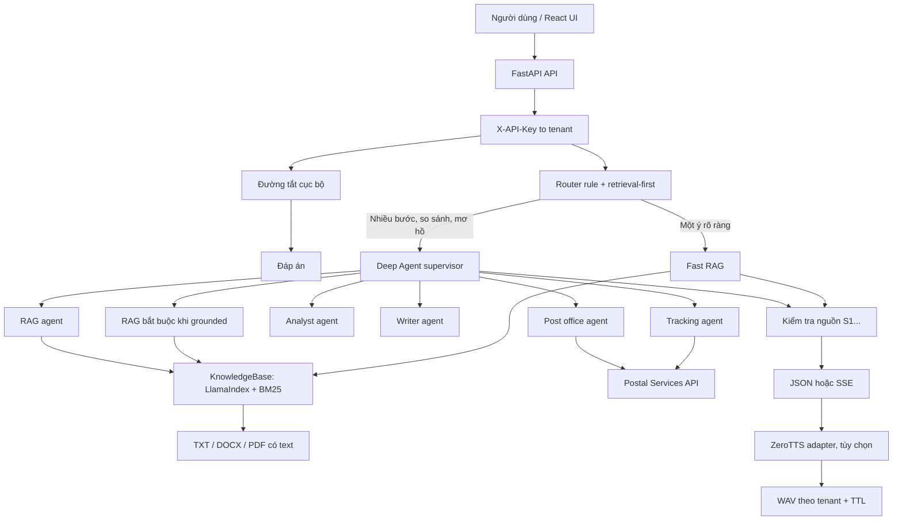

# Kiến trúc chatbot Deep Agent + RAG + ZeroTTS

Phiên bản 1.1. Tài liệu này mô tả ứng dụng đang chạy ở thư mục gốc: FastAPI trong `app/`, giao diện React trong `frontend/` và các dịch vụ LLM/embedding/ZeroTTS bên ngoài. Nó không mô tả một hệ thống Kubernetes, A2A hay MCP riêng.

Mục tiêu là chọn đường xử lý nhỏ nhất nhưng vẫn có bằng chứng: câu đơn giản trả lời cục bộ hoặc Direct RAG; chỉ yêu cầu nhiều bước, so sánh, tính toán hoặc mơ hồ mới đi qua Deep Agent. Với câu hỏi nghiệp vụ có bật `grounded`, câu trả lời chỉ được trả khi có nguồn hợp lệ.

## 1. Thành phần đang triển khai

| Thành phần | Trách nhiệm thực tế |
|---|---|
| FastAPI | `/api/chat`, `/api/chat/stream`, quản lý tài liệu, phiên, TTS và audio; frontend được phục vụ cùng origin khi đã build. |
| Router | Rule/retrieval-first mặc định, không gọi LLM. LLM router là thử nghiệm, chỉ chạy khi `LLM_ROUTER_ENABLED=true`. |
| Fast path | Trả lời chào hỏi, phép tính hoặc ngày tháng đủ chắc chắn mà không gọi LLM/RAG. |
| Fast RAG | Một lần retrieval rồi một lượt LLM streaming/không streaming cho câu một ý. Thiếu bằng chứng có thể leo thang Deep Agent. |
| Deep Agent | `create_deep_agent` điều phối `rag-agent`, `analyst-agent`, `writer-agent`, `tracking-agent`, `post-office-agent`; có giới hạn bước, timeout và ngân sách task. |
| RAG | Đọc TXT, DOCX (gồm bảng) và PDF có text layer; hybrid vector + BM25, RRF và reranker tùy chọn. |
| TTS | Gọi ZeroTTS; gửi đáp án chữ trước, âm thanh lỗi không làm mất đáp án chữ. |

## 2. Luồng định tuyến và trả lời

1. API xác thực `X-API-Key` và ánh xạ khóa sang tenant. Browser không truyền tenant vào body hoặc tool.
2. Nếu nhận diện được chào hỏi, phép tính hoặc ngày tháng đơn giản, `fastpath` trả lời tại chỗ.
3. Với `mode=fast` hoặc một yêu cầu một ý trong `mode=auto`, Fast RAG lấy nguồn trước. Cổng bằng chứng kiểm tra số nguồn và ngưỡng điểm; không đủ thì chuyển sang Deep Agent.
4. Với `mode=deep`, yêu cầu dài, nhiều câu hỏi, so sánh, hình ảnh hoặc suy luận thời gian, hệ thống gọi Deep Agent. Khi `grounded=true`, backend bắt buộc retrieval trước supervisor và nạp excerpt có mã `[S...]` vào lượt hiện tại.
5. Kết quả đi qua kiểm tra citation: mã nguồn phải tồn tại và excerpt phải có đủ từ khóa hỗ trợ; citation không đạt bị loại. Nếu thiếu bằng chứng nghiệp vụ, hệ thống trả mẫu `[[NO_EVIDENCE]]` đã chuẩn hóa. Với các tác vụ thời gian thực từ `tracking-agent` hoặc `post-office-agent`, kết quả được gán trạng thái `grounding_status="computed"` đảm bảo tính xác thực mà không đòi hỏi trích đoạn tài liệu tĩnh.
6. API lưu câu trả lời/nguồn theo tenant và phiên. Với SSE, event `answer` được gửi trước synthesis; sau đó là `speech_ready` hoặc `speech_error`, rồi `done`.

`router_enabled` không làm LLM router thành mặc định: LLM router là opt-in và tắt mặc định.

## 3. Deep Agent và chạy đồng thời

| Agent | Công cụ | Vai trò |
|---|---|---|
| `rag-agent` | `search_documents` | Tìm bằng chứng mới từ kho tri thức, trả excerpt và `[S...]`. |
| `analyst-agent` | `calculate`, `calculate_date` | So sánh bằng chứng, số học và ngày tháng an toàn. |
| `writer-agent` | Không có công cụ | Soạn/tóm tắt từ dữ liệu đã được giao. |
| `tracking-agent` | `track_item` | Tra cứu hành trình bưu phẩm/bưu kiện theo mã vận đơn chuẩn UPU S10 hoặc nội địa. |
| `post-office-agent` | `lookup_post_office` | Tra cứu mạng lưới bưu cục VNPost, mã Vpostcode, địa chỉ và giờ mở cửa. |

Prompt hiện hành yêu cầu supervisor chỉ giao việc qua `parallel_tasks`. Việc độc lập được gom batch và chạy bằng `asyncio.gather`; việc phụ thuộc chờ batch trước. `create_deep_agent` là harness nền, nhưng không nên mô tả native `task` là cơ chế điều phối chính của ứng dụng.

Mỗi request có `RunContext` riêng: tenant, session, registry nguồn, cache retrieval, semaphore và ngân sách. Cấu hình mẫu giới hạn 3 sub-agent đồng thời và 8 task/request; đây không phải năng lực chịu tải đã chứng minh. Sub-agent lỗi trả trạng thái kiểm soát, không làm lộ lỗi provider hoặc prompt.

## 4. Dữ liệu và RAG

- TXT được tách theo đoạn/dòng.
- DOCX giữ thứ tự đoạn và bảng; dữ liệu bảng mang cả tên cột.
- PDF được đọc bằng `pypdf` theo trang khi có text layer. PDF scan hoặc không trích được chữ bị từ chối; OCR chưa có trong root app.
- Upload thông thường là nguồn người dùng. `/api/documents/verified` chỉ nhận nguồn `official_public` từ HTTPS thuộc domain cấu hình, bằng khóa quản trị riêng. `/api/documents/s3` nhận URL presigned hoặc bucket/key.

`SentenceSplitter` chỉ là fallback cho đơn vị cấu trúc quá dài. RAG giữ nguyên đơn vị cấu trúc: đoạn/dòng của TXT, đoạn hoặc hàng bảng của DOCX và trang của PDF. `CHUNK_SIZE=256` và `CHUNK_OVERLAP=64` không phải cách cắt mặc định toàn bộ tài liệu; chúng chỉ áp dụng khi một đơn vị cấu trúc vượt ngưỡng, để vẫn nằm trong giới hạn embedding của `bkai-foundation-models/vietnamese-bi-encoder`.

RAG kết hợp vector retrieval và BM25Plus đã chuẩn hóa dấu tiếng Việt, sau đó RRF hợp nhất thứ hạng. `RETRIEVAL_TOP_K` mặc định là 5. Reranker cross-encoder `BAAI/bge-reranker-v2-m3` chỉ chạy khi `RERANKER_ENABLED=true`; khi bật, tối đa `RERANKER_CANDIDATE_K` ứng viên được xếp lại trước khi chọn top K.

Embedding cache SQLite tách namespace query/document/model/revision. Index được build snapshot mới rồi đổi con trỏ nguyên tử. Index LlamaIndex và BM25 hiện nằm trong process, phù hợp pilot một instance.

## 5. Bằng chứng, quyền và dữ liệu nhạy cảm

Mỗi hit được đăng ký trong request dưới mã `[S1]`, `[S2]`...; chỉ mã thực sự được dùng và vượt kiểm tra hỗ trợ mới trả về client. Kiểm tra này không thay thế đánh giá entailment nghiệp vụ bởi con người.

Tenant là ranh giới hiện có: API key chọn tenant, kho/index/audio/session được tách theo tenant. Đây **không phải** SSO, RBAC theo người dùng hoặc ACL theo tài liệu/phòng ban. Không đưa tài liệu mật đa cấp vào hệ thống cho đến khi ACL được lấy từ hệ thống định danh đáng tin cậy và được lọc ngay trong retrieval, trước khi nội dung tới LLM.

## 6. TTS và streaming

ZeroTTS dùng base URL cấu hình (mặc định `https://ai.vnpost.vn/zero-tts`) và các endpoint `/tts`, `/tts/stream`, `/v1/audio/speech`, `/voices` tùy mode. Client giới hạn timeout, số kết nối đồng thời, số ký tự và số byte audio; không retry POST synthesis. WAV lưu theo tenant và chỉ tải qua API đã xác thực, với TTL.

Chat SSE chỉ stream token ở Fast RAG. Deep Agent phát event tiến trình và câu trả lời đã kiểm tra, không phát chain-of-thought. Ứng dụng chưa có ASR; cần xây thành dịch vụ độc lập nếu muốn nhận câu hỏi qua micro.

## 7. Cấu hình và kiểm chứng

LLM dùng endpoint OpenAI-compatible qua `ChatOpenAI`; Deep Agent yêu cầu tool/function calling. `scripts/check_services.py --live` cần chạy trước pilot live. Demo dùng model kịch bản và embedding hash để kiểm luồng, không là bằng chứng chất lượng nghiệp vụ.

Trước nghiệm thu, cần bộ 100–200 câu do nghiệp vụ gán đáp án và nguồn đúng, gồm câu trực tiếp, paraphrase, bảng/số liệu, so sánh, không có đáp án và nguồn mâu thuẫn. Đo Recall@K/MRR@K bằng `scripts/evaluate_retrieval.py`, sau đó chấm câu trả lời, nguồn, p50/p95, chi phí và độ trễ TTS trên dịch vụ thật.

## 8. Lộ trình mở rộng

Khi mở rộng, giữ các nguyên tắc: route theo bằng chứng thay vì mặc định gọi nhiều agent; fan-out có giới hạn; ACL fail-closed trước retrieval; logs không ghi toàn bộ nội dung nhạy cảm; ingestion bất đồng bộ và có version; TTS tách dịch vụ khi dùng GPU riêng.

Chưa nằm trong root app: vector database (Qdrant/pgvector), PostgreSQL/Redis, queue/worker ingestion, OCR, ASR, SSO/RBAC/ACL tài liệu, multi-instance, audit log đầy đủ, tracing token/cost và entailment tự động. Khi cần các năng lực này, thay index RAM bằng vector store có metadata filter, lưu catalog/version ở database và đưa ingestion vào worker; không tăng số Uvicorn worker khi state session/KB vẫn nằm trong process.

## 9. Tài liệu liên quan

- `README.md`: chạy, cấu hình và giới hạn pilot.
- `docs/API.md`: hợp đồng API.
- `docs/ROUTING_AND_SCALE.md`: định tuyến và hướng mở rộng.
- `docs/VALIDATION.md`: phạm vi kiểm thử và những điều chưa xác nhận trên dịch vụ thật.