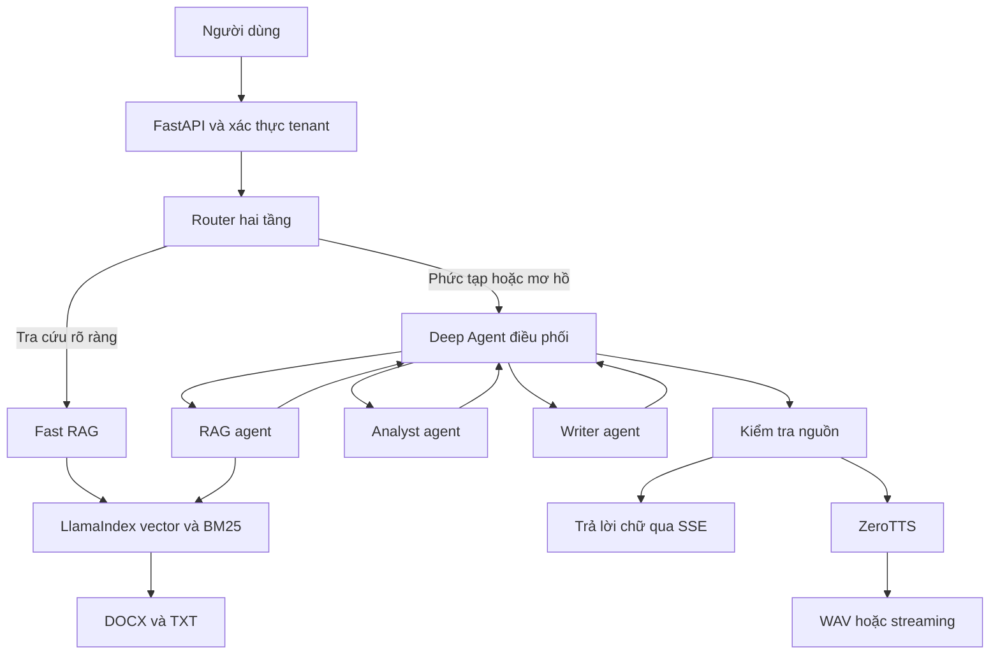

# Kiến trúc chatbot Deep Agent với RAG và ZeroTTS

Phiên bản 1.0.0. Thiết kế dành cho nhóm phát triển triển khai một chatbot tra cứu tài liệu tiếng Việt, có phân công nhiều agent và đầu ra giọng nói. Hệ thống dùng Deep Agents làm harness điều phối, LlamaIndex làm lớp tài liệu/vector và ZeroTTS làm dịch vụ âm thanh.

Thiết kế ưu tiên một luồng có thể kiểm tra: truy vấn → bằng chứng → phân tích khi cần → câu trả lời có nguồn → giọng đọc. Số agent được chọn theo yêu cầu; không chạy tất cả chuyên viên cho một câu hỏi đơn giản. Chọn model cuối cùng dựa trên dữ liệu và hạ tầng thật, thay vì mặc định thêm model lớn ở mọi bước.

## 1 Thành phần đã triển khai

Mỗi request có context riêng gồm tenant, nguồn, budget task và sự kiện tiến trình. Sub-agent có context nhiệm vụ độc lập; supervisor nhận kết quả gọn. Các công cụ của Deep Agent chỉ chạm vào filesystem ảo của StateBackend. File DOCX/TXT thật do lớp RAG đọc trong phạm vi tenant đã xác thực, không được mở bởi lệnh tùy ý từ LLM.

Router dùng hai tầng. Tầng quy tắc nhận ngay hình ảnh, câu hỏi nhiều phần, so sánh, tính toán và yêu cầu soạn thảo; đồng thời chỉ cho Fast RAG với các mẫu tra cứu một ý có độ chắc chắn cao. Các câu còn lại được gọi một LLM router riêng với JSON nhỏ, nhiệt độ 0 và timeout ngắn. Nếu router lỗi, không trả JSON hợp lệ hoặc độ tin cậy dưới ngưỡng, hệ thống chọn Deep Agent thay vì đoán Fast RAG. Vì vậy router không chỉ dò từ khóa, nhưng cũng không tăng một lượt LLM cho những câu rõ ràng. Sự kiện `router_decision` ghi route, chiến lược và độ tin cậy để đánh giá sau pilot.

| Thành phần | Đầu vào | Đầu ra | Công cụ hoặc cơ chế |
|---|---|---|---|
| Supervisor | Yêu cầu và hội thoại ngắn | Kế hoạch nhỏ, tổng hợp kết quả | `create_deep_agent`, `task`, `parallel_tasks` |
| RAG agent | Nhiệm vụ tra cứu | Bằng chứng, vị trí và `[S...]` | Hybrid BM25/vector → cross-encoder reranker → LlamaIndex |
| Analyst agent | Bằng chứng và số liệu đã có | So sánh, nhận xét, phép tính | Calculator AST giới hạn |
| Writer agent | Bằng chứng/yêu cầu đã cho | Bản soạn hoặc tóm tắt | Model, không thêm công cụ tài liệu |
| Kiểm tra nguồn | Đáp án và registry nguồn | Đáp án hoặc thông báo thiếu nguồn | Kiểm tra ID, lựa chọn đúng nguồn đã trích |
| ZeroTTS adapter | Văn bản cuối cùng | WAV hoặc stream | API từ Postman, timeout và giới hạn byte |

Trong registry, `general-purpose` được thay bằng writer có giới hạn chung, để lời gọi `task` chuẩn không tạo một chuyên viên ngoài budget. Analyst và writer là graph LangChain đã compile; RAG là agent LangChain dùng tool LlamaIndex. Đây là cách tích hợp `CompiledSubAgent` vào Deep Agents, không phải framework agent tự viết thay thế Deep Agents.

## 2 Phân công và chạy đồng thời

Supervisor có thể phát nhiều lời gọi `task` trong cùng lượt. Ngoài ra, `parallel_tasks` nhận danh sách `TaskSpec`, chạy các graph qua `asyncio.gather`, trả kết quả theo thứ tự đầu vào. Với câu hỏi Deep ở chế độ cần nguồn, backend thực hiện một lượt RAG bắt buộc trước supervisor rồi đưa excerpts có mã `[S...]` vào context; điều này không cho phép model bỏ qua retrieval và trả lời quy định nội bộ từ trí nhớ. Sau đó supervisor vẫn tự chọn các task analyst/writer và các RAG task bổ sung khi câu hỏi cần nhiều hướng tra cứu. Semaphore giới hạn tối đa ba chuyên viên đang chạy trong một request và budget mặc định tám lần giao nhiệm vụ. Timeout và giới hạn bước dừng vòng agent kéo dài.

Ví dụ “So sánh điều kiện hoàn cước của dịch vụ A và B, rồi viết câu trả lời cho khách hàng” được xử lý thành các đợt:

1. Hai RAG task tìm điều kiện A và B cùng lúc.
2. Khi đủ hai bằng chứng, analyst so sánh, giữ mã nguồn và đơn vị số liệu.
3. Supervisor trả lời trực tiếp hoặc giao writer nếu có yêu cầu văn phong cụ thể.
4. Kiểm tra nguồn, gửi chữ, rồi gọi TTS nếu người dùng bật voice.

Chạy analyst trước khi có số liệu hoặc chạy writer trước khi có bằng chứng làm tăng nguy cơ đoán sai. Những phụ thuộc này được nêu trong prompt; runtime giới hạn concurrency/budget nhưng không tự chứng minh kế hoạch LLM là tối ưu. Test riêng xác nhận lời gọi native `task` và dispatcher bổ sung thực sự có các khoảng thời gian chạy chồng nhau.

Một sub-agent lỗi sẽ trả trạng thái lỗi có kiểm soát. Các kết quả khác vẫn được giữ để supervisor sử dụng. Trace chỉ gồm nhiệm vụ, trạng thái, thời gian và số nguồn; không phát chain-of-thought hay khóa API ra giao diện.

## 3 Dữ liệu và RAG

TXT được đọc UTF-8, chia theo phạm vi dòng. DOCX được đọc theo thứ tự đoạn và bảng, giữ tên mục, số đoạn, số bảng và hàng. Dòng dữ liệu bảng mang cả tên cột để tránh mất ý nghĩa số liệu. Không suy đoán số trang DOCX vì số trang phụ thuộc layout và trình dựng Word.

LlamaIndex `SentenceSplitter` tạo các node với kích thước khởi điểm 512 token đếm theo tokenizer regex và overlap 64. Đây là đơn vị đếm nội bộ để chia đoạn, không phải số token tính phí của LLM. Node giữ `document_id`, `filename`, `location`; ID chunk được hash từ nội dung và vị trí. Metadata dùng để trích nguồn được loại khỏi chuỗi embedding để tên file không lấn át nội dung.

Sau khi nhập tài liệu, `VectorStoreIndex` tạo/lưu vector. Khi truy vấn, retriever LlamaIndex lấy ứng viên semantic và BM25Plus lấy ứng viên từ khóa đã chuẩn hóa dấu tiếng Việt. Reciprocal Rank Fusion kết hợp thứ hạng với hằng số 60; trả tối đa năm chunk mặc định. Threshold vector 0,35 là giá trị khởi điểm cần hiệu chỉnh, không phải xác suất đúng hay tiêu chuẩn chung cho mọi model.

BM25 hỗ trợ mã dịch vụ và cụm từ chính xác; vector hỗ trợ cách diễn đạt khác. Sau RRF, tối đa 15 đoạn ứng viên được rerank bởi cross-encoder đa ngôn ngữ `BAAI/bge-reranker-v2-m3` trên GPU và chỉ năm đoạn đầu đi vào LLM. Reranker đọc cặp câu hỏi–đoạn thay vì vector độc lập, vì vậy cải thiện thứ hạng nhưng không thay thế bộ đánh giá nghiệp vụ. Điểm reranker không phải xác suất câu trả lời đúng. Kiểm thử câu paraphrase, mã bưu gửi và chính sách gần tên nhau trước khi thay model hoặc fine-tune.

Cache embedding SQLite lưu hash và vector, tách khóa truy vấn/đoạn tài liệu và namespace model/endpoint/revision. Upload mới có thể tái dùng vector của các chunk không đổi. Index được rebuild trong snapshot riêng rồi chuyển con trỏ nguyên tử; truy vấn đọc snapshot cũ trong lúc nhập file. Nếu embedding lỗi, tài liệu mới không được công bố vào KB và file vừa ghi bị gỡ.

## 4 Nguồn và độ chính xác

Mỗi lần retrieval đăng ký nguồn tại context của request và nhận mã `[S1]`, `[S2]`. Supervisor chỉ được trích các ID thực có trong registry. Kết quả chỉ gửi những nguồn đã xuất hiện trong đáp án. Khi người dùng chọn chế độ tài liệu mà đáp án thiếu nguồn, backend trả thông báo chưa đủ bằng chứng.

Các kiểm tra trên phát hiện nguồn giả và thiếu nguồn. Chúng không kiểm tra entailment của mọi câu với tài liệu, cũng không giải quyết tự động tài liệu lỗi thời hoặc xung đột. Cần đánh giá thủ công câu trả lời trên bộ câu hỏi nghiệp vụ, gồm câu có đáp án, không có đáp án, nguồn mâu thuẫn và tài liệu có chỉ dẫn độc hại. LLM được hướng dẫn coi chỉ dẫn trong tài liệu là dữ liệu; không nên coi prompt là bảo đảm tuyệt đối chống mọi dạng injection.

Tính toán dùng AST với toán tử được phép, không dùng `eval`/`exec`, giới hạn độ dài biểu thức, số node, số mũ và kết quả. Điều này tránh sai số học do LLM tự tính; lựa chọn đúng số liệu và đơn vị vẫn là trách nhiệm của agent và bộ đánh giá nghiệp vụ.

## 5 TTS và thời gian đáp ứng

API trong Postman có URL gốc `https://ai.vnpost.vn/zero-tts`. Adapter giữ tiền tố này khi gọi `/tts`, `/tts/stream`, `/v1/audio/speech` và `/voices`. Payload OpenAI speech dùng đúng `model: ZeroTTS`, `input`, `voice`, `response_format: wav` và `speed: 1.0`.

Văn bản được gửi qua event `answer` trước khi bắt đầu chờ synthesis. Sau đó gửi `speech_ready` hoặc `speech_error`, rồi `done`. Lỗi TTS không làm mất đáp án chữ. REST `/api/chat` trả khi hoàn tất cả bước được yêu cầu; nên dùng SSE khi quan tâm thời gian thấy chữ.

Giao diện mặc định đọc WAV đầy đủ để dễ kiểm tra file; người dùng cũng có thể chọn streaming. Parser RIFF nhận header qua nhiều chunk, đọc `fmt`, bỏ qua các chunk metadata và giữ byte lẻ. Sample rate được lấy từ WAV. Thời gian nhận PCM đầu tiên được đo thực trên client; chưa đo độ trễ vật lý của loa.

TTS có timeout tổng, giới hạn ký tự và byte, không retry POST, giới hạn kết nối đồng thời. Âm thanh được lưu theo tenant và kiểm tra TTL khi tải. Bản hiện tại dùng giọng nói để trả lời; nếu cần nhập câu hỏi bằng micro thì bổ sung ASR thành dịch vụ độc lập trước API chat.

## 6 Vì sao kiến trúc này tiết kiệm thời gian

Supervisor chọn số chuyên viên theo yêu cầu thay vì luôn qua một chuỗi cố định. Công việc độc lập chạy đồng thời; nhiều bước truy xuất ở sub-agent không làm phình context chính. Top K và số task được giới hạn. Embedding được batch/cache; không nạp lại index và model trong mỗi câu hỏi. Ingestion và retrieval đồng bộ được đưa ra worker thread để không chặn event loop.

Tổng thời gian một đợt độc lập xấp xỉ thời gian của task lâu nhất cộng phần điều phối, thay vì tổng tất cả task. Tuy nhiên, chạy nhiều task vẫn tăng số token/call và có thể chạm rate limit hoặc tranh tài nguyên GPU. Giá trị ba task đồng thời là cấu hình khởi điểm; giảm khi model server chỉ xử lý hiệu quả một hoặc hai request.

Không thể cam kết độ trễ thực của LLM/TTS từ test offline. Với RAG agent hiện tại, một câu tra cứu thường có lượt supervisor giao việc, lượt RAG gọi tool, lượt RAG tổng hợp và lượt supervisor trả lời. Nếu benchmark cho thấy overhead lớn, có thể thay RAG bằng compiled graph retrieval trước rồi synthesis một lượt, giữ cùng hợp đồng bằng chứng và registry.

## 7 Cấu hình model và hạ tầng

Điểm tích hợp LLM là API OpenAI-compatible qua `ChatOpenAI`; bắt buộc tool calling. Có thể chạy dịch vụ nội bộ hoặc nhà cung cấp ngoài theo chính sách dữ liệu của đơn vị. `SUBAGENT_MODEL` cho phép dùng model nhẹ hơn cho các task chuyên môn. Model phải được kiểm tra về tool schema, tiếng Việt, các con số và khả năng tuân thủ nguồn trước khi sử dụng.

Embedding có hai lựa chọn thật: server OpenAI-compatible hoặc HuggingFace cục bộ. Reranker đã được tích hợp nhưng phải được so sánh với cấu hình hybrid-only trên cùng dữ liệu VNPost; chỉ giữ bật nếu tăng Recall@K/MRR hoặc độ đúng câu trả lời đủ bù phần tăng độ trễ. Không coi tên model đa ngôn ngữ là bằng chứng thay thế evaluation.

Khi dùng một GPU cho LLM, embedding và ZeroTTS, cần đo tải chồng nhau trước khi tăng concurrency. Bản code không gắn chặt vào một cấu hình GPU. Tách ZeroTTS thành dịch vụ đã có sẵn giúp chatbot không phải nạp thêm model âm thanh vào process điều phối.

## 8 Lưu trữ và cách ly

API key được ánh xạ tới tenant trên server. Client không truyền tenant trong body hoặc tool. Tài liệu/index và audio đặt trong thư mục tenant; mọi truy vấn session/reply/audio dùng điều kiện tenant. ContextVar giữ registry nguồn riêng cho từng request. Một khóa có thể đại diện một đơn vị; người cùng tenant chia sẻ quyền của tenant.

SQLite lưu hội thoại rút gọn, bản sao nguồn và kết quả trả lời. Các request cùng phiên được khóa nối tiếp để không ghi đè lượt hội thoại. Chỉ lịch sử user/assistant được gửi lại cho LLM; không lưu toàn bộ vòng tool/filesystem của harness. Browser giữ khóa truy cập trong RAM và tải audio bằng header, không đưa khóa vào URL.

Mã nguồn hiện dùng khóa chia sẻ theo tenant, không có SSO hay RBAC theo từng nhân viên/tài liệu. Cần authentication theo người dùng và ACL tài liệu khi đưa vào hệ thống nội bộ có nhiều mức quyền. Việc cách ly tenant trong code đã có kiểm thử riêng; khả năng chịu tải nhiều process chưa được thực hiện.

## 9 Đánh giá trước khi chốt cấu hình

Tạo bộ 100–200 câu do người nghiệp vụ gán đáp án và nguồn. Tách tập điều chỉnh và tập kiểm tra cuối cùng để không chỉnh tham số trên cùng dữ liệu báo cáo. Bao gồm câu hỏi tra cứu trực tiếp, paraphrase tiếng Việt, bảng/số liệu, so sánh hai tài liệu, câu không có đáp án, câu thiếu dữ kiện, nguồn mâu thuẫn và lượt hỏi tiếp.

| Nhóm chỉ số | Đo gì | Cách đánh giá |
|---|---|---|
| Retrieval | Đoạn đúng có xuất hiện, đứng thứ mấy | Recall@K, MRR@K, mẫu JSONL đã gán nguồn |
| Câu trả lời | Sự kiện, số liệu và đơn vị đúng | Người nghiệp vụ chấm theo đáp án chuẩn |
| Nguồn | Mã tồn tại và nguồn thực hỗ trợ câu | Kiểm tra runtime cộng đánh giá entailment thủ công |
| Thiếu thông tin | Từ chối hoặc hỏi thêm khi cần | Bộ câu không có đáp án/thiếu dữ kiện |
| Độ trễ | Thấy chữ, âm thanh, kết thúc | p50/p95 ở tải 1 rồi 2 rồi 4 request |
| Chi phí | Call, token, RAM/VRAM và synthesis | Log provider và theo dõi hạ tầng thật |

`evaluate_retrieval.py` đã có để đo retrieval; đánh giá chất lượng cuối cùng cần người nghiệp vụ. Mục tiêu nghiệm thu phải được thống nhất theo use case, không tự đặt một tỷ lệ đúng cao rồi coi test nhỏ là bằng chứng. Không dùng thông tin “streaming khoảng 0,3 giây” từ Postman làm KPI đã đo của chatbot.

## 10 Mở rộng khi pilot vượt giới hạn

Bản 1.0.0 phù hợp một instance với giới hạn ban đầu 200 file, 10 triệu ký tự/tenant. Đây là giới hạn bảo vệ khởi điểm; cần đo bộ tài liệu thực để định kích thước RAM và thời gian indexing. Chạy `--workers 1`, vì khóa session và trạng thái KB nằm trong process.

Khi tăng kho hoặc số người dùng, thay index RAM bằng Qdrant/pgvector hoặc vector store phù hợp qua LlamaIndex, thay catalog bằng PostgreSQL và quản lý khóa/cache/queue qua Redis. Tách worker ingestion để API upload trả job ID ngay; dùng upsert/delete theo document thay vì rebuild toàn snapshot. Thêm ACL vào filter retrieval trước khi nội dung tới LLM, không lọc sau khi đã trả lời.

Các hạng mục này là hướng mở rộng, chưa nằm trong code hiện tại: OCR cho PDF scan, ASR, SSO/RBAC, multi-instance, ingestion job queue, tracing token/cost tự động và kiểm tra entailment tự động. Chúng không phải điều kiện để chạy pilot DOCX/TXT với Deep Agents và TTS hiện có.

## 11 Đối chiếu code TTS ban đầu

ZIP đầu vào chỉ có frontend ZeroTTS. Chưa có code backend agent hay RAG. Postman đã cung cấp đủ các endpoint cần cho trả lời giọng nói, nhưng chưa cung cấp LLM, embedding hay dữ liệu nghiệp vụ để đo chất lượng thật.

Các điểm đã xử lý ở bộ code mới: proxy TTS tại backend để giữ khóa, giữ path `/zero-tts`, đo PCM đầu tiên thay vì gán giá trị fallback 0,3 giây, parse WAV nhiều chunk thay vì bỏ 44 byte ở chunk đầu, dùng sample rate từ header, giữ đáp án chữ khi voice lỗi. Health hiện báo liveness và cấu hình; không suy ra GPU từ trường `active_providers` khi mẫu Postman dùng `providers`.

## 12 Tài liệu kỹ thuật tham khảo

- Deep Agents Subagents: https://docs.langchain.com/oss/python/deepagents/subagents
- Deep Agents Customization: https://docs.langchain.com/oss/python/deepagents/customization
- Deep Agents package: https://pypi.org/project/deepagents/
- LlamaIndex Retriever: https://developers.llamaindex.ai/python/framework/module_guides/querying/retriever/
- LlamaIndex OpenAI Embedding: https://developers.llamaindex.ai/python/framework-api-reference/embeddings/openai/
- API ZeroTTS: collection Postman do người dùng cung cấp, bản đối chiếu trong `reference/ZeroTTS.postman_collection.json`.

Dependency chính được pin theo các phiên bản đã cài và kiểm tra trong bộ bàn giao. `requirements.lock.txt` ghi môi trường kiểm thử; tên package/hành vi đã đối chiếu với tài liệu và API thư viện đang cài.
