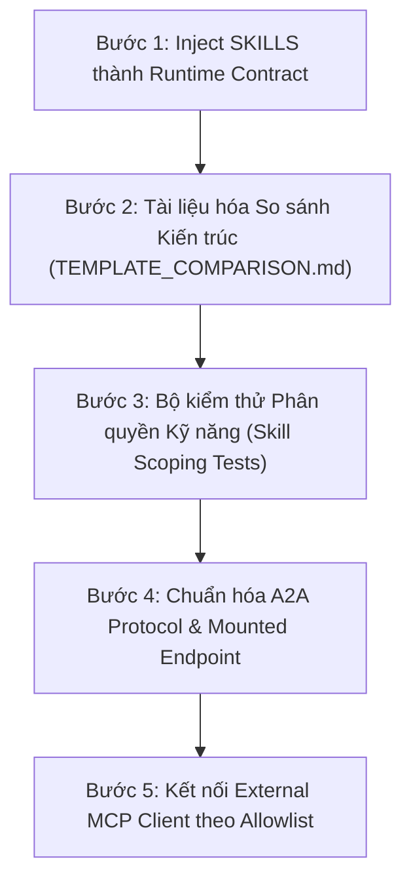

# PHÂN TÍCH SO SÁNH KIẾN TRÚC: VNPOST DEEP AGENT VS AGENT.TEMPLATE

> **Tài liệu tham chiếu kỹ thuật dành cho Mentor & Ban Dự án**  
> **Phiên bản:** 1.0.0  
> **Ngày lập:** 21/10/2026  
> **Dự án:** Trợ lý ảo AI Bưu điện Việt Nam (Mipo VNPost Deep Agent)

---

## 1. TỔNG QUAN VÀ BỐI CẢNH DỰ ÁN

`agent.template` (mẫu `hello-goodbye-agent`) là dự án mẫu chuẩn hóa được Mentor cung cấp nhằm minh họa các nguyên lý cốt lõi khi xây dựng một AI Agent độc lập:
* Khởi tạo và quản lý vòng đời ứng dụng bằng FastAPI Lifespan.
* Đóng gói và giao tiếp liên Agent qua giao thức **Agent-to-Agent (A2A)** (`/a2a`).
* Nạp công cụ động từ các dịch vụ bên ngoài thông qua **Model Context Protocol (MCP Client)**.
* Giám sát phân tán bằng **OpenTelemetry** (OTel exporter + OTLP HTTP) và quản trị prompt bằng **MLflow Prompt Registry**.

Hệ thống **VNPost Deep Agent** hiện tại được phát triển chuyên biệt để giải quyết trọn vẹn bài toán vận hành logistics, bưu chính và dịch vụ khách hàng cấp doanh nghiệp của **Tổng công ty Bưu điện Việt Nam (VNPost)**. Thay vì "ép" dự án quay trở lại mô hình tác tử đơn thể (Single Agent) tối giản của template, kiến trúc VNPost đã kế thừa các triết lý thiết kế quan trọng từ template, đồng thời chuyên biệt hóa và mở rộng thành một **Hệ sinh thái Đa tác tử phân cấp (Hierarchical Deep Agent)** với các năng lực nghiệp vụ nâng cao.

---

## 2. BẢNG SO SÁNH CHI TIẾT (HEAD-TO-HEAD COMPARISON)

| Hạng mục tiêu chí | Template Mentor (`agent.template`) | Dự án VNPost Deep Agent hiện tại | Nhận xét kiến trúc & Đánh giá |
| :--- | :--- | :--- | :--- |
| **1. Agent Core Architecture** | **Single Agent** độc lập (`agent.agent.Agent.create`), xử lý tuần tự qua ReAct loop đơn thể. | **Hierarchical Deep Agent** gồm 1 Supervisor (`vnpost-supervisor`) và 7 Sub-agents chuyên trách nội bộ (`rag`, `analyst`, `tracking`, `post-office`, `booking`, `complaint`, `writer`) cùng điều phối song song (`parallel_tasks`). | **VNPost vượt trội về năng lực phân rã nghiệp vụ phức tạp:** Tách biệt rõ ràng miền trách nhiệm; Supervisor điều phối song song giúp giảm đáng kể độ trễ khi xử lý các câu hỏi phức hợp (ví dụ vừa tra cước vừa tìm bưu cục). |
| **2. Giao diện & Giao thức (API & Protocols)** | Mount 2 endpoint chính: `/chat` (chat streaming) và `/a2a` (chuẩn A2A server cho remote agent gọi vào). | Hệ thống API phong phú: `/api/chat` (SSE Streaming + Prefetched Sources), `/api/actions/*` (HITL Action state machine), `/ws/audio` (Zero-shot TTS & STT), `/agent-card.json`. | **VNPost đáp ứng trải nghiệm người dùng cuối tốt hơn:** Hỗ trợ thoại hai chiều (Voice), xác nhận hành động có con người giám sát (HITL) và streaming thời gian thực. Template mạnh hơn ở tính chuẩn hóa liên Agent qua A2A. |
| **3. Model Context Protocol (MCP)** | Đóng vai trò **MCP Client**: Nạp công cụ động từ các server MCP bên ngoài lúc khởi động (`stdio_mcp_server_commands`, `sse_mcp_server_urls`). | Đóng vai trò **FastMCP Server** nội bộ (`app/mcp/server.py`): Cung cấp 10 công cụ bưu chính chuẩn hóa; hỗ trợ transport Stdio và SSE có xác thực API Key (`MCPServerAuthMiddleware`) và ràng buộc Tenant (`current_mcp_tenant`). | **Bổ trợ lẫn nhau:** VNPost xuất sắc trong việc cung cấp công cụ bưu chính an toàn ra bên ngoài; template linh hoạt trong việc tiêu thụ công cụ từ các microservice bên ngoài. |
| **4. RAG & Tri thức miền (Knowledge Base)** | Không tích hợp RAG chuyên sâu; chủ yếu dựa vào prompt và tri thức nội tại của LLM. | **LlamaIndex RAG chuyên sâu:** Qdrant Vector Store, BM25 Hybrid Search, Fast RAG (tách câu hỏi thường gặp), S3/MinIO chunked streaming, phân lập dữ liệu tài liệu theo Tenant, tự động trích xuất bảng giá và điều khoản bồi thường. | **VNPost vượt trội hoàn toàn về tra cứu tài liệu:** Bắt buộc đối với nghiệp vụ bưu chính do biểu cước và quy định vận chuyển thay đổi liên tục và đòi hỏi trích dẫn căn cứ chính xác. |
| **5. Quản lý trạng thái & Phân lập Tenant** | Quản lý trạng thái bộ nhớ đơn giản; không có cơ chế đa khách thuê (Multi-tenant) hay phân tách dữ liệu người dùng. | **Doanh nghiệp đa khách thuê (Multi-tenant):** PostgreSQL Persistent Checkpointer, TTL Cache, phân lập State theo `tenant_id` và `session_id`, chống triệt để IDOR ở mọi tầng dữ liệu và API. | **VNPost đáp ứng tiêu chuẩn Enterprise Security:** Đảm bảo dữ liệu khách hàng doanh nghiệp này không bị rò rỉ sang doanh nghiệp khác. |
| **6. Quy chuẩn Kỹ năng (Skills Contract)** | Không có khái niệm Skills độc lập; chỉ có prompt tĩnh và `terminology.json`. | **Skills chuẩn hóa dạng Enterprise Files (`skills/`):** 5 bộ kỹ năng (`boi_thuong_khieu_nai`, `uoc_tinh_cuoc_phi`, `quy_chuan_dong_goi`, `ma_buu_chinh_vpostcode`, `tra_cuu_buu_gui`) được inject trực tiếp vào prompt từng Sub-agent thành **Runtime Contract bắt buộc**, kèm công cụ `scoped_read_file` kiểm soát quyền truy cập kỹ năng. | **VNPost sở hữu cơ chế thực thi kỹ năng độc đáo:** Biến các quy chuẩn tài liệu thành ràng buộc kỹ thuật có thể kiểm thử tự động, tránh hiện tượng LLM bị ảo giác quy định. |
| **7. Quan sát hệ thống (Observability)** | Tích hợp **OpenTelemetry hoàn chỉnh**: OTLPSpanExporter, BatchSpanProcessor, baggage propagation (`session.id`, `user.id`), tự động instrument FastAPI. | Hệ thống đo lường nội bộ: `RunMetricsCallback`, Event Telemetry theo vòng đời request, Structured Logging, benchmark độ trễ từng sub-agent. | **Template dẫn đầu về chuẩn OTel:** Sẵn sàng kết nối các APM enterprise như Jaeger, Prometheus, Datadog; VNPost cần bổ sung OTLP Exporter để hoàn thiện khả năng quan sát phân tán. |
| **8. Quản trị Prompt (Prompt Governance)** | Hỗ trợ **MLflow Prompt Registry**: Tải prompt từ MLflow server với cache TTL, versioning theo alias, fallback về file local khi mất kết nối. | Quản lý prompt phân cấp theo thư mục (`app/agents/subagents/*/prompt.md`), versioning qua Git, tách biệt prompt Supervisor và từng Sub-agent. | **Template linh hoạt hơn khi cập nhật prompt:** Cho phép prompt engineer đổi prompt qua MLflow mà không cần redeploy; cấu trúc file của VNPost dễ đọc và kiểm soát mã nguồn chặt chẽ hơn. |
| **9. Kiểm thử & Đánh giá (Evaluation & Testing)** | Bộ kịch bản E2E kiểm thử luồng Agent theo artifact. | Bộ kiểm thử tự động toàn diện với **36+ test cases**: Unit test, Security IDOR, S3 Guard, MCP Auth, Phone Identity Verification, Skill Scoping và RAG Benchmarks. | **VNPost có độ phủ kiểm thử an ninh và nghiệp vụ cao:** Bảo vệ an toàn các luồng nghiệp vụ nhạy cảm như hủy đơn và tính cước. |

---

## 3. PHÂN TÍCH ƯU ĐIỂM & NHƯỢC ĐIỂM

### 3.1. Đối với `agent.template`
* **Ưu điểm:**
  1. **Kiến trúc tinh gọn, chuẩn mực:** Dễ dàng triển khai dưới dạng một microservice container độc lập.
  2. **Chuẩn hóa cao về giao thức:** Hỗ trợ đầy đủ A2A endpoint và MCP client, thuận tiện khi tham gia vào mạng lưới đa Agent liên tổ chức.
  3. **Hệ thống quan sát sẵn sàng cho Production:** Cấu hình OpenTelemetry bài bản, dễ theo dõi trace qua các dịch vụ.
  4. **Quản trị prompt linh hoạt:** Tích hợp sẵn MLflow Registry giúp tách biệt việc tinh chỉnh prompt khỏi chu kỳ phát hành code.
* **Hạn chế:**
  1. Không có RAG nghiệp vụ sâu và không có cơ chế tìm kiếm tài liệu hybrid.
  2. Không có cơ chế Human-in-the-Loop (HITL) và State Machine để xác nhận các giao dịch nhạy cảm (tạo đơn, khiếu nại, tính tiền).
  3. Thiếu mô hình bảo mật Multi-tenant, dễ gặp rủi ro rò rỉ dữ liệu khi phục vụ nhiều đối tác cùng lúc.
  4. Không hỗ trợ tương tác giọng nói thời gian thực (Voice AI / Zero-shot TTS).

### 3.2. Đối với dự án VNPost Deep Agent hiện tại
* **Ưu điểm:**
  1. **Giải quyết triệt để bài toán nghiệp vụ Bưu chính:** Tích hợp sâu LlamaIndex RAG, bảng cước 3 vùng, quy chuẩn thể tích $D \times R \times C / 6000$, thời hiệu khiếu nại bưu gửi quốc tế/nội địa.
  2. **Bảo mật Enterprise nhiều lớp:** Chống IDOR chéo tenant, bảo vệ chính chủ bằng số điện thoại khi hủy đơn, SSE MCP Authentication middleware.
  3. **Đa tác tử chuyên trách:** 7 sub-agents vận hành theo cơ chế phân quyền, chỉ nhận đúng công cụ và kỹ năng thuộc phạm vi của mình.
  4. **Trải nghiệm người dùng toàn diện:** Hỗ trợ Web UI hiện đại, Chatbot văn bản, Hội thoại giọng nói và quy trình phê duyệt HITL trực quan.
* **Hạn chế:**
  1. Hiện đóng vai trò FastMCP Server nội bộ nhưng chưa tận dụng `app/mcp/clients.py` để kết nối MCP server ngoài.
  2. A2A hiện mới có Agent Card và A2A client model, chưa mount một endpoint `/a2a` server độc lập.
  3. OpenTelemetry đang dùng custom callback nội bộ thay vì xuất trực tiếp ra OTLP collector như template.

---

## 4. CÁC ĐIỂM ĐÃ KẾ THỪA TỪ TRIẾT LÝ CỦA TEMPLATE

Mặc dù có kiến trúc đa tác tử chuyên biệt, VNPost Deep Agent đã kế thừa trọn vẹn các nguyên lý cốt lõi từ template của Mentor:
1. **Quản lý vòng đời ứng dụng (FastAPI Lifespan):** Khởi tạo `ChatService`, nạp tri thức LlamaIndex, thiết lập pool cơ sở dữ liệu PostgreSQL và giải phóng tài nguyên đồng bộ lúc tắt ứng dụng.
2. **Khái niệm Agent Card & Định danh tác tử:** Khai báo cấu trúc `agent_card.json` mô tả năng lực, phiên bản, tác giả và danh mục công cụ chuẩn hóa.
3. **Phân tách cấu trúc rõ ràng:** Cấu hình (`config.py`), thuật ngữ viết tắt bưu chính (`terminology.json`), system prompt độc lập và logic công cụ tách biệt.
4. **Hỗ trợ giao thức MCP:** Triển khai đầy đủ tool schema theo chuẩn Model Context Protocol, giúp công cụ của VNPost có thể tích hợp với Claude Desktop hoặc bất kỳ MCP host nào.
5. **Streaming thời gian thực:** Hỗ trợ cơ chế stream token và streaming âm thanh WAV trực tiếp đến trình duyệt.

---

## 5. LỘ TRÌNH TRIỂN KHAI HOÀN THIỆN (CONVERGENCE ROADMAP)

Để đưa hệ thống đạt chuẩn hoàn thiện cao nhất theo định hướng của Mentor mà không phá vỡ kiến trúc nghiệp vụ Deep Agent, dự án thực hiện theo 5 bước:

### Chi tiết tiến độ 5 bước:
* **[x] Bước 1: Biến SKILLS thành Runtime Contract thực thụ:**
  * Đã inject nội dung từ `skills/` trực tiếp vào system prompt của từng Sub-agent tương ứng khi khởi tạo tại `app/agents/orchestrator.py`.
  * Cung cấp công cụ `scoped_read_file` kiểm soát chặt chẽ quyền đọc tài liệu kỹ năng, ngăn chặn Sub-agent đọc trộm kỹ năng ngoài phạm vi được giao.
* **[x] Bước 2: Báo cáo phân tích so sánh với Template:**
  * Hoàn thành tài liệu `docs/TEMPLATE_COMPARISON.md` phân tích toàn diện điểm giống/khác, ưu/nhược điểm và định hướng kế thừa để báo cáo Mentor.
* **[x] Bước 3: Bổ sung bộ test cho Skill Scoping:**
  * Hoàn thành `tests/test_skill_scoping.py` (3/3 test passed) kiểm chứng cả ở tầng prompt injection và tầng công cụ `scoped_read_file`.
* **[x] Bước 4: Chuẩn hóa A2A Protocol:**
  * Đã khóa phiên bản `a2a-sdk==1.2.3`, mount endpoint `/a2a` (JSON-RPC) và `/.well-known/agent-card.json` phục vụ AgentCard chuẩn A2A spec.
  * Hoàn thành bộ kiểm thử hợp đồng `tests/test_a2a_contract.py` (4/4 tests passed) kiểm chứng cả phân giải card, gọi SDK client roundtrip và JSON-RPC trực tiếp.
* **[x] Bước 5: Nối External MCP Client an toàn:**
  * Xây dựng `ExternalMCPManager` với đầy đủ cơ chế bảo vệ: URL allowlist (chống SSRF vào cloud metadata/private IPs), Command allowlist (chống command injection qua STDIO), và xác thực token/headers an toàn.
  * Tích hợp trọn vẹn vào vòng đời của `ChatService` (`warmup()` kết nối và khám phá tools, `close()` giải phóng an toàn tài nguyên).

---

## 6. KẾT LUẬN

Kiến trúc **VNPost Deep Agent** hiện tại là sự kết hợp hài hòa giữa **tính chuẩn mực công nghệ của `agent.template`** và **chiều sâu nghiệp vụ bưu chính thực tế**. Việc giữ vững hạt nhân Deep Agent + LlamaIndex RAG + Sub-agents nội bộ, đồng thời từng bước hoàn thiện các chuẩn liên tác (A2A, External MCP, OTel) theo lộ trình trên là quyết định kiến trúc đúng đắn, mang lại giá trị cao nhất cho bài toán Chuyển đổi số Bưu chính.
